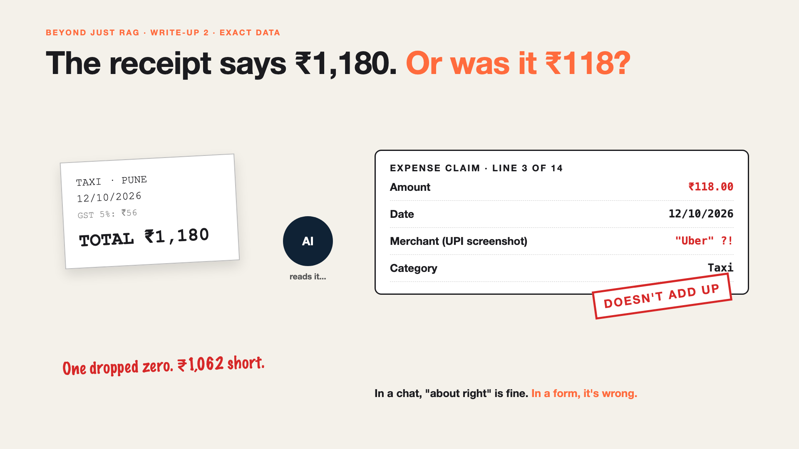

# 2. The Receipt Says ₹1,180. Or Was It ₹118? | Exact Data from Messy Receipts



*Beyond Just RAG: From Answers to Actions series: Exact data*

Priya's taxi receipt says ₹1,180. The AI fills in the claim: ₹118.

One dropped zero. The claim goes through. Priya gets ₹1,062 less, and nobody notices until her bank balance does.

Another receipt is a UPI screenshot with no merchant name. The AI writes "Uber". It sounded right. It wasn't.

In a chat, "about right" is fine. In a form, it's simply wrong.

## Why exact data is hard

- **AI writes sentences. Forms need fields.** Amount, date, merchant, category: each in the right box, in the right format.
- **Receipts are messy.** Blurred totals, handwriting, Marathi, GST lines that look like the amount.
- **A guess looks exactly like a fact.** "Uber" and "₹118" arrive with the same confidence as the right answers.
- **Small errors hide in big totals.** One wrong line in 14 is easy to miss.

Reading the scan was the job of [#JustAddRAG write-up 2](https://www.linkedin.com/pulse/why-cant-your-ai-read-pdf-10-year-old-can-arpit-jain-fimif/). This is what happens next: turning what it read into numbers a system will trust.

## The fix, in plain words

1. **Give it a form, not a blank page.** The AI must fill exact fields: amount as a number, date as a date. That's **structured output**.
2. **Check every field like a strict clerk.** Is the date real? Does the total match the sum of the lines? That's **validation**.
3. **Let "I don't know" be a valid answer.** A blank merchant beats a made-up one. Unclear fields go to a person.
4. **Cross-check with a second source.** The UPI amount should match the bank SMS. That's **reconciliation**.

Like a careful accountant: copy the number, then check it adds up, before signing anything.

## Words to know

- **Structured output:** an answer in exact fields a system can use. *{amount: 1180.00, date: "12/10/2026"}*
- **Schema:** the list of fields and their rules. *Amount must be a number above zero.*
- **Validation:** automatic checks on every field. *Total equals the sum of the lines.*

## Take this to your next kickoff meeting

1. Write down the exact fields and formats before anyone writes a prompt.
2. Make "unknown" a valid answer, and send it to a person.
3. Check that the numbers add up before anything is submitted.

A form doesn't care how confident the AI sounds. It needs the right number.

Next write-up (3): **It filed the same claim twice.**

Follow me for the next one. Have you ever been paid the wrong amount on a claim?

**Earlier in this series:**

1. [Your AI can answer. Now it has to act.](https://www.linkedin.com/pulse/1-your-ai-can-answer-now-has-act-from-answers-actions-arpit-jain-po6lf/)

*Missed the first series? Start with [Why does "Just add RAG" sound like 2 weeks but take 6 months?](https://www.linkedin.com/pulse/why-does-just-add-rag-sound-like-2-weeks-take-6-months-arpit-jain-l4kkf/) or jump to [the grand finale](https://www.linkedin.com/pulse/15-so-should-you-really-just-add-rag-grand-finale-arpit-jain-ninmf/).*

---

**Post text (copy and paste):**

```
The receipt said ₹1,180. The AI filed ₹118.

One dropped zero. The claim went through. Nobody noticed until the bank balance did.

In a chat, "about right" is fine. In a form, it's wrong.

The fix: give AI a form to fill, check every field, and let "I don't know" go to a person.

Have you ever been paid the wrong amount?

Missed the first series? Start with "Why does Just add RAG sound like 2 weeks but take 6 months?" https://www.linkedin.com/pulse/why-does-just-add-rag-sound-like-2-weeks-take-6-months-arpit-jain-l4kkf/ or jump to the grand finale: https://www.linkedin.com/pulse/15-so-should-you-really-just-add-rag-grand-finale-arpit-jain-ninmf/

#AIEngineering #GenAI #AIAgents #BeyondJustRAG #AnswersToActions
```

**Series index (post as the first comment; also update the pinned comment on write-up 1):**

```
📌 Beyond Just RAG: From Answers to Actions

1. Your AI can answer. Now it has to act. https://www.linkedin.com/pulse/1-your-ai-can-answer-now-has-act-from-answers-actions-arpit-jain-po6lf/
2. The receipt says ₹1,180. Or was it ₹118? (you're here)
3. It filed the same claim twice. (next)

New here? #JustAddRAG starts here: https://www.linkedin.com/pulse/why-does-just-add-rag-sound-like-2-weeks-take-6-months-arpit-jain-l4kkf/
```
