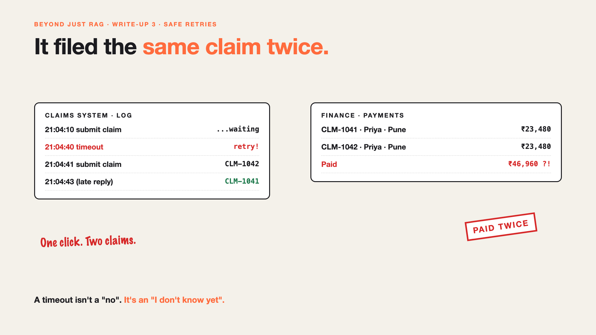

# 3. It Filed the Same Claim Twice | Safe Retries



*Beyond Just RAG: From Answers to Actions series: Safe retries*

The AI pressed submit on Priya's claim. The claims system took too long and timed out.

So the AI did what any of us would do. It tried again.

Two claims went in: CLM-1041 and CLM-1042. Both looked fine. Both were approved. Priya was paid ₹23,480 twice, and finance spent a week getting it back.

A timeout isn't a "no". It's an "I don't know yet".

## Why retries go wrong

- **Slow isn't failed.** The first claim often went through. The answer just didn't come back in time.
- **Retrying feels safe.** For reading, it is. For filing, paying or sending, it repeats the action.
- **AI agents retry on their own.** Nobody is watching the second click at 2 AM.
- **Duplicates look normal.** Two identical claims don't raise an alarm by themselves.

## The fix, in plain words

1. **Ask before you repeat.** After a timeout, check whether the claim exists before filing again. That's a **status check**.
2. **Give every action a unique tag.** If the same tag arrives twice, the system keeps one and ignores the other. That's an **idempotency key**.
3. **Retry slowly, and not forever.** Wait a little longer each time, and stop after a few tries.
4. **Write down what was sent.** Keep the tag, time and result of every attempt, so anyone can see what happened.

Like sending a courier: if the tracking page is slow, you check it again. You don't post a second parcel.

## Words to know

- **Timeout:** giving up on waiting for a reply. *The claim may still have gone through.*
- **Idempotency key:** a unique tag for one action, so repeats count once. *CLAIM-PRIYA-PUNE-OCT.*
- **Retry:** trying an action again after it seemed to fail.

## Take this to your next kickoff meeting

1. Make every action that moves money carry a unique tag.
2. After a timeout, check status first. Retry second.
3. Test it: force a timeout on purpose, and count the claims.

One click should mean one claim, however many times the AI presses it.

Next write-up (4): **The claim was filed. The receipts weren't attached.**

Follow me for the next one. Has a double payment ever happened to you?

**Earlier in this series:**

1. [Your AI can answer. Now it has to act.](https://www.linkedin.com/pulse/1-your-ai-can-answer-now-has-act-from-answers-actions-arpit-jain-po6lf/)
2. [The receipt says ₹1,180. Or was it ₹118?](https://www.linkedin.com/pulse/2-receipt-says-1180-118-exact-data-from-messy-receipts-arpit-jain-7e8pf/)

*Missed the first series? Start with [Why does "Just add RAG" sound like 2 weeks but take 6 months?](https://www.linkedin.com/pulse/why-does-just-add-rag-sound-like-2-weeks-take-6-months-arpit-jain-l4kkf/) or jump to [the grand finale](https://www.linkedin.com/pulse/15-so-should-you-really-just-add-rag-grand-finale-arpit-jain-ninmf/).*

---

**Post text (copy and paste):**

```
The claims system timed out. So the AI pressed submit again.

Two claims. Both approved. Priya was paid twice.

A timeout isn't a "no". It's an "I don't know yet".

The fix: check before you repeat, and give every action a unique tag so repeats count once.

Has a double payment ever happened to you?

Missed the first series? Start with "Why does Just add RAG sound like 2 weeks but take 6 months?" https://www.linkedin.com/pulse/why-does-just-add-rag-sound-like-2-weeks-take-6-months-arpit-jain-l4kkf/ or jump to the grand finale: https://www.linkedin.com/pulse/15-so-should-you-really-just-add-rag-grand-finale-arpit-jain-ninmf/

#AIEngineering #GenAI #AIAgents #BeyondJustRAG #AnswersToActions
```

**Series index (post as the first comment; also update the pinned comment on write-up 1):**

```
📌 Beyond Just RAG: From Answers to Actions

1. Your AI can answer. Now it has to act. https://www.linkedin.com/pulse/1-your-ai-can-answer-now-has-act-from-answers-actions-arpit-jain-po6lf/
2. The receipt says ₹1,180. Or was it ₹118? https://www.linkedin.com/pulse/2-receipt-says-1180-118-exact-data-from-messy-receipts-arpit-jain-7e8pf/
3. It filed the same claim twice. (you're here)
4. The claim was filed. The receipts weren't attached. (next)

New here? #JustAddRAG starts here: https://www.linkedin.com/pulse/why-does-just-add-rag-sound-like-2-weeks-take-6-months-arpit-jain-l4kkf/
```
