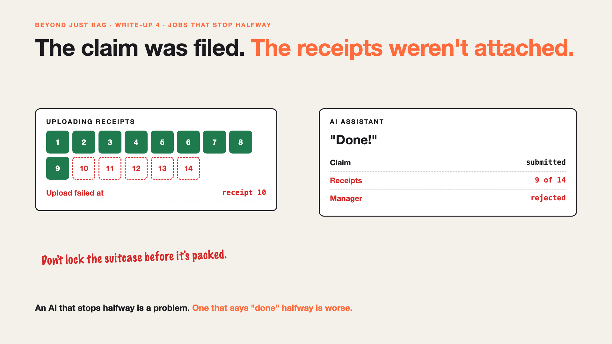

# 4. The Claim Was Filed. The Receipts Weren't Attached. | Jobs That Stop Halfway



*Beyond Just RAG: From Answers to Actions series: Jobs that stop halfway*

The AI filed Priya's claim. Then it started uploading her 14 receipts.

After receipt 9, the upload failed. The AI told Priya: "Done!"

Her manager opened a ₹23,480 claim with 9 receipts. Missing proof, so: rejected. Priya had to start again, and explain why the AI said it was done.

Half-done is often worse than not done.

## Why jobs stop halfway

- **One job is really many steps.** Fill the form, upload receipts, submit, notify. Each one can fail on its own.
- **Some steps can't be taken back.** Once a claim is submitted, the approver sees it.
- **The AI may not notice.** If nobody checks every step, "done" just means "I stopped".
- **Half-done confuses everyone.** Is it pending, broken or finished? Nobody knows.

## The fix, in plain words

1. **Do the step you can't undo last.** Upload all 14 receipts first. Submit only when everything is in place.
2. **Remember where you stopped.** Save progress, so a retry starts at receipt 10, not receipt 1.
3. **If you can't finish, undo cleanly.** Withdraw the draft, rather than leave a broken claim behind. Teams call this **compensation**.
4. **Never say "done" unless every step is confirmed.** "9 of 14 uploaded, retrying" is honest. "Done!" isn't.

Like packing a suitcase: you don't lock it until everything is inside.

## Words to know

- **Partial failure:** some steps worked, others didn't. *Claim filed, 5 receipts missing.*
- **Compensation:** undoing the steps that did work. *Withdrawing the draft claim.*
- **Checkpoint:** a saved point to restart from. *"Uploaded 9 of 14."*

## Take this to your next kickoff meeting

1. List every step of the job, and mark the one that can't be undone. Put it last.
2. For each step, decide: retry, resume or undo?
3. Agree that the AI reports progress honestly, never just "done".

An AI that stops halfway isn't the problem. An AI that says "done" halfway is.

Next write-up (5): **It asked for the same receipt 40 times.**

Follow me for the next one. What's the most "half-done" thing a system has ever left you with?

**Earlier in this series:**

1. [Your AI can answer. Now it has to act.](https://www.linkedin.com/pulse/1-your-ai-can-answer-now-has-act-from-answers-actions-arpit-jain-po6lf/)
2. [The receipt says ₹1,180. Or was it ₹118?](https://www.linkedin.com/pulse/2-receipt-says-1180-118-exact-data-from-messy-receipts-arpit-jain-7e8pf/)
3. [It filed the same claim twice.](https://www.linkedin.com/pulse/3-filed-same-claim-twice-safe-retries-arpit-jain-7ttrf)

*Missed the first series? Start with [Why does "Just add RAG" sound like 2 weeks but take 6 months?](https://www.linkedin.com/pulse/why-does-just-add-rag-sound-like-2-weeks-take-6-months-arpit-jain-l4kkf/) or jump to [the grand finale](https://www.linkedin.com/pulse/15-so-should-you-really-just-add-rag-grand-finale-arpit-jain-ninmf/).*

---

**Post text (copy and paste):**

```
The AI filed Priya's claim. The receipt upload stopped after 9 of 14.

It said: "Done!"

Her manager saw a claim with missing proof, and rejected it.

The fix: do the step you can't undo last, remember where you stopped, and never say "done" until every step is confirmed.

What's the most half-done thing a system has left you with?

Missed the first series? Start with "Why does Just add RAG sound like 2 weeks but take 6 months?" https://www.linkedin.com/pulse/why-does-just-add-rag-sound-like-2-weeks-take-6-months-arpit-jain-l4kkf/ or jump to the grand finale: https://www.linkedin.com/pulse/15-so-should-you-really-just-add-rag-grand-finale-arpit-jain-ninmf/

#AIEngineering #GenAI #AIAgents #BeyondJustRAG #AnswersToActions
```

**Series index (post as the first comment; also update the pinned comment on write-up 1):**

```
📌 Beyond Just RAG: From Answers to Actions

1. Your AI can answer. Now it has to act. https://www.linkedin.com/pulse/1-your-ai-can-answer-now-has-act-from-answers-actions-arpit-jain-po6lf/
2. The receipt says ₹1,180. Or was it ₹118? https://www.linkedin.com/pulse/2-receipt-says-1180-118-exact-data-from-messy-receipts-arpit-jain-7e8pf/
3. It filed the same claim twice. https://www.linkedin.com/pulse/3-filed-same-claim-twice-safe-retries-arpit-jain-7ttrf
4. The claim was filed. The receipts weren't attached. (you're here)
5. It asked for the same receipt 40 times. (next)

New here? #JustAddRAG starts here: https://www.linkedin.com/pulse/why-does-just-add-rag-sound-like-2-weeks-take-6-months-arpit-jain-l4kkf/
```
