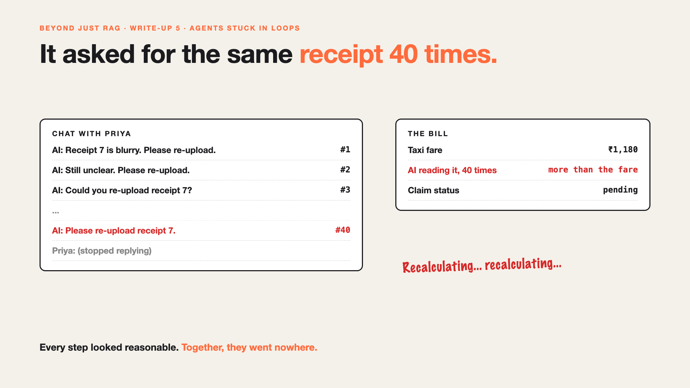

# 5. It Asked for the Same Receipt 40 Times | Agents Stuck in Loops



*Beyond Just RAG: From Answers to Actions series: Agents stuck in loops*

**Published:** 22 October 2026 on [LinkedIn](https://www.linkedin.com/pulse/5-asked-same-receipt-40-times-agents-stuck-loops-arpit-jain-qcshf/)

One of Priya's taxi receipts is blurry. The AI reads it, isn't sure of the amount, and asks her to upload it again.

She does. Same blur. The AI asks again.

By the 40th request, Priya has stopped replying, the claim is still pending, and the AI has spent more on reading that one receipt than the taxi cost.

Every single step looked reasonable. Together, they went nowhere.

## Why agents get stuck

- **An agent chooses its own next step.** That's its strength. It also means nothing tells it to stop.
- **Each try looks sensible.** "Let me check once more" is a good idea the first time.
- **The same input gives the same result.** A blurry photo stays blurry, however often it's read.
- **Loops cost money and patience.** Every step uses the AI, and every request annoys a real person.

## The fix, in plain words

1. **Set a step limit.** After, say, 10 steps on one claim, stop.
2. **Stop repeating what didn't work.** Same result twice? Try something different, or stop.
3. **Set a budget.** A maximum time and cost for each claim, like a spending limit on a card.
4. **Hand over, with notes.** Pass it to a person with what was tried: "Receipt 7 is unreadable after 2 tries."

Like a GPS that keeps recalculating around a closed road: at some point, someone has to say "let's take another route".

## Words to know

- **Agent loop:** the cycle of think, act, check, repeat. *Read receipt, ask, read again.*
- **Step limit:** the most steps an agent may take on one task.
- **Stop condition:** a rule that ends the loop. *Same result twice, so stop.*

## Take this to your next kickoff meeting

1. Agree a step limit and a cost limit for every task, before launch.
2. Decide what the AI does when it hits them: who gets the task, with what notes?
3. Watch for repeats: the same tool called with the same input is a warning sign.

An agent that can't stop isn't clever. It's stuck, and paying for it.

Next write-up (6): **Does this even need an AI agent?**

Follow me for the next one. What's the longest loop a system has ever put you through?

**Earlier in this series:**

1. [Your AI can answer. Now it has to act.](https://www.linkedin.com/pulse/1-your-ai-can-answer-now-has-act-from-answers-actions-arpit-jain-po6lf/)
2. [The receipt says ₹1,180. Or was it ₹118?](https://www.linkedin.com/pulse/2-receipt-says-1180-118-exact-data-from-messy-receipts-arpit-jain-7e8pf/)
3. [It filed the same claim twice.](https://www.linkedin.com/pulse/3-filed-same-claim-twice-safe-retries-arpit-jain-7ttrf)
4. [The claim was filed. The receipts weren't attached.](https://www.linkedin.com/pulse/4-claim-filed-receipts-werent-attached-jobs-stop-halfway-arpit-jain-ki3vf)

*Missed the first series? Start with [Why does "Just add RAG" sound like 2 weeks but take 6 months?](https://www.linkedin.com/pulse/why-does-just-add-rag-sound-like-2-weeks-take-6-months-arpit-jain-l4kkf/) or jump to [the grand finale](https://www.linkedin.com/pulse/15-so-should-you-really-just-add-rag-grand-finale-arpit-jain-ninmf/).*

**Previous series:**

- **Series 1, #JustAddRAG:** [start here](https://www.linkedin.com/pulse/why-does-just-add-rag-sound-like-2-weeks-take-6-months-arpit-jain-l4kkf/) or jump to [the grand finale](https://www.linkedin.com/pulse/15-so-should-you-really-just-add-rag-grand-finale-arpit-jain-ninmf/)
- **Series 20, Today in AI** (ongoing): [start here](https://www.linkedin.com/pulse/today-ai-001-what-happens-when-your-agent-visits-someone-arpit-jain-2vqmf/) or read [the latest issue](https://www.linkedin.com/pulse/today-ai-011-text-to-speech-fits-your-phone-internet-needed-jain-1ipuf)

---

**Post text (copy and paste):**

```
One blurry taxi receipt. The AI asked Priya to re-upload it. Then again. And again.

40 times.

The claim was still pending, and reading that receipt cost more than the taxi.

The fix: a step limit, a budget, a rule to stop repeating what didn't work, and a person to hand over to.

What's the longest loop a system has put you through?

Missed the first series? Start with "Why does Just add RAG sound like 2 weeks but take 6 months?" https://www.linkedin.com/pulse/why-does-just-add-rag-sound-like-2-weeks-take-6-months-arpit-jain-l4kkf/ or jump to the grand finale: https://www.linkedin.com/pulse/15-so-should-you-really-just-add-rag-grand-finale-arpit-jain-ninmf/

#AIEngineering #GenAI #AIAgents #BeyondJustRAG #AnswersToActions
```

**Series index (post as the first comment; also update the pinned comment on write-up 1):**

```
📌 Beyond Just RAG: From Answers to Actions

1. Your AI can answer. Now it has to act. https://www.linkedin.com/pulse/1-your-ai-can-answer-now-has-act-from-answers-actions-arpit-jain-po6lf/
2. The receipt says ₹1,180. Or was it ₹118? https://www.linkedin.com/pulse/2-receipt-says-1180-118-exact-data-from-messy-receipts-arpit-jain-7e8pf/
3. It filed the same claim twice. https://www.linkedin.com/pulse/3-filed-same-claim-twice-safe-retries-arpit-jain-7ttrf
4. The claim was filed. The receipts weren't attached. https://www.linkedin.com/pulse/4-claim-filed-receipts-werent-attached-jobs-stop-halfway-arpit-jain-ki3vf
5. It asked for the same receipt 40 times. (you're here)
6. Does this even need an AI agent? (next)

New here? #JustAddRAG starts here: https://www.linkedin.com/pulse/why-does-just-add-rag-sound-like-2-weeks-take-6-months-arpit-jain-l4kkf/
```
