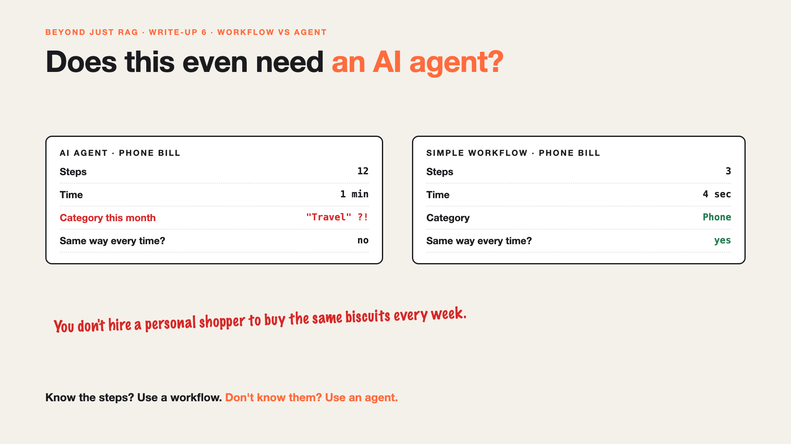

# 6. Does This Even Need an AI Agent? | Workflow vs Agent



*Beyond Just RAG: From Answers to Actions series: Workflow vs agent*

Every month, Priya claims her phone bill. Same company. Same amount. Same category.

The AI agent handles it beautifully: 12 steps, a few thoughtful checks, a polite summary. It takes a minute and costs more than it should. And twice this year, it filed the bill under "Travel" instead of "Phone".

A simple form with one AI step, to read the bill, would do it in seconds. The same way, every time.

Not every task needs an agent.

## Why agents get overused

- **"Agentic" sounds modern.** So everything becomes an agent, even routine work.
- **Freedom has a price.** An agent decides its own steps, which makes it slower, costlier and less predictable.
- **Most work is routine.** Most claims follow the same few patterns.
- **Predictable is a feature.** For money and compliance, "the same way every time" is exactly what you want.

## The fix, in plain words

1. **Use a workflow when you know the steps.** Fixed steps, the same every time, with AI only where it's needed, like reading the bill.
2. **Use an agent when the path is unknown.** A trip in three currencies with missing receipts genuinely needs judgement.
3. **Mix them.** Run the workflow first. Hand the unusual cases to the agent.
4. **Start simple.** Begin with a workflow, and add an agent only where the workflow keeps failing.

Like a vending machine and a personal shopper. You don't hire a shopper to buy the same biscuits every week.

## Words to know

- **Workflow:** fixed steps, defined in advance. *Read bill, check amount, submit.*
- **AI agent:** an AI that decides its own steps. *Figures out how to handle a messy trip.*
- **Hybrid:** a workflow for routine cases, an agent for exceptions.

## Take this to your next kickoff meeting

1. List your five most common cases. Could each be a fixed workflow?
2. Use an agent only for what's left, and say why.
3. Compare cost, speed and consistency before choosing.

The smartest AI design is often the simplest one that works.

Next write-up (7): **Two claims, two different paths. Which one was right?**

Follow me for the next one. Where have you seen an agent used for something a simple form could do?

**Earlier in this series:**

1. [Your AI can answer. Now it has to act.](https://www.linkedin.com/pulse/1-your-ai-can-answer-now-has-act-from-answers-actions-arpit-jain-po6lf/)
2. [The receipt says ₹1,180. Or was it ₹118?](https://www.linkedin.com/pulse/2-receipt-says-1180-118-exact-data-from-messy-receipts-arpit-jain-7e8pf/)
3. [It filed the same claim twice.](https://www.linkedin.com/pulse/3-filed-same-claim-twice-safe-retries-arpit-jain-7ttrf)
4. [The claim was filed. The receipts weren't attached.](https://www.linkedin.com/pulse/4-claim-filed-receipts-werent-attached-jobs-stop-halfway-arpit-jain-ki3vf)
5. It asked for the same receipt 40 times. *(link added when published)*

*Missed the first series? Start with [Why does "Just add RAG" sound like 2 weeks but take 6 months?](https://www.linkedin.com/pulse/why-does-just-add-rag-sound-like-2-weeks-take-6-months-arpit-jain-l4kkf/) or jump to [the grand finale](https://www.linkedin.com/pulse/15-so-should-you-really-just-add-rag-grand-finale-arpit-jain-ninmf/).*

---

**Post text (copy and paste):**

```
Every month, the same phone bill. The AI agent took 12 steps, a minute, and twice filed it under "Travel".

A simple form with one AI step would do it in seconds. The same way, every time.

Use a workflow when you know the steps. Use an agent when you don't.

Where have you seen an agent used for something a form could do?

Missed the first series? Start with "Why does Just add RAG sound like 2 weeks but take 6 months?" https://www.linkedin.com/pulse/why-does-just-add-rag-sound-like-2-weeks-take-6-months-arpit-jain-l4kkf/ or jump to the grand finale: https://www.linkedin.com/pulse/15-so-should-you-really-just-add-rag-grand-finale-arpit-jain-ninmf/

#AIEngineering #GenAI #AIAgents #BeyondJustRAG #AnswersToActions
```

**Series index (post as the first comment; also update the pinned comment on write-up 1):**

```
📌 Beyond Just RAG: From Answers to Actions

1. Your AI can answer. Now it has to act. https://www.linkedin.com/pulse/1-your-ai-can-answer-now-has-act-from-answers-actions-arpit-jain-po6lf/
2. The receipt says ₹1,180. Or was it ₹118? https://www.linkedin.com/pulse/2-receipt-says-1180-118-exact-data-from-messy-receipts-arpit-jain-7e8pf/
3. It filed the same claim twice. https://www.linkedin.com/pulse/3-filed-same-claim-twice-safe-retries-arpit-jain-7ttrf
4. The claim was filed. The receipts weren't attached. https://www.linkedin.com/pulse/4-claim-filed-receipts-werent-attached-jobs-stop-halfway-arpit-jain-ki3vf
5. It asked for the same receipt 40 times. [link]
6. Does this even need an AI agent? (you're here)
7. Two claims, two different paths. Which one was right? (next)

New here? #JustAddRAG starts here: https://www.linkedin.com/pulse/why-does-just-add-rag-sound-like-2-weeks-take-6-months-arpit-jain-l4kkf/
```
