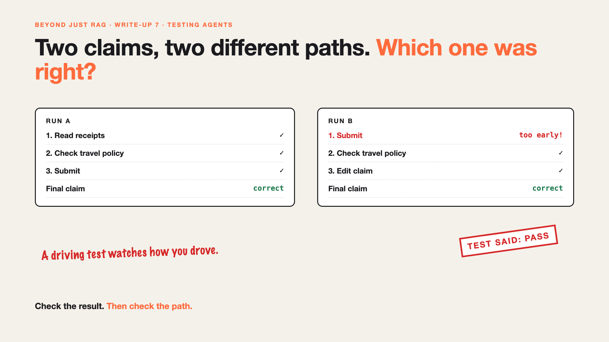

# 7. Two Claims, Two Different Paths. Which One Was Right? | Testing Agents



*Beyond Just RAG: From Answers to Actions series: Testing agents*

We ran Priya's claim through the AI twice, to test it.

Run A: read the receipts, checked the travel policy, then submitted.

Run B: submitted first, then checked the policy, then edited the claim to fix it.

Both ended with the same, correct claim. The test said: pass, pass.

But run B sent a claim to the approver before checking the rules. On a different day, with a different receipt, that's a problem nobody would catch until it happened.

## Why agents are hard to test

- **Same request, different steps.** An agent can take a new path every time it runs.
- **A right answer can hide a risky path.** Checking only the final claim misses what happened on the way.
- **One pass proves little.** It might work 8 times in 10. You only saw one.
- **Old tests don't fit.** Normal software tests expect the same steps every time.

## The fix, in plain words

1. **Check the result.** Is the final claim right: amounts, dates, category?
2. **Check the path.** Did it follow the rules on the way? Policy check before submit, never more than 10 steps, no duplicate actions.
3. **Run each test many times.** Measure how often it passes, not whether it passed once.
4. **Replay real cases.** Turn real claims, especially messy ones, into tests.

Like a driving test: the examiner watches how you drove, not just whether you arrived.

## Words to know

- **Path (trajectory):** the steps an agent took to finish a task. *Read, check, submit.*
- **Pass rate:** how often a test passes across many runs. *9 out of 10.*
- **Path rule:** a rule every run must follow. *Never submit before the policy check.*

## Take this to your next kickoff meeting

1. Write down the rules every path must follow, not just the right final answer.
2. Run every test at least 10 times, and report the pass rate.
3. Save every real failure as a new test.

For agents, how they got there matters as much as where they ended up.

Next write-up (8): **So, should your AI do things, or just answer?** (the finale)

Follow me for the next one. How do you test something that never does the same thing twice?

**Earlier in this series:**

1. [Your AI can answer. Now it has to act.](https://www.linkedin.com/pulse/1-your-ai-can-answer-now-has-act-from-answers-actions-arpit-jain-po6lf/)
2. [The receipt says ₹1,180. Or was it ₹118?](https://www.linkedin.com/pulse/2-receipt-says-1180-118-exact-data-from-messy-receipts-arpit-jain-7e8pf/)
3. [It filed the same claim twice.](https://www.linkedin.com/pulse/3-filed-same-claim-twice-safe-retries-arpit-jain-7ttrf)
4. The claim was filed. The receipts weren't attached. *(link added when published)*
5. It asked for the same receipt 40 times. *(link added when published)*
6. Does this even need an AI agent? *(link added when published)*

*Missed the first series? Start with [Why does "Just add RAG" sound like 2 weeks but take 6 months?](https://www.linkedin.com/pulse/why-does-just-add-rag-sound-like-2-weeks-take-6-months-arpit-jain-l4kkf/) or jump to [the grand finale](https://www.linkedin.com/pulse/15-so-should-you-really-just-add-rag-grand-finale-arpit-jain-ninmf/).*

---

**Post text (copy and paste):**

```
We tested Priya's claim twice. Both runs ended with the right claim. Pass, pass.

But one run submitted first and checked the rules later.

Testing agents means checking the result AND the path, and running each test many times, not once.

Like a driving test: arriving isn't enough.

How do you test something that never does the same thing twice?

Missed the first series? Start with "Why does Just add RAG sound like 2 weeks but take 6 months?" https://www.linkedin.com/pulse/why-does-just-add-rag-sound-like-2-weeks-take-6-months-arpit-jain-l4kkf/ or jump to the grand finale: https://www.linkedin.com/pulse/15-so-should-you-really-just-add-rag-grand-finale-arpit-jain-ninmf/

#AIEngineering #GenAI #AIAgents #BeyondJustRAG #AnswersToActions
```

**Series index (post as the first comment; also update the pinned comment on write-up 1):**

```
📌 Beyond Just RAG: From Answers to Actions

1. Your AI can answer. Now it has to act. https://www.linkedin.com/pulse/1-your-ai-can-answer-now-has-act-from-answers-actions-arpit-jain-po6lf/
2. The receipt says ₹1,180. Or was it ₹118? https://www.linkedin.com/pulse/2-receipt-says-1180-118-exact-data-from-messy-receipts-arpit-jain-7e8pf/
3. It filed the same claim twice. https://www.linkedin.com/pulse/3-filed-same-claim-twice-safe-retries-arpit-jain-7ttrf
4. The claim was filed. The receipts weren't attached. [link]
5. It asked for the same receipt 40 times. [link]
6. Does this even need an AI agent? [link]
7. Two claims, two different paths. Which one was right? (you're here)
8. So, should your AI do things, or just answer? (next)

New here? #JustAddRAG starts here: https://www.linkedin.com/pulse/why-does-just-add-rag-sound-like-2-weeks-take-6-months-arpit-jain-l4kkf/
```
