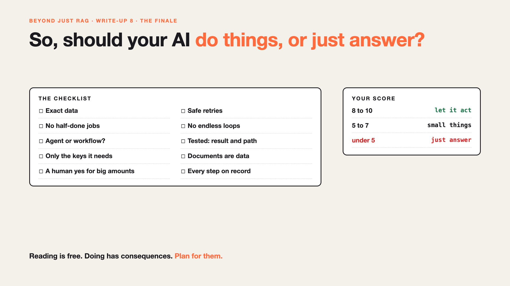

# 8. So, Should Your AI Do Things, or Just Answer? | The Finale



*Beyond Just RAG: From Answers to Actions series: The finale*

Priya's claim is filed. Correct amounts, every receipt attached, paid once, checked on the way.

It took more than "just let the AI do it". It took a checklist.

So, should your AI act? Yes, when the action is worth it and the checklist is ticked. Otherwise, let it answer, and let a person press the button.

## When acting is worth it

- **The task repeats.** Hundreds of claims a month, not three.
- **The steps are clear.** Or at least the rules are.
- **A mistake can be caught.** Or undone before it hurts.

## The checklist

One question for each risk. Tick it only if the team has a clear answer.

- [ ] **Exact data:** does every field have a format, checks, and a person for "not sure"?
- [ ] **Retries:** does every action carry a unique tag, with a status check before trying again?
- [ ] **Halfway:** is the step you can't undo last, with a plan to resume or undo the rest?
- [ ] **Loops:** is there a step limit, a budget, and a handover?
- [ ] **Agent or workflow:** is there a reason each task needs an agent?
- [ ] **Testing:** is it tested on the result and the path, many times over?
- [ ] **Access:** does it have only the keys it needs? ([#JustAddRAG 8](https://www.linkedin.com/pulse/8-can-intern-ask-your-ai-ceos-salary-arpit-jain-7m9zf))
- [ ] **Hidden instructions:** are documents treated as data, never orders? ([#JustAddRAG 8](https://www.linkedin.com/pulse/8-can-intern-ask-your-ai-ceos-salary-arpit-jain-7m9zf))
- [ ] **Human yes:** does a person approve the big amounts? ([#JustAddRAG 5](https://www.linkedin.com/pulse/5-what-does-your-ai-say-when-doesnt-know-arpit-jain-wr5bf))
- [ ] **Records:** can you see every step it took? ([#JustAddRAG 13](https://www.linkedin.com/pulse/13-when-your-ai-gives-wrong-answer-can-you-tell-why-arpit-jain-m4kff))

**8 to 10 ticks:** let it act. **5 to 7:** let it act on small things, with a person watching. **Under 5:** let it answer, for now.

## Take this to your next kickoff meeting

1. Score your AI project with the checklist, honestly.
2. Start with one small, repeatable action, not the whole process.
3. Let the AI earn bigger actions as the ticks go up.

Reading is free. Doing has consequences. Plan for them, and AI can do a lot of the doing.

## Thank you

To everyone who shared their worst expense claim stories: thank you. This series is better for them. The next series picks up from here: once AI can act, who decides what it's allowed to do?

How many boxes did your project tick?

**Earlier in this series:**

1. [Your AI can answer. Now it has to act.](https://www.linkedin.com/pulse/1-your-ai-can-answer-now-has-act-from-answers-actions-arpit-jain-po6lf/)
2. [The receipt says ₹1,180. Or was it ₹118?](https://www.linkedin.com/pulse/2-receipt-says-1180-118-exact-data-from-messy-receipts-arpit-jain-7e8pf/)
3. [It filed the same claim twice.](https://www.linkedin.com/pulse/3-filed-same-claim-twice-safe-retries-arpit-jain-7ttrf)
4. [The claim was filed. The receipts weren't attached.](https://www.linkedin.com/pulse/4-claim-filed-receipts-werent-attached-jobs-stop-halfway-arpit-jain-ki3vf)
5. [It asked for the same receipt 40 times.](https://www.linkedin.com/pulse/5-asked-same-receipt-40-times-agents-stuck-loops-arpit-jain-qcshf/)
6. Does this even need an AI agent? *(link added when published)*
7. Two claims, two different paths. Which one was right? *(link added when published)*

*Missed the first series? Start with [Why does "Just add RAG" sound like 2 weeks but take 6 months?](https://www.linkedin.com/pulse/why-does-just-add-rag-sound-like-2-weeks-take-6-months-arpit-jain-l4kkf/) or jump to [the grand finale](https://www.linkedin.com/pulse/15-so-should-you-really-just-add-rag-grand-finale-arpit-jain-ninmf/).*

---

**Post text (copy and paste):**

```
Priya's claim is filed. Right amounts, all receipts, paid once.

It took more than "just let the AI do it". It took a checklist: exact data, safe retries, no half-done jobs, no endless loops, the right tool, and real testing.

So, should your AI act? Only when the checklist says yes.

How many boxes does your project tick?

Missed the first series? Start with "Why does Just add RAG sound like 2 weeks but take 6 months?" https://www.linkedin.com/pulse/why-does-just-add-rag-sound-like-2-weeks-take-6-months-arpit-jain-l4kkf/ or jump to the grand finale: https://www.linkedin.com/pulse/15-so-should-you-really-just-add-rag-grand-finale-arpit-jain-ninmf/

#AIEngineering #GenAI #AIAgents #BeyondJustRAG #AnswersToActions
```

**Series index (post as the first comment; also update the pinned comment on write-up 1):**

```
📌 Beyond Just RAG: From Answers to Actions

1. Your AI can answer. Now it has to act. https://www.linkedin.com/pulse/1-your-ai-can-answer-now-has-act-from-answers-actions-arpit-jain-po6lf/
2. The receipt says ₹1,180. Or was it ₹118? https://www.linkedin.com/pulse/2-receipt-says-1180-118-exact-data-from-messy-receipts-arpit-jain-7e8pf/
3. It filed the same claim twice. https://www.linkedin.com/pulse/3-filed-same-claim-twice-safe-retries-arpit-jain-7ttrf
4. The claim was filed. The receipts weren't attached. https://www.linkedin.com/pulse/4-claim-filed-receipts-werent-attached-jobs-stop-halfway-arpit-jain-ki3vf
5. It asked for the same receipt 40 times. https://www.linkedin.com/pulse/5-asked-same-receipt-40-times-agents-stuck-loops-arpit-jain-qcshf/
6. Does this even need an AI agent? [link]
7. Two claims, two different paths. Which one was right? [link]
8. So, should your AI do things, or just answer? (you're here)

New here? #JustAddRAG starts here: https://www.linkedin.com/pulse/why-does-just-add-rag-sound-like-2-weeks-take-6-months-arpit-jain-l4kkf/
```
