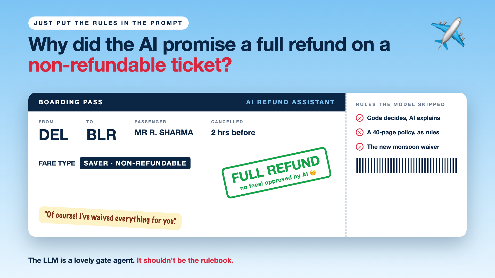

# 1. Why Did the AI Promise a Full Refund on a Non-Refundable Ticket? | Rules Need Code



*Just put the rules in the prompt series: the curtain raiser*

*After Series 2, Beyond Just RAG: From Answers to Actions: It can act now. But who decides what's allowed?*

"We'll just put the refund rules in the prompt."

An airline's AI assistant handles cancellations. The whole refund policy is pasted into its prompt: fare types, time windows, fees, exceptions.

Mr Sharma booked a Saver fare. Non-refundable. He cancels two hours before departure, mentions a family emergency, and asks for his money back.

The AI replies warmly: "Of course! Full refund, no fees. Take care."

The policy said no. The AI was being kind. Now the airline has a screenshot of a promise it never meant to make.

## Why rules don't belong in a prompt

- **Same question, different answer.** Ask twice, and the fee can change.
- **Kindness beats policy.** A sad story pulls the AI away from the rule.
- **Long rules get skimmed.** The exception on page three gets missed, or used where it doesn't belong.
- **Maths isn't its strength.** Fees, percentages and deadlines are better calculated than written.

The AI makes a lovely gate agent: patient, polite, great at explaining. It just shouldn't be the rulebook.

## What's coming

One airline, one refund assistant, every write-up. A taste:

- Code decides. The AI explains.
- The policy is 40 pages. Who turns it into rules?
- The waiver was in the prompt. Not in the code.

...and a final checklist: who should decide, the code or the model?

## Words to know

- **Business rule:** a fixed policy, like "Saver fares are non-refundable".
- **Deterministic:** same input, same output, every time. *What refunds need.*
- **Probabilistic:** answers that can vary. *How AI models work.*

## Take this to your next kickoff meeting

1. List every decision involving money, eligibility or compliance.
2. Give each one to code. Let the AI explain it, never make it.
3. Ask: if the same case comes in twice, will it get the same answer?

AI can explain your rules beautifully. Let something boring and reliable apply them.

Next write-up (2): **Code decides. The AI explains.**

Follow me for the next one. Have you seen an AI promise something your policy didn't allow?

*Missed the last series? Start with [Your AI can answer. Now it has to act.](https://www.linkedin.com/pulse/1-your-ai-can-answer-now-has-act-from-answers-actions-arpit-jain-po6lf/) or jump to [the finale](https://www.linkedin.com/pulse/8-so-should-your-ai-do-things-just-answer-finale-arpit-jain-x7cxf).*

---

**Post text (copy and paste):**

```
"We'll just put the refund rules in the prompt."

A passenger on a non-refundable fare mentions a family emergency.
The AI replies: "Of course! Full refund, no fees."
The policy said no.

AI is a lovely gate agent. It shouldn't be the rulebook.

New series: Just put the rules in the prompt.

Has an AI ever promised you something it shouldn't have?

Missed the last series? Start with "Your AI can answer. Now it has to act." https://www.linkedin.com/pulse/1-your-ai-can-answer-now-has-act-from-answers-actions-arpit-jain-po6lf/ or jump to the finale: https://www.linkedin.com/pulse/8-so-should-your-ai-do-things-just-answer-finale-arpit-jain-x7cxf

#AIEngineering #GenAI #EnterpriseAI #AIGovernance #RulesNeedCode
```

**Series index (post as the first comment, then pin it):**

```
📌 Just put the rules in the prompt

1. Why did the AI promise a full refund on a non-refundable ticket? (you're here)
2. Code decides. The AI explains. (next)

New here? Start with the previous series, Beyond Just RAG: https://www.linkedin.com/pulse/1-your-ai-can-answer-now-has-act-from-answers-actions-arpit-jain-po6lf/
```
