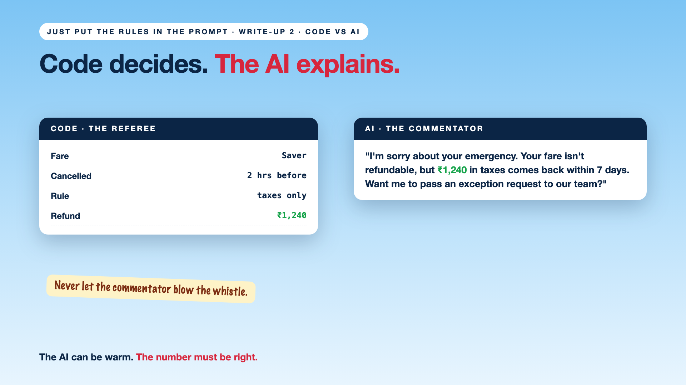

# 2. Code Decides. The AI Explains. | Splitting the Work



*Just put the rules in the prompt series: Code decides, the AI explains*

Same passenger, same Saver fare, same family emergency. This time, the airline split the job.

Code checked the rules: non-refundable fare, cancelled 2 hours before. Refund: airport taxes only, ₹1,240.

Then the AI explained it: "I'm sorry about your emergency. Your fare isn't refundable, but you'll get ₹1,240 back in taxes within 7 days. If you'd like, I can connect you to our team to request an exception."

Same honesty. Same kindness. The right number, every time.

## Why splitting works

- **Code is exact.** Same case, same refund. Every single time.
- **AI is great with words.** It explains, apologises and answers follow-up questions.
- **Each does what it's good at.** Numbers from code. Sentences from the AI.
- **You can test the code.** Try 100 cases, check 100 refunds. You can't do that with a prompt.

## The fix, in plain words

1. **Code makes the decision.** Eligibility, refund amount, fees: calculated, never written.
2. **The AI asks code, it doesn't calculate.** It calls a refund tool and gets the answer back.
3. **The AI never changes the numbers.** It can soften the words, not the ₹1,240.
4. **Exceptions go to a person.** The AI can't waive a fee. It can pass the request to someone who can.

Like a football match: the referee applies the rules, the commentator explains them. You'd never let the commentator blow the whistle.

## Words to know

- **Tool calling:** the AI asking code to do a job and using the result. *"Calculate refund for this booking."*
- **Rules engine:** code that applies business rules the same way every time.
- **Escalation:** passing a case to a person with authority. *A fee waiver request.*

## Take this to your next kickoff meeting

1. Draw a line: which parts are decisions, and which are explanations?
2. Put every decision in code the AI can call.
3. Check that the AI's reply always shows the exact number code returned.

The AI can be warm. The number must be right.

Next write-up (3): **The policy is 40 pages. Who turns it into rules?**

Follow me for the next one. Would you rather hear "no" kindly, or "yes" wrongly?

**Earlier in this series:**

1. Why did the AI promise a full refund on a non-refundable ticket? *(link added when published)*

*Missed the last series? Start with [Your AI can answer. Now it has to act.](https://www.linkedin.com/pulse/1-your-ai-can-answer-now-has-act-from-answers-actions-arpit-jain-po6lf/)*

---

**Post text (copy and paste):**

```
Same passenger. Same non-refundable fare. Same family emergency.

This time, code decided the refund: ₹1,240 in taxes. The AI explained it kindly, and offered to pass on an exception request.

Code is the referee. AI is the commentator. Never let the commentator blow the whistle.

Would you rather hear "no" kindly, or "yes" wrongly?

Missed the last series? Start with "Your AI can answer. Now it has to act." https://www.linkedin.com/pulse/1-your-ai-can-answer-now-has-act-from-answers-actions-arpit-jain-po6lf/

#AIEngineering #GenAI #EnterpriseAI #AIGovernance #RulesNeedCode
```

**Series index (post as the first comment; also update the pinned comment on write-up 1):**

```
📌 Just put the rules in the prompt

1. Why did the AI promise a full refund on a non-refundable ticket? [link]
2. Code decides. The AI explains. (you're here)
3. The policy is 40 pages. Who turns it into rules? (next)

New here? Start with the previous series, Beyond Just RAG: https://www.linkedin.com/pulse/1-your-ai-can-answer-now-has-act-from-answers-actions-arpit-jain-po6lf/
```
