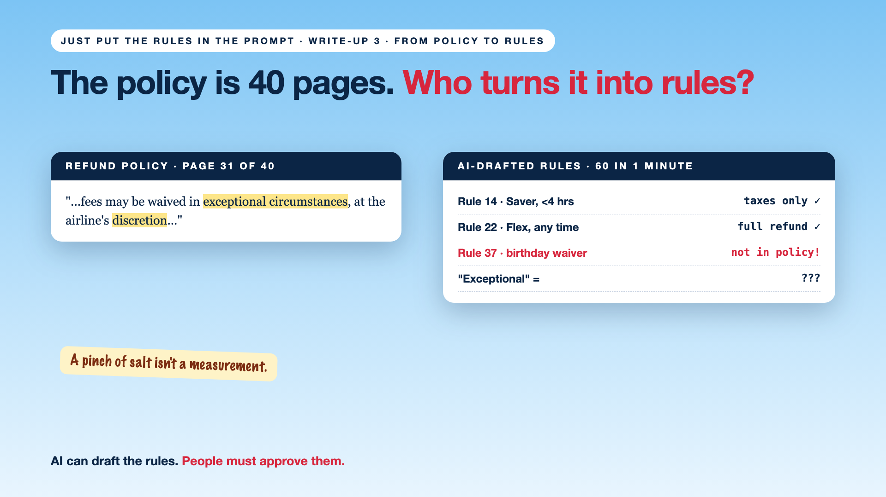

# 3. The Policy Is 40 Pages. Who Turns It Into Rules? | From Policy to Rules



*Just put the rules in the prompt series: From policy to rules*

"Code decides" sounds simple. Then someone opens the refund policy.

It's 40 pages, written by lawyers, for people. Page 31 says: "Fees may be waived in exceptional circumstances, at the airline's discretion."

What counts as exceptional? Code can't run "discretion".

So the team asked an AI to turn the PDF into rules. It produced 60 neat ones in a minute. Three of them weren't in the policy at all.

## Why policies don't turn into rules easily

- **Policies are written for people.** They rely on judgement: "reasonable", "exceptional", "where appropriate".
- **They contradict themselves.** Page 12 and page 31 disagree about medical emergencies.
- **AI drafts fast, and invents.** A tidy rule that was never in the policy looks just as convincing as a real one.
- **Nobody owns the translation.** Legal wrote the policy. Engineering wrote the code. Who decided what it means?

## The fix, in plain words

1. **Turn the policy into a table.** Fare type, hours before departure, fee. One row per case. That's a **decision table**.
2. **Let AI draft, let people approve.** Every rule links back to the page it came from, and the policy owner signs it off.
3. **Decide the vague words.** "Exceptional" becomes a short list, plus "send to a person" for everything else.
4. **Test against the past.** Run last year's real cancellations through the new rules. Do the answers match what the airline actually did?

Like turning grandma's recipe ("a pinch of salt, cook till done") into a restaurant's exact measurements. Someone has to taste it and agree.

## Words to know

- **Decision table:** a grid of conditions and outcomes. *Saver fare + under 4 hours = taxes only.*
- **Rule owner:** the person who decides what a rule means. *Usually the policy team, not engineering.*
- **Traceability:** every rule links back to its source. *"Rule 14, from policy page 12."*

## Take this to your next kickoff meeting

1. Find the vague words in your policy, and decide each one, or route it to a person.
2. Name a rule owner who signs off every rule.
3. Test the rules on last year's real cases before launch.

Code can only be as clear as the policy behind it.

Next write-up (4): **The waiver was in the prompt. Not in the code.**

Follow me for the next one. What's the vaguest line you've seen in a company policy?

**Earlier in this series:**

1. [Why did the AI promise a full refund on a non-refundable ticket?](https://www.linkedin.com/pulse/1-why-did-ai-promise-full-refund-non-refundable-ticket-arpit-jain-gxg4f)
2. [Code decides. The AI explains.](https://www.linkedin.com/pulse/2-code-decides-ai-explains-splitting-work-arpit-jain-ebeif)

**Previous series:**

- **Series 1, #JustAddRAG:** [start here](https://www.linkedin.com/pulse/why-does-just-add-rag-sound-like-2-weeks-take-6-months-arpit-jain-l4kkf/) or jump to [the grand finale](https://www.linkedin.com/pulse/15-so-should-you-really-just-add-rag-grand-finale-arpit-jain-ninmf/)
- **Series 2, Beyond Just RAG: From Answers to Actions:** [start here](https://www.linkedin.com/pulse/1-your-ai-can-answer-now-has-act-from-answers-actions-arpit-jain-po6lf/) or jump to [the finale](https://www.linkedin.com/pulse/8-so-should-your-ai-do-things-just-answer-finale-arpit-jain-x7cxf)

---

**Post text (copy and paste):**

```
The refund policy is 40 pages. Page 31: "Fees may be waived in exceptional circumstances."

What's exceptional? Code can't run "discretion".
An AI turned the policy into 60 neat rules in a minute. Three weren't in the policy at all.

AI can draft the rules. People must approve them.

What's the vaguest line in your company's policy?

Missed the last series? Start with "Your AI can answer. Now it has to act." https://www.linkedin.com/pulse/1-your-ai-can-answer-now-has-act-from-answers-actions-arpit-jain-po6lf/ or jump to the finale: https://www.linkedin.com/pulse/8-so-should-your-ai-do-things-just-answer-finale-arpit-jain-x7cxf

#AIEngineering #GenAI #EnterpriseAI #AIGovernance #RulesNeedCode
```

**Series index (post as the first comment; also update the pinned comment on write-up 1):**

```
📌 Just put the rules in the prompt

1. Why did the AI promise a full refund on a non-refundable ticket? https://www.linkedin.com/pulse/1-why-did-ai-promise-full-refund-non-refundable-ticket-arpit-jain-gxg4f
2. Code decides. The AI explains. https://www.linkedin.com/pulse/2-code-decides-ai-explains-splitting-work-arpit-jain-ebeif
3. The policy is 40 pages. Who turns it into rules? (you're here)
4. The waiver was in the prompt. Not in the code. (next)

New here? Start with the previous series, Beyond Just RAG: https://www.linkedin.com/pulse/1-your-ai-can-answer-now-has-act-from-answers-actions-arpit-jain-po6lf/
```
