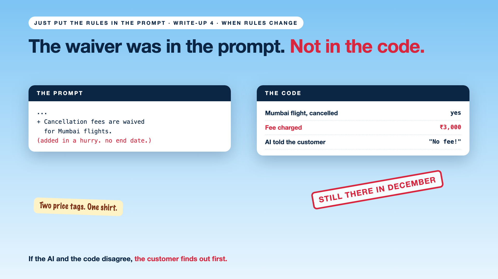

# 4. The Waiver Was in the Prompt. Not in the Code. | When Rules Change



*Just put the rules in the prompt series: When rules change*

Heavy monsoon rain in Mumbai. The airline announces free cancellation on all Mumbai flights this week.

Someone quickly adds a line to the AI's prompt: "Cancellation fees are waived for Mumbai flights."

The AI tells every caller: "No fee, cancel anytime." The code, never updated, charges ₹3,000.

Passengers were promised one thing and charged another. And in December, the waiver line was still sitting in the prompt.

## Why rule changes go wrong

- **One rule, two places.** The prompt says one thing, the code says another. Customers hear one, and pay the other.
- **Prompt edits are invisible.** No review, no test, no record of who changed what.
- **Temporary rules outstay their welcome.** "This week only" has no end date in a prompt.
- **Changes happen in a hurry.** Floods, strikes, outages: exactly when nobody checks twice.

## The fix, in plain words

1. **Keep each rule in one place.** The waiver lives in the rules table. The AI reads it from there.
2. **Give every change a start and an end date.** "Mumbai waiver: 14 to 20 October." It switches itself off.
3. **Review and test every change.** Even urgent ones. Run a few real bookings through it before it goes live.
4. **Keep rules out of the prompt.** The prompt explains. It never holds the rules.

Like two price tags on the same shirt: the customer always remembers the lower one.

## Words to know

- **Single source of truth:** one agreed place for each rule. *The rules table, not the prompt.*
- **Effective dates:** when a rule starts and stops. *14 to 20 October.*
- **Rule version:** a numbered, recorded change. *Waiver v2, approved by the policy team.*

## Take this to your next kickoff meeting

1. Search your prompts for rules. Move every one into the rules table.
2. Give every temporary rule an end date.
3. Agree a fast, tested way to change rules during an emergency.

If the AI and the code disagree, the customer will find out first.

Next write-up (5): **So, who should decide: the code or the model?** (the finale)

Follow me for the next one. Ever been promised one price and charged another?

**Earlier in this series:**

1. Why did the AI promise a full refund on a non-refundable ticket? *(link added when published)*
2. Code decides. The AI explains. *(link added when published)*
3. The policy is 40 pages. Who turns it into rules? *(link added when published)*

*Missed the last series? Start with [Your AI can answer. Now it has to act.](https://www.linkedin.com/pulse/1-your-ai-can-answer-now-has-act-from-answers-actions-arpit-jain-po6lf/) or jump to [the finale](https://www.linkedin.com/pulse/8-so-should-your-ai-do-things-just-answer-finale-arpit-jain-x7cxf).*

---

**Post text (copy and paste):**

```
Monsoon in Mumbai. The airline waives cancellation fees for a week.

Someone adds it to the AI's prompt, but not the code.

The AI says: "No fee." The code charges ₹3,000.

And in December, the waiver was still in the prompt.

Keep each rule in one place, with a start and an end date.

Ever been promised one price and charged another?

Missed the last series? Start with "Your AI can answer. Now it has to act." https://www.linkedin.com/pulse/1-your-ai-can-answer-now-has-act-from-answers-actions-arpit-jain-po6lf/ or jump to the finale: https://www.linkedin.com/pulse/8-so-should-your-ai-do-things-just-answer-finale-arpit-jain-x7cxf

#AIEngineering #GenAI #EnterpriseAI #AIGovernance #RulesNeedCode
```

**Series index (post as the first comment; also update the pinned comment on write-up 1):**

```
📌 Just put the rules in the prompt

1. Why did the AI promise a full refund on a non-refundable ticket? [link]
2. Code decides. The AI explains. [link]
3. The policy is 40 pages. Who turns it into rules? [link]
4. The waiver was in the prompt. Not in the code. (you're here)
5. So, who should decide: the code or the model? (next)

New here? Start with the previous series, Beyond Just RAG: https://www.linkedin.com/pulse/1-your-ai-can-answer-now-has-act-from-answers-actions-arpit-jain-po6lf/
```
