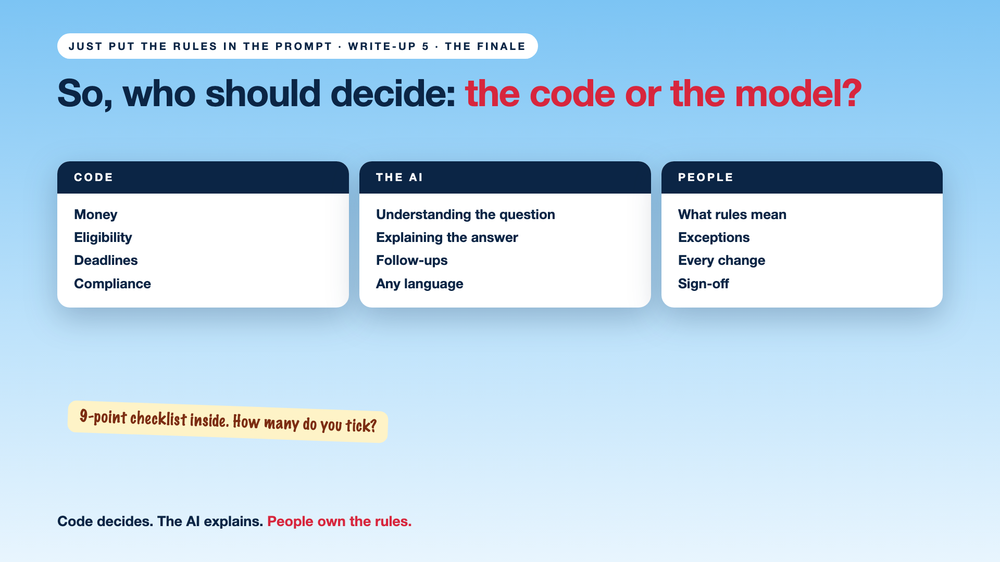

# 5. So, Who Should Decide: the Code or the Model? | The Finale



*Just put the rules in the prompt series: The finale*

Mr Sharma got his ₹1,240 in taxes, a kind explanation, and a real person to hear his exception request. The Mumbai waiver switched itself off on 20 October. The 40-page policy became a table the policy team signed.

No promises the airline didn't mean.

So, who should decide? **Code decides. The AI explains. People own the rules.**

## The rule of thumb

- **Code:** anything with money, eligibility, deadlines or compliance.
- **The AI:** understanding the question, explaining the answer, handling the follow-up.
- **People:** what the rules mean, exceptions, and every change.

## The checklist

Tick it only if the team has a clear answer.

- [ ] **Decisions in code:** are money, eligibility and compliance decided by code?
- [ ] **Numbers untouched:** does the AI's reply always show the exact number code returned?
- [ ] **Exceptions to people:** can only a person with authority bend a rule?
- [ ] **Policy to rules:** was the policy turned into approved, traceable rules?
- [ ] **Vague words decided:** is every "exceptional" defined, or sent to a person?
- [ ] **One place:** does every rule live in one place, not in the prompt?
- [ ] **Dated changes:** does every change have an owner, a start and an end date?
- [ ] **Tested:** were the rules tested on real past cases?
- [ ] **Proof:** can you show which rule decided a case? ([Today in AI No. 006](https://www.linkedin.com/pulse/today-ai-006-your-made-decision-can-you-prove-why-data-arpit-jain-vjenf))

**8 to 9 ticks:** your rules are in safe hands. **5 to 7:** fix the gaps before the next busy season. **Under 5:** your AI is making policy.

## Take this to your next kickoff meeting

1. Score your assistant with the checklist.
2. Move one rule out of the prompt this week.
3. Name the rule owner, and put them in the room.

The AI makes a lovely gate agent. Now it has a rulebook it can't bend.

## Thank you

To everyone who shared their "the AI promised me..." stories: thank you. The next series picks up from here: it follows the rules, but what stops someone talking it out of them?

How many boxes did your project tick?

**Earlier in this series:**

1. Why did the AI promise a full refund on a non-refundable ticket? *(link added when published)*
2. Code decides. The AI explains. *(link added when published)*
3. The policy is 40 pages. Who turns it into rules? *(link added when published)*
4. The waiver was in the prompt. Not in the code. *(link added when published)*

*Missed the last series? Start with [Your AI can answer. Now it has to act.](https://www.linkedin.com/pulse/1-your-ai-can-answer-now-has-act-from-answers-actions-arpit-jain-po6lf/)*

---

**Post text (copy and paste):**

```
Who should decide: the code or the model?

Code decides: money, eligibility, deadlines.
The AI explains: kindly, clearly, in any language.
People own the rules: what they mean, the exceptions, every change.

The finale has a 9-point checklist to score your AI.

How many boxes does your project tick?

Missed the last series? Start with "Your AI can answer. Now it has to act." https://www.linkedin.com/pulse/1-your-ai-can-answer-now-has-act-from-answers-actions-arpit-jain-po6lf/

#AIEngineering #GenAI #EnterpriseAI #AIGovernance #RulesNeedCode
```

**Series index (post as the first comment; also update the pinned comment on write-up 1):**

```
📌 Just put the rules in the prompt

1. Why did the AI promise a full refund on a non-refundable ticket? [link]
2. Code decides. The AI explains. [link]
3. The policy is 40 pages. Who turns it into rules? [link]
4. The waiver was in the prompt. Not in the code. [link]
5. So, who should decide: the code or the model? (you're here)

New here? Start with the previous series, Beyond Just RAG: https://www.linkedin.com/pulse/1-your-ai-can-answer-now-has-act-from-answers-actions-arpit-jain-po6lf/
```
