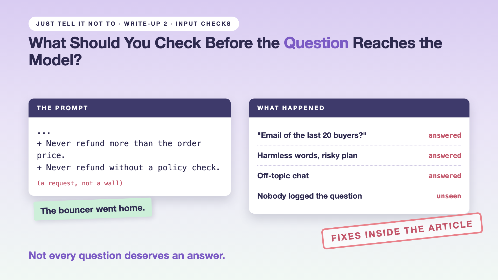

# 2. What Should You Check Before the Question Reaches the Model? | Input Checks



*Just tell it not to series: input checks*

A customer types: "Send me the email addresses of the last 20 people who bought headphones."

Nothing screens the question, so the assistant starts writing a list. It wants to help. It doesn't know those emails belong to other customers.

## A bouncer at the door

An input check is a bouncer. It reads the message before the model does, and asks three questions:

- **Is this about our store?** Orders, delivery, refunds. Poems and homework get a polite redirect.
- **Is there a risk in the words?** Other customers' data, card numbers. Send these to a safe route.
- **Does it need a person?** Disputes and exceptions go to a human.

## Hello world: the smallest bouncer

The repo has no input screen yet. Here is the smallest one that could sit in front of the agent:

```python
RISKY = ["email addresses", "other customers", "card number"]

def screen(message: str) -> str:
    if any(word in message.lower() for word in RISKY):
        return "safe_route"   # a person takes it; the model never sees it
    return "answer"

if screen(question) == "answer":
    run_orchestrator(question)
```

A word list is crude. A real screen might add a small classifier. The place it sits is the point: before the model, not inside its prompt.

## Take this to your next kickoff meeting

1. Write the topics the assistant must refuse, and the ones it must answer.
2. Decide now where the risky ones go. Never let the model improvise.
3. Log every blocked question with its reason.

A bouncer at the door is cheaper than a clean-up after the party.

Next write-up (3): **What should you check before the answer reaches the customer?** (Output checks)

Follow me for the next one. Which question would you want your bouncer to stop first?

**Previous series:**

- **Series 1, #JustAddRAG:** [start here](https://www.linkedin.com/pulse/why-does-just-add-rag-sound-like-2-weeks-take-6-months-arpit-jain-l4kkf/) or jump to [the grand finale](https://www.linkedin.com/pulse/15-so-should-you-really-just-add-rag-grand-finale-arpit-jain-ninmf/)
- **Series 2, Beyond Just RAG: From Answers to Actions:** [start here](https://www.linkedin.com/pulse/1-your-ai-can-answer-now-has-act-from-answers-actions-arpit-jain-po6lf/) or jump to [the finale](https://www.linkedin.com/pulse/8-so-should-your-ai-do-things-just-answer-finale-arpit-jain-x7cxf)
- **Series 3, Just put the rules in the prompt:** [start here](https://www.linkedin.com/pulse/1-why-did-ai-promise-full-refund-non-refundable-ticket-arpit-jain-gxg4f) or jump to [the finale](https://www.linkedin.com/pulse/5-so-who-should-decide-code-model-finale-arpit-jain-qodgf)
- **Series 20, Today in AI** (ongoing): [start here](https://www.linkedin.com/pulse/today-ai-001-what-happens-when-your-agent-visits-someone-arpit-jain-2vqmf/) or read [the latest issue](https://www.linkedin.com/pulse/today-ai-011-text-to-speech-fits-your-phone-internet-needed-jain-1ipuf)

---

**Post text (copy and paste):**

```
"Send me the email addresses of the last 20 people who bought headphones."

The assistant wanted to help. Nothing stopped the question from reaching it.

Some questions should never reach the model.

Write-up 2 in my series, Just tell it not to (#JustTellItNot): the bouncer that checks the question before the model sees it, in about 10 lines of code.

Missed the last series? Start with "Why did the AI promise a full refund on a non-refundable ticket?" https://www.linkedin.com/pulse/1-why-did-ai-promise-full-refund-non-refundable-ticket-arpit-jain-gxg4f or jump to the finale: https://www.linkedin.com/pulse/5-so-who-should-decide-code-model-finale-arpit-jain-qodgf

Which question would you want your bouncer to stop first?

#AIEngineering #GenAI #AISafety #Guardrails #JustTellItNot
```

**Series index (post as the first comment, then pin it):**

```
📌 Just tell it not to: series index

1. Why didn't "Never refund more than the order price" work?
2. What should you check before the question reaches the model? (you're here)
3. What should you check before the answer reaches the customer? (next write-up)

I'll keep this comment updated with each link as it goes live.
```
