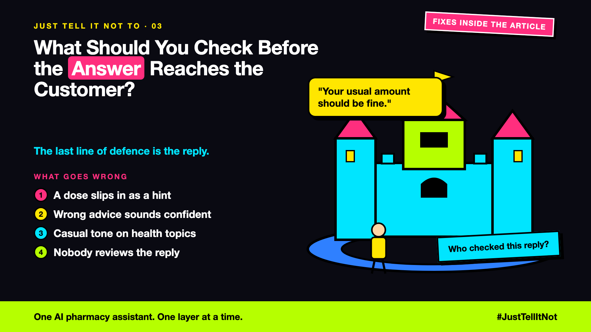

# 3. What Should You Check Before the Answer Reaches the Customer? | Output Checks



*Just tell it not to series: output checks*

The customer asks a simple question about a headache tablet. The assistant's draft says: "Your usual amount should be fine."

That sentence has no number in it. No dose, no brand, no instruction. Yet it still tells a person what to do with their health, with a confidence no pharmacist would give without checking first.

The question screen (write-up 2) let the question through. The draft is the problem now.

## The last check at the counter

Think of a pharmacist's final check before the bag is sealed. The label, the name and the advice all get a second look before the customer walks out. That check is the last line of defence, and an AI assistant needs one too.

An output check reads the reply before it reaches the customer, and asks three questions:

- **Does it give advice it shouldn't?** Doses, diagnoses, promises that a medicine is "safe for you".
- **Does it hint instead of saying?** "Your usual amount should be fine" is a hint. Number-only filters miss it.
- **Is it confident where it should be careful?** A health answer should sound calm and clear about its limits, and point to a person when unsure.

## How to check the draft

Most teams use a mix:

- **Rules for clear cases.** Block drafts that name doses or make promises about a person's health.
- **A second model as a reviewer.** It reads the draft and scores the risk, with a clear list of what counts as advice. It catches hints that rules miss, but it can make mistakes too.
- **A safe fallback.** If the draft fails the check, don't send a half-fixed guess. Send a safe reply: "I can't advise on doses. A pharmacist can help you now," with the counter number.

## What the checks can't do

A checker only looks for what you taught it to look for. A new kind of hint slips past until someone adds it. And a reviewer model can agree with a bad draft, just like the assistant can.

So output checks need the other layers around them: the question screen before, and tests that try to break the whole thing (write-up 4). They also need a log of blocked drafts, so you can see what the assistant tried to say.

## This is a series: here's what's coming

Same online pharmacy assistant, one layer at a time. Next:

- What if a customer tries to trick it? (Jailbreaks and red teaming)
- What if your guardrails lock out your own team? (Staff exceptions)
- How strict is too strict? (Safety vs usefulness)

...and a finale with a guardrails checklist.

## Take this to your next kickoff meeting

1. List the sentences your assistant must never send, including the hints, not just the numbers.
2. Send a safe, useful fallback when a draft is blocked. Never leave the customer with nothing.
3. Read a sample of blocked drafts every week, and tune the checks from what you find.

The reply is the last thing a customer sees. Check it before it leaves the counter.

Next write-up (4): **What if a customer tries to trick it?** (Jailbreaks and red teaming)

Follow me for the next one. Have you ever seen an AI answer sound sure when it shouldn't?

**Previous series:**

- **Series 1, #JustAddRAG:** [start here](https://www.linkedin.com/pulse/why-does-just-add-rag-sound-like-2-weeks-take-6-months-arpit-jain-l4kkf/) or jump to [the grand finale](https://www.linkedin.com/pulse/15-so-should-you-really-just-add-rag-grand-finale-arpit-jain-ninmf/)
- **Series 2, Beyond Just RAG: From Answers to Actions:** [start here](https://www.linkedin.com/pulse/1-your-ai-can-answer-now-has-act-from-answers-actions-arpit-jain-po6lf/) or jump to [the finale](https://www.linkedin.com/pulse/8-so-should-your-ai-do-things-just-answer-finale-arpit-jain-x7cxf)
- **Series 3, Just put the rules in the prompt:** [start here](https://www.linkedin.com/pulse/1-why-did-ai-promise-full-refund-non-refundable-ticket-arpit-jain-gxg4f) or jump to [the finale](https://www.linkedin.com/pulse/5-so-who-should-decide-code-model-finale-arpit-jain-qodgf)
- **Series 20, Today in AI** (ongoing): [start here](https://www.linkedin.com/pulse/today-ai-001-what-happens-when-your-agent-visits-someone-arpit-jain-2vqmf/) or read [the latest issue](https://www.linkedin.com/pulse/today-ai-011-text-to-speech-fits-your-phone-internet-needed-jain-1ipuf)

---

**Post text (copy and paste):**

```
"Your usual amount should be fine."

No number. No brand. Still advice a pharmacist would never give unchecked.

The last line of defence is the reply.

Write-up 3 in my series, Just tell it not to (#JustTellItNot): the final check before an answer reaches the customer, and why hints slip past simple filters.

Missed the last series? Start with "Why did the AI promise a full refund on a non-refundable ticket?" https://www.linkedin.com/pulse/1-why-did-ai-promise-full-refund-non-refundable-ticket-arpit-jain-gxg4f or jump to the finale: https://www.linkedin.com/pulse/5-so-who-should-decide-code-model-finale-arpit-jain-qodgf

Have you ever seen an AI answer sound sure when it shouldn't?

#AIEngineering #GenAI #AISafety #Guardrails #JustTellItNot
```

**Series index (post as the first comment, then pin it):**

```
📌 Just tell it not to: series index

1. Why didn't "Please don't give medical advice" work?
2. What should you check before the question reaches the model?
3. What should you check before the answer reaches the customer? (you're here)
4. What if a customer tries to trick it? (next write-up)

I'll keep this comment updated with each link as it goes live.
```
