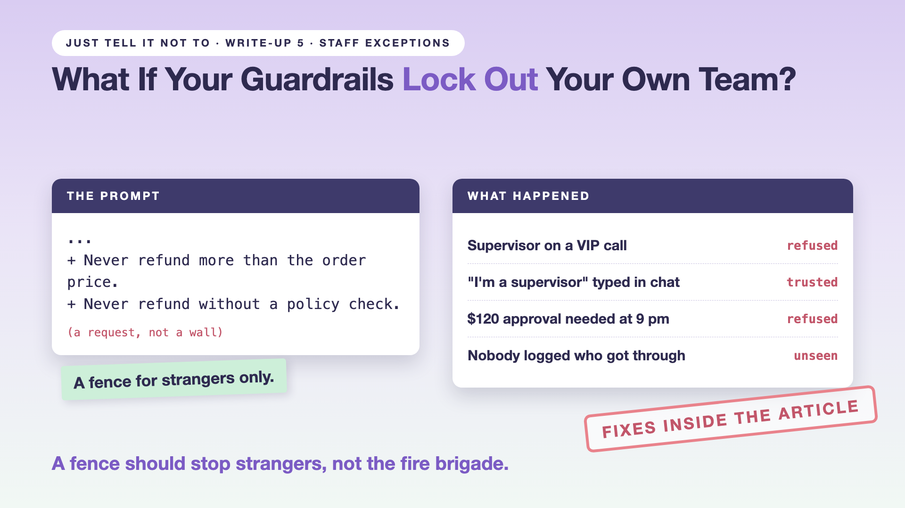

# 5. What If Your Guardrails Lock Out Your Own Team? | Staff Exceptions



*Just tell it not to series: staff exceptions*

It's 9 pm. A store supervisor is on a call with a VIP customer. The customer's headphones arrived broken, and the supervisor wants to approve a $120 refund now.

The refund agent says no. The order is past its refund rules. For the supervisor on a live call, it's the wrong door, locked at the wrong moment.

The fence was built for customers. Nobody remembered the staff.

## The fire door in the castle wall

A wall with no gate for the fire brigade doesn't protect the castle. It traps the people inside. Guardrails have the same problem. A rule strict enough to stop customers can stop your own staff too.

The fix is not to remove the fence. It's to build a proper door for the people who should use it.

## Hello world: the staff door is a human

The repo's safe route is `escalate_to_human`. The agent can't approve the exception, but it can hand the case to a person with a summary that stands alone:

```python
escalate_to_human(
    order_id="9931",
    customer_issue="Headphones arrived broken; VIP customer asks for a $120 refund",
    actions_taken="Policy said eligible (3 days after delivery); supervisor on call",
    recommended_action="Approve the $120 refund after a photo check",
    escalation_reason="Exception needed above the agent's limit",
)
```

All five fields are required, so the person never has to ask "what happened?" The supervisor's login, the time limit and the log are the rest of the staff door. They live outside the agent, in your identity system.

## Every override needs a record

Each exception should answer four questions in the log: who, when, why, and what was decided. Review the log regularly. An override nobody reviews slowly becomes the back door everyone uses.

## Take this to your next kickoff meeting

1. Decide who can get past the fence, and make them prove it with a login, not a typed sentence.
2. Give every emergency override an expiry time and a log entry.
3. Remove access the moment someone changes role.

A fence should stop customers, not the fire brigade.

Next write-up (6): **How strict is too strict?** (Safety vs usefulness)

Follow me for the next one. Who in your team would need a way through the fence in an emergency?

**Previous series:**

- **Series 1, #JustAddRAG:** [start here](https://www.linkedin.com/pulse/why-does-just-add-rag-sound-like-2-weeks-take-6-months-arpit-jain-l4kkf/) or jump to [the grand finale](https://www.linkedin.com/pulse/15-so-should-you-really-just-add-rag-grand-finale-arpit-jain-ninmf/)
- **Series 2, Beyond Just RAG: From Answers to Actions:** [start here](https://www.linkedin.com/pulse/1-your-ai-can-answer-now-has-act-from-answers-actions-arpit-jain-po6lf/) or jump to [the finale](https://www.linkedin.com/pulse/8-so-should-your-ai-do-things-just-answer-finale-arpit-jain-x7cxf)
- **Series 3, Just put the rules in the prompt:** [start here](https://www.linkedin.com/pulse/1-why-did-ai-promise-full-refund-non-refundable-ticket-arpit-jain-gxg4f) or jump to [the finale](https://www.linkedin.com/pulse/5-so-who-should-decide-code-model-finale-arpit-jain-qodgf)
- **Series 20, Today in AI** (ongoing): [start here](https://www.linkedin.com/pulse/today-ai-001-what-happens-when-your-agent-visits-someone-arpit-jain-2vqmf/) or read [the latest issue](https://www.linkedin.com/pulse/today-ai-011-text-to-speech-fits-your-phone-internet-needed-jain-1ipuf)

---

**Post text (copy and paste):**

```
9 pm. A supervisor on a call with a VIP customer needs a refund approved, now.

The agent says no. The fence was built for customers.

A fence should stop customers, not the fire brigade.

Write-up 5 in my series, Just tell it not to (#JustTellItNot): how to give your own team a proper staff door, with a login, an expiry time and a log.

Missed the last series? Start with "Why did the AI promise a full refund on a non-refundable ticket?" https://www.linkedin.com/pulse/1-why-did-ai-promise-full-refund-non-refundable-ticket-arpit-jain-gxg4f or jump to the finale: https://www.linkedin.com/pulse/5-so-who-should-decide-code-model-finale-arpit-jain-qodgf

Who in your team would need a way through the fence in an emergency?

#AIEngineering #GenAI #AISafety #Guardrails #JustTellItNot
```

**Series index (post as the first comment, then pin it):**

```
📌 Just tell it not to: series index

1. Why didn't "Never refund more than the order price" work?
2. What should you check before the question reaches the model?
3. What should you check before the answer reaches the customer?
4. What if a customer tries to trick it?
5. What if your guardrails lock out your own team? (you're here)
6. How strict is too strict? (next write-up)

I'll keep this comment updated with each link as it goes live.
```
