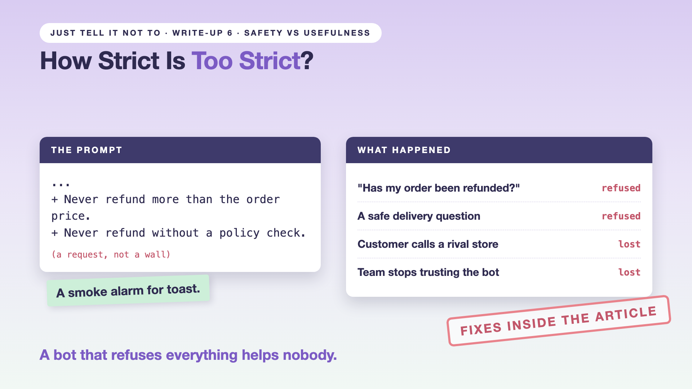

# 6. How Strict Is Too Strict? | Safety vs Usefulness



*Just tell it not to series: safety vs usefulness*

"Has my headphone order 9931 been refunded yet? It arrived broken."

"Sorry, I can't help with that."

A safe question, a simple answer, and the bot refuses. The customer shrugs and calls a rival store. Nothing dangerous happened. Something useful was lost.

Every guardrail we built can be too strict. A fence that refuses everything keeps the customers out.

## The smoke alarm that goes off for toast

An alarm that sounds for every piece of toast teaches people to switch it off. Then it's useless in a real fire. Guardrails that refuse safe questions teach the same lesson.

## Two numbers, not one

You need two numbers side by side:

- **Missed harm:** how often a risky request gets a harmful answer.
- **False refusal:** how often a safe request gets refused.

## Hello world: the dial is one line

The refund rule has a dial. This line decides how long after delivery a refund is allowed:

```python
# tools/functions.py: check_refund_policy()
return {"eligible": order["days_since_delivery"] <= 30, "rule": "Refunds allowed within 30 days of delivery"}
```

Set `30` to `2` and order 9931 (delivered 3 days ago) gets refused: a false refusal. Set it to `365` and old orders get refunded: missed harm. Change the number, then measure both numbers on the same test set.

## Take this to your next kickoff meeting

1. Track both numbers from day one: missed harm and false refusals.
2. Set the strictness topic by topic, not with one global setting.
3. Make every refusal offer a next step, such as "I've passed this to our team".

A bot that refuses everything helps nobody.

Next write-up (7, the finale): **So, is your AI fenced or just asked nicely?** (Guardrails checklist)

Follow me for the finale. Which of your bot's refusals would you change first?

**Previous series:**

- **Series 1, #JustAddRAG:** [start here](https://www.linkedin.com/pulse/why-does-just-add-rag-sound-like-2-weeks-take-6-months-arpit-jain-l4kkf/) or jump to [the grand finale](https://www.linkedin.com/pulse/15-so-should-you-really-just-add-rag-grand-finale-arpit-jain-ninmf/)
- **Series 2, Beyond Just RAG: From Answers to Actions:** [start here](https://www.linkedin.com/pulse/1-your-ai-can-answer-now-has-act-from-answers-actions-arpit-jain-po6lf/) or jump to [the finale](https://www.linkedin.com/pulse/8-so-should-your-ai-do-things-just-answer-finale-arpit-jain-x7cxf)
- **Series 3, Just put the rules in the prompt:** [start here](https://www.linkedin.com/pulse/1-why-did-ai-promise-full-refund-non-refundable-ticket-arpit-jain-gxg4f) or jump to [the finale](https://www.linkedin.com/pulse/5-so-who-should-decide-code-model-finale-arpit-jain-qodgf)
- **Series 20, Today in AI** (ongoing): [start here](https://www.linkedin.com/pulse/today-ai-001-what-happens-when-your-agent-visits-someone-arpit-jain-2vqmf/) or read [the latest issue](https://www.linkedin.com/pulse/today-ai-011-text-to-speech-fits-your-phone-internet-needed-jain-1ipuf)

---

**Post text (copy and paste):**

```
"Has my headphone order been refunded? It arrived broken."

"Sorry, I can't help with that."

The customer called a rival store. Nothing dangerous happened. Something useful was lost.

A bot that refuses everything helps nobody.

Write-up 6 in my series, Just tell it not to (#JustTellItNot): why you need two numbers, missed harm and false refusals, and how one line of code sets the dial.

Missed the last series? Start with "Why did the AI promise a full refund on a non-refundable ticket?" https://www.linkedin.com/pulse/1-why-did-ai-promise-full-refund-non-refundable-ticket-arpit-jain-gxg4f or jump to the finale: https://www.linkedin.com/pulse/5-so-who-should-decide-code-model-finale-arpit-jain-qodgf

Which of your bot's refusals would you change first?

#AIEngineering #GenAI #AISafety #Guardrails #JustTellItNot
```

**Series index (post as the first comment, then pin it):**

```
📌 Just tell it not to: series index

1. Why didn't "Never refund more than the order price" work?
2. What should you check before the question reaches the model?
3. What should you check before the answer reaches the customer?
4. What if a customer tries to trick it?
5. What if your guardrails lock out your own team?
6. How strict is too strict? (you're here)
7. So, is your AI fenced or just asked nicely? (the finale, next)

I'll keep this comment updated with each link as it goes live.
```
