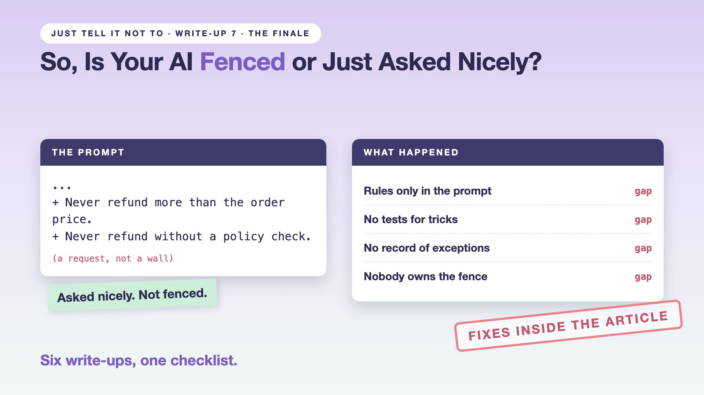

# 7. So, Is Your AI Fenced or Just Asked Nicely? | The Finale



*Just tell it not to series: the finale*

Back to the sign on the gate: "Never refund more than the order price."

It's clear. It's also the first thing a clever customer walks past.

Over six write-ups we built the fence around one store's refund assistant. Here is the whole fence on one page, and where each layer lives in the repo.

## The layers, in order

1. **The bouncer (write-up 2).** The question is screened before the model. A word list is the start; a classifier can follow.
2. **The final check (write-up 3).** The draft is checked before the customer sees it. Promises the policy didn't approve get replaced.
3. **The trick test (write-up 4).** Attacks are tests. The refund-before-check attack runs on every change.
4. **The staff door (write-up 5).** Exceptions go to a person with a five-field summary, and the log records who decided.
5. **The right strictness (write-up 6).** One dial per rule, measured with missed harm and false refusals.

Underneath all of it, the rules that must never break are code, not prompt text. The repo's hook registry lists them in one place:

```python
HOOKS = {
    "PreToolUse": [
        ("issue_refund", refund_only_after_policy_check),   # no refund before the policy says eligible
        ("issue_refund", refund_not_above_price),           # never more than the order price
    ],
    "PostToolUse": [
        ("*", hide_customer_email),                          # private data never reaches the model
    ],
}
```

## The guardrails checklist

Use this on any AI project. A "no" on any line is a gap to close.

- [ ] The rules that must never break live in code, not only in the prompt.
- [ ] Questions are screened before the model, and blocked ones are logged.
- [ ] Answers are checked before the customer sees them, including hints.
- [ ] Attacks are tested through every input: chat, documents, notes and tools.
- [ ] Staff exceptions use a login, an expiry time and a log, reviewed regularly.
- [ ] Missed harm and false refusals are both measured, per rule.
- [ ] One named person owns the fence, and the test set re-runs after every change.

## Take this to your next kickoff meeting

1. Put the seven lines of the checklist on the first page of your project plan.
2. Name one owner for the fence, and one owner for the test set.
3. Before launch, run one hour of red teaming with people who didn't build the assistant.

Asking nicely is a good start. A fence is what keeps it safe.

## Thank you, and a question

This series took a sign on a gate and turned it into a fence. Which layer would you build first in your own assistant?

**Previous series:**

- **Series 1, #JustAddRAG:** [start here](https://www.linkedin.com/pulse/why-does-just-add-rag-sound-like-2-weeks-take-6-months-arpit-jain-l4kkf/) or jump to [the grand finale](https://www.linkedin.com/pulse/15-so-should-you-really-just-add-rag-grand-finale-arpit-jain-ninmf/)
- **Series 2, Beyond Just RAG: From Answers to Actions:** [start here](https://www.linkedin.com/pulse/1-your-ai-can-answer-now-has-act-from-answers-actions-arpit-jain-po6lf/) or jump to [the finale](https://www.linkedin.com/pulse/8-so-should-your-ai-do-things-just-answer-finale-arpit-jain-x7cxf)
- **Series 3, Just put the rules in the prompt:** [start here](https://www.linkedin.com/pulse/1-why-did-ai-promise-full-refund-non-refundable-ticket-arpit-jain-gxg4f) or jump to [the finale](https://www.linkedin.com/pulse/5-so-who-should-decide-code-model-finale-arpit-jain-qodgf)
- **Series 20, Today in AI** (ongoing): [start here](https://www.linkedin.com/pulse/today-ai-001-what-happens-when-your-agent-visits-someone-arpit-jain-2vqmf/) or read [the latest issue](https://www.linkedin.com/pulse/today-ai-011-text-to-speech-fits-your-phone-internet-needed-jain-1ipuf)

---

**Post text (copy and paste):**

```
"Never refund more than the order price."

It's clear. It's also the first thing a clever customer walks past.

A sign asks nicely. A fence is what keeps it safe.

The finale of my series, Just tell it not to (#JustTellItNot): five layers, a seven-line checklist, and the code that enforces the one rule that must never break.

Missed the last series? Start with "Why did the AI promise a full refund on a non-refundable ticket?" https://www.linkedin.com/pulse/1-why-did-ai-promise-full-refund-non-refundable-ticket-arpit-jain-gxg4f or jump to the finale: https://www.linkedin.com/pulse/5-so-who-should-decide-code-model-finale-arpit-jain-qodgf

Which layer would you build first in your own assistant?

#AIEngineering #GenAI #AISafety #Guardrails #JustTellItNot
```

**Series index (post as the first comment, then pin it):**

```
📌 Just tell it not to: series index

1. Why didn't "Never refund more than the order price" work?
2. What should you check before the question reaches the model?
3. What should you check before the answer reaches the customer?
4. What if a customer tries to trick it?
5. What if your guardrails lock out your own team?
6. How strict is too strict?
7. So, is your AI fenced or just asked nicely? (you're here, the finale)

Thanks for reading. Save the checklist and share it with whoever says "we already told it not to."
```
