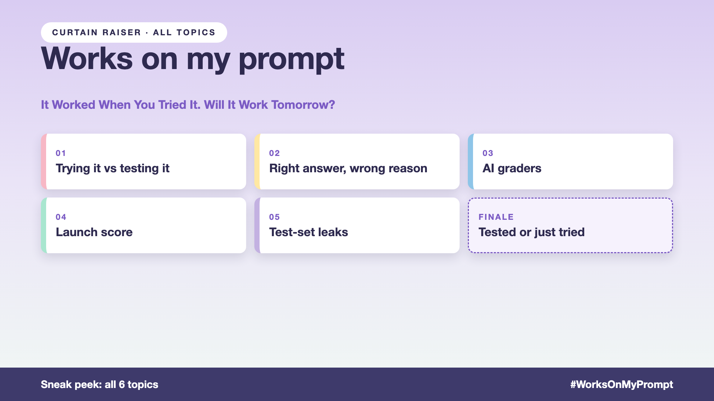

# Curtain raiser post: Works on my prompt

*Post with cover only. No article. The cover lists every topic in the series.*



**Post text (copy and paste):**

```
"I tried it, and it works."

One question. Asked once. On a laptop: "Where's order 9931?" Green tick in the status update.

Three weeks later: the refund bot approves a $300 order that was never delivered. Marked 10/10 by the AI grader.

Ship on "I tried it", and you pay for it:
• Accuracy: wrong answers nobody notices until customers complain
• Trust: one wrong refund answer, and people go back to calling the store
• Risk: refund disputes that cost real money
• Speed: every change becomes scary, because nothing checks it

Write-up 1 in my new series, Works on my prompt (#WorksOnMyPrompt): why trying it isn't testing it, what good evals check, and three things to take to your next kickoff meeting.

Coming up: all 6 write-ups are on the cover.

How many questions did your last AI project test before someone said "it works"?

#AIEngineering #GenAI #LLMEvals #AITesting #WorksOnMyPrompt
```

**Series index (post as the first comment, then pin it):**

```
📌 Works on my prompt: series index

1. It worked when you tried it. Will it work tomorrow? (you're here)
2. Right answer, wrong reason? (next write-up)

I'll keep this comment updated with each link as it goes live.
```
