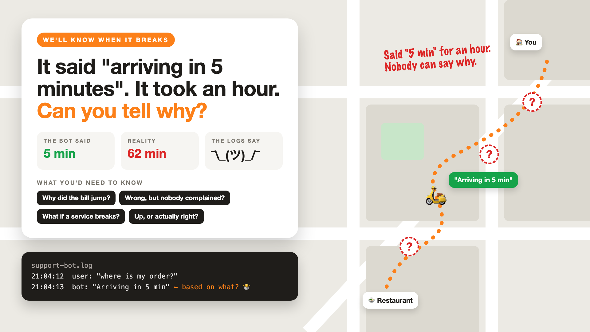

# 1. It Said "Arriving in 5 Minutes". It Took an Hour. Can You Tell Why?



*We'll know when it breaks series: the curtain raiser*

*After Series 5, Works on my prompt: It passed the tests. So why did a real customer still get a wrong answer?*

"If something goes wrong, we'll check the logs."

Picture a food-delivery app's support bot. A hungry customer asks, "Where's my order?" The bot replies, "Arriving in 5 minutes." Twenty minutes later, they ask again. "Arriving in 5 minutes." The food arrives after an hour, cold, along with a one-star review and a screenshot on social media.

The support lead asks a simple question: why did the bot keep saying five minutes?

The team opens the logs. They show the customer's question, the bot's answer, and a timestamp. That's all. Did the bot read old tracking data? The wrong order? Did a prompt change last week? Nobody can tell.

## Why "we'll check the logs" isn't enough

Normal software fails loudly: an error, a crash, a red light. AI fails politely. It gives a confident, well-written, wrong answer, and nothing anywhere turns red.

- **Wrong answers don't complain.** Most customers who get a wrong delivery time don't report it. They just order elsewhere next time.
- **The bill knows first.** A small prompt change can stop the bot reusing earlier work, and the cost triples before anyone sees a wrong answer.
- **The systems around the bot fail too.** When the tracking service slows down at 8 PM on a Friday, what does the bot say?
- **"Up" isn't "right".** The bot can answer every question, fast, and still get 12% of delivery times wrong.

The basics (recording every step, dashboards, alerts, linking complaints to what happened) are in [write-up 13 of my #JustAddRAG series](https://www.linkedin.com/pulse/13-when-your-ai-gives-wrong-answer-can-you-tell-why-arpit-jain-m4kff). This series is about the failures those basics miss.

It's a delivery map with the rider dot frozen in place and question marks along the route.

## What sits behind "we'll check the logs"

A log line is the visible part. What lets you catch problems early is everything behind it: watching cost as a warning sign, testing the bot with questions you already know the answers to, breaking things on purpose before Friday night does, and measuring whether it's right, not just whether it's up. The questions on the cover are the ones your team should be able to answer.

## This is a series: here's what's coming

This write-up is the first in a series. Each one takes one part of seeing inside your AI and goes deep, with the same delivery support bot every time. A few of the questions it will answer:

- The bill tripled. Nothing errored. Where do you look? (Cost as a warning sign)
- How do you catch a wrong answer nobody reported? (Canary questions)
- What happens when you break it on purpose? (Fault testing)
- Is it up, or is it right? (Targets and incidents)

...and a final write-up with an observability checklist.

## Take this to your next kickoff meeting

1. Pick ten questions with known answers, and ask them every hour, all day.
2. Put the daily AI bill on the same screen as the error count.
3. Agree a target for right answers, not just for uptime.

If you can't explain a wrong answer, you can't fix it. You can only apologise for it.

Next write-up (2): **The bill tripled. Nothing errored. Where do you look?** (Cost as a warning sign)

Follow me for the next one. And tell me: how long did it take your team to explain the last wrong AI answer?

---

**Post text (copy and paste):**

```
"Arriving in 5 minutes." Said three times. The food took an hour.

The team opened the logs: question, answer, timestamp. Nothing about what the bot read or why.

Launch AI without observability, and you pay for it:
• Time: hours of guessing for every wrong answer
• Trust: the same mistake repeats while nobody can find the cause
• Reputation: customers find the problem on social media before you do
• Cost: a bill that triples before anyone sees a wrong answer

Write-up 1 in my new series, We'll know when it breaks (#WeWillKnow): why AI fails politely, the failures normal logs miss, and three things to take to your next kickoff meeting.

How long did it take your team to explain the last wrong AI answer?

#AIEngineering #GenAI #Observability #LLMOps #WeWillKnow
```

**Series index (post as the first comment, then pin it):**

```
📌 We'll know when it breaks: series index

1. It said "arriving in 5 minutes". It took an hour. Can you tell why? (you're here)
2. The bill tripled. Nothing errored. Where do you look? (next write-up)

I'll keep this comment updated with each link as it goes live.
```
