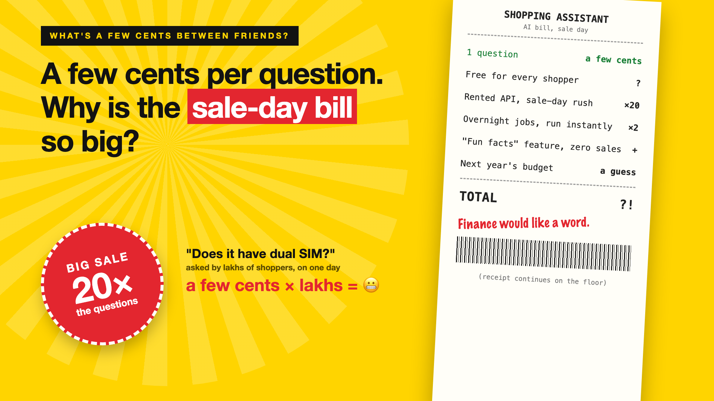

# Curtain raiser post: What's a few cents between friends?

*Post with cover only. No article. The cover lists every topic in the series.*



**Post text (copy and paste):**

```
"It's only a few cents per question."

Then the sale arrives. Twenty times the "where is my order?" traffic. Every answer live, at full price, for every shopper.

Assume a few cents stays small, and you pay for it:
• Cost: a sale-day bill nobody multiplied in advance
• Waste: features that cost lakhs and sell nothing
• Risk: a budget built on a guess
• Trust: finance stops saying yes to the next AI idea

Write-up 1 in my new series, What's a few cents between friends? (#FewCentsMore): why small AI costs stop being small, the money decisions behind the bill, and three things to take to your next kickoff meeting.

Coming up: all 7 write-ups are on the cover.

What's the biggest "only a few cents" surprise you've seen?

#AIEngineering #GenAI #FinOps #AICost #FewCentsMore
```

**Series index (post as the first comment, then pin it):**

```
📌 What's a few cents between friends?: series index

1. A few cents per question. Why is the sale-day bill so big? (you're here)
2. What should you charge for your AI feature? (next write-up)

I'll keep this comment updated with each link as it goes live.
```
