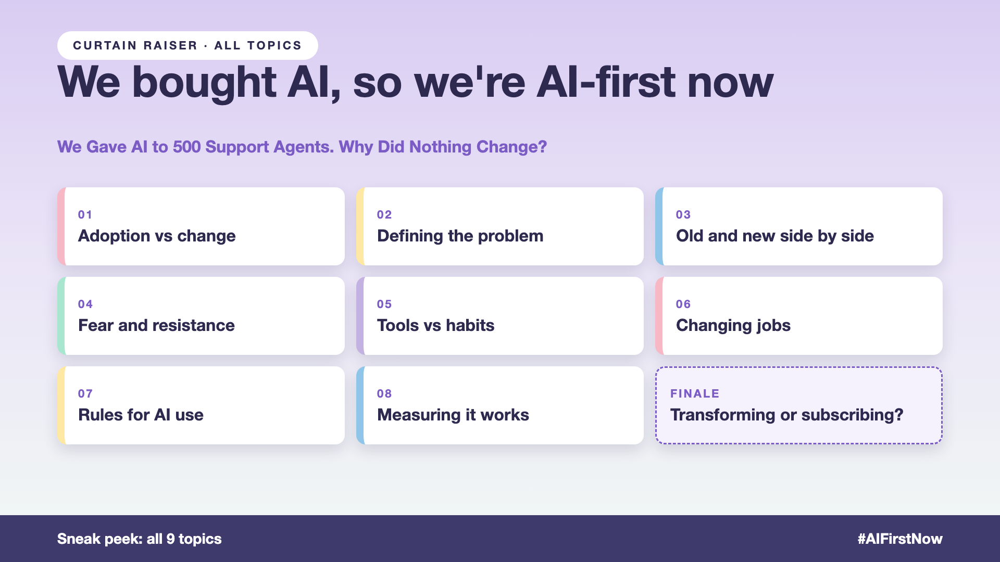

# Curtain raiser post: We bought AI, so we're AI-first now

*Post with cover only. No article. The cover lists every topic in the series.*



**Post text (copy and paste):**

```
500 support agents. 500 AI licences. One training session. 500 logins by Friday.

Six months later: same handling time, same repeat contacts about the same refunds.

The agents used AI. Mostly to sound more polite in their emails about them.

Treat a licence as a transformation, and you pay for it:
• Cost: a full year of seats for a tool that changed nothing
• Time: six months of the same old day, with a new tab open
• Credibility: the next AI idea gets a much harder "no"
• People: agents learn that "transformation" means one more tool

Write-up 1 in my new series, We bought AI, so we're AI-first now (#AIFirstNow): why buying AI isn't changing work, what sits behind the licence, and three things to take to your next kickoff meeting.

Coming up: all 9 write-ups are on the cover.

What's the most expensive "coat rack" you've seen in an AI rollout?

#AIEngineering #GenAI #AITransformation #ChangeManagement #AIFirstNow
```

**Series index (post as the first comment, then pin it):**

```
📌 We bought AI, so we're AI-first now: series index

1. We gave AI to 500 support agents. Why did nothing change? (you're here)
2. Which problem was the AI supposed to solve? (next write-up)

I'll keep this comment updated with each link as it goes live.
```
