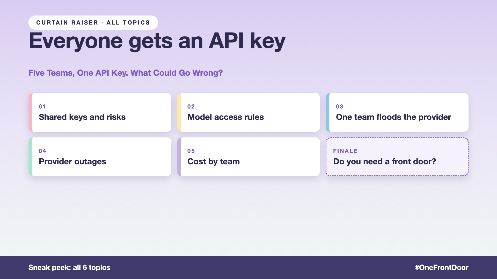

# Curtain raiser post: Everyone gets an API key

*Post with cover only. No article. The cover lists every topic in the series.*



**Post text (copy and paste):**

```
Sales, HR, Support, Legal. Four bots. One AI provider. Often one API key.

Then one Monday: Sales floods the provider, Support's chatbot crawls, a short outage silences every bot, and finance gets one big invoice with no names on it.

Let every team call the model directly, and you pay for it:
• Availability: one provider outage takes down every bot at once
• Performance: one busy team slows everyone else
• Cost: the priciest model for every email, and no way to split the bill
• Security: logging and data rules reinvented, or skipped, by each team

Write-up 1 in my new series, Everyone gets an API key (#OneFrontDoor): why one line of code becomes a company problem, what an AI gateway does, and three things to take to your next kickoff meeting.

Coming up: all 6 write-ups are on the cover.

How many API keys does your company have for the same AI provider?

#AIEngineering #GenAI #AIGateway #PlatformEngineering #OneFrontDoor
```

**Series index (post as the first comment, then pin it):**

```
📌 Everyone gets an API key: series index

1. Five teams, one API key. What could go wrong? (you're here)
2. Who is allowed to use which model? (next write-up)

I'll keep this comment updated with each link as it goes live.
```
