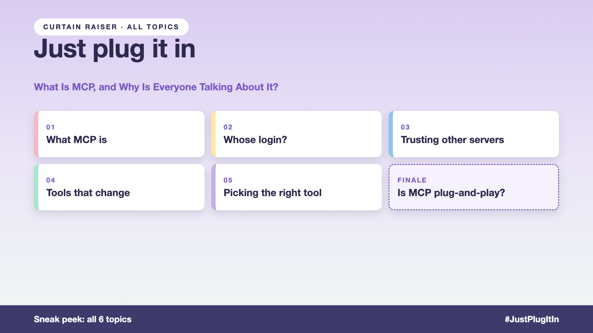

# Curtain raiser post: Just plug it in

*Post with cover only. No article. The cover lists every topic in the series.*



**Post text (copy and paste):**

```
"Let's just add an MCP server."

The IT helpdesk assistant gets plugged into ticketing, team chat, laptop inventory, the HR system, and a free "ticket helper" from the internet. Done in an afternoon.

Plug in without thinking, and you pay for it:
• Security: an assistant acting with the IT admin's login
• Privacy: tickets flowing to a third-party server nobody reviewed
• Availability: one tool update, and every request fails
• Accuracy: twenty tools, and requests going to the wrong one

Write-up 1 in my new series, Just plug it in (#JustPlugItIn): what MCP is in plain words, why it's genuinely useful, what it doesn't solve, and three things to take to your next kickoff meeting.

Coming up: all 6 write-ups are on the cover.

How many MCP servers is your team running, and who approved each one?

#AIEngineering #GenAI #MCP #AIAgents #JustPlugItIn
```

**Series index (post as the first comment, then pin it):**

```
📌 Just plug it in: series index

1. What is MCP, and why is everyone talking about it? (you're here)
2. Whose login does the assistant use? (next write-up)

I'll keep this comment updated with each link as it goes live.
```
