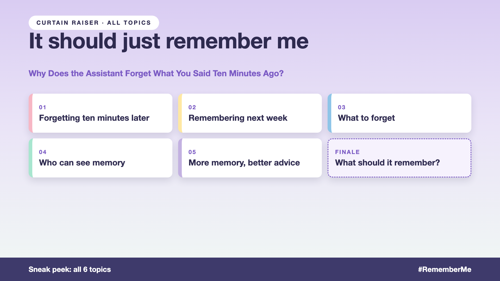

# Curtain raiser post: It should just remember me

*Post with cover only. No article. The cover lists every topic in the series.*



**Post text (copy and paste):**

```
"Order 9931. The headphones, $120."

40 messages later, the assistant asks which order you mean, and quotes $140. Next week, it forgets the order completely, but remembers a return from 2023.

Get AI memory wrong, and you pay for it:
• Experience: customers repeat themselves, then leave
• Relevance: one-off returns treated as lifelong preferences
• Privacy: remembered details customers can't see or delete
• Cost: recalling everything for every answer, slowly and expensively

Write-up 1 in my new series, It should just remember me (#RememberMe): why AI memory is harder than it sounds, the drawers every assistant needs, and three things to take to your next kickoff meeting.

Coming up: all 6 write-ups are on the cover.

What's the strangest thing an app has "remembered" about you?

#AIEngineering #GenAI #AIMemory #AIAgents #RememberMe
```

**Series index (post as the first comment, then pin it):**

```
📌 It should just remember me: series index

1. Why does the assistant forget what you said ten minutes ago? (you're here)
2. How does an AI remember you next week? (next write-up)

I'll keep this comment updated with each link as it goes live.
```
