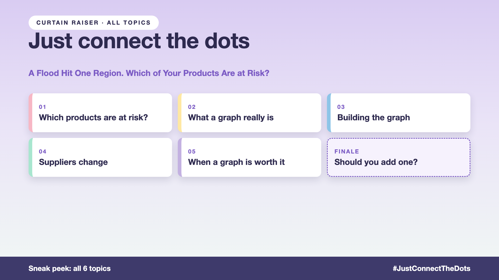

# Curtain raiser post: Just connect the dots

*Post with cover only. No article. The cover lists every topic in the series.*



**Post text (copy and paste):**

```
A flood hits one port. The COO asks: which orders and refunds depend on that route?

The AI finds the shipping partner. But the answer is a chain: partner, route, 300 orders, 40 customers, 12 refunds in progress. Plus "ABC Logistics", spelt differently, on half the invoices.

Use plain search for connection questions, and you pay for it:
• Risk: orders at risk that nobody listed
• Accuracy: the same partner counted as three, or missed entirely
• Time: analysts rebuilding the chain by hand during a crisis
• Cost: or the opposite mistake, a graph built for questions that never needed one

Write-up 1 in my new series, Just connect the dots (#JustConnectTheDots): why some questions are about connections, what a knowledge graph really takes, and three things to take to your next kickoff meeting.

Coming up: all 6 write-ups are on the cover.

What's a question in your business that only makes sense as a chain of links?

#AIEngineering #GenAI #KnowledgeGraph #GraphRAG #JustConnectTheDots
```

**Series index (post as the first comment, then pin it):**

```
📌 Just connect the dots: series index

1. A flood hit one port. Which orders are at risk? (you're here)
2. What is a knowledge graph, really? (next write-up)

I'll keep this comment updated with each link as it goes live.
```
