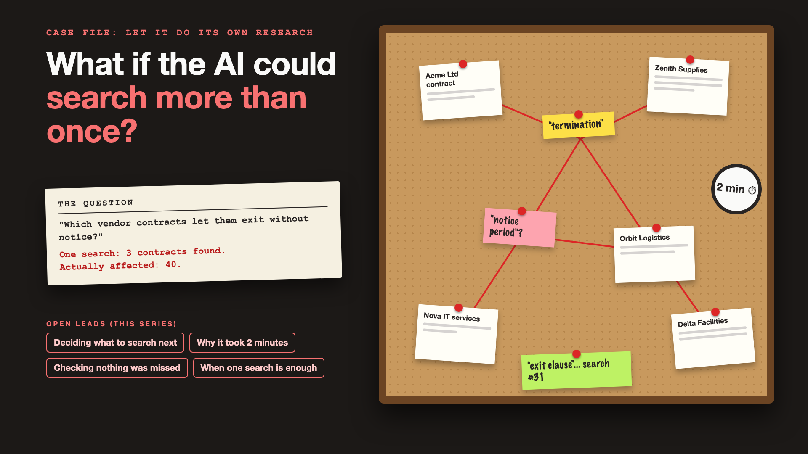

# Curtain raiser post: Let it do its own research

*Post with cover only. No article. The cover lists every topic in the series.*



**Post text (copy and paste):**

```
"Which orders were refunded under a 2025 policy exception?"

One search found 3 policy pages. The real answer: 40 pages and the refund log, joined together.

Rely on one search for research questions, and you pay for it:
• Risk: a confident answer that misses 37 refunds
• Accuracy: the policy's words aren't the customer's words
• Cost and speed: or the opposite, 30 searches for a one-line lookup
• Trust: the support lead stops using it after the first missed exception

Write-up 1 in my new series, Let it do its own research (#LetItResearch): why one search is rarely enough, what agentic RAG really is, and three things to take to your next kickoff meeting.

Coming up: all 6 write-ups are on the cover.

What's a question in your business that no single search could ever answer?

#AIEngineering #GenAI #AgenticRAG #RAG #LetItResearch
```

**Series index (post as the first comment, then pin it):**

```
📌 Let it do its own research: series index

1. What if the AI could search more than once? (you're here)
2. How does the agent decide what to search next? (next write-up)

I'll keep this comment updated with each link as it goes live.
```
