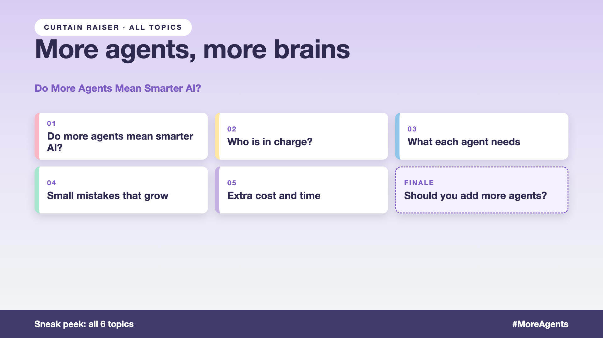

# Curtain raiser post: More agents, more brains

*Post with cover only. No article. The cover lists every topic in the series.*



**Post text (copy and paste):**

```
Five AI agents for one order: order, shipping, refund, fraud and email.

Order 9931 is delayed. The shipping agent says "in transit". The refund agent says "eligible". The email agent sends "your order is lost". The customer gets three answers.

Add agents without coordination, and you pay for it:
• Accuracy: one small mistake passed from agent to agent
• Cost: five agents, five times the calls
• Speed: every handoff adds waiting
• Experience: a customer who stops trusting the store

Write-up 1 in my new series, More agents, more brains (#MoreAgents): why more agents can mean more confusion, what makes an AI team work, and three things to take to your next kickoff meeting.

Coming up: all 6 write-ups are on the cover.

Where have you seen "more agents" make a system worse, not better?

#AIEngineering #GenAI #MultiAgent #AIAgents #MoreAgents
```

**Series index (post as the first comment, then pin it):**

```
📌 More agents, more brains: series index

1. Do more agents mean smarter AI? (you're here)
2. Who is in charge? (next write-up)

I'll keep this comment updated with each link as it goes live.
```
