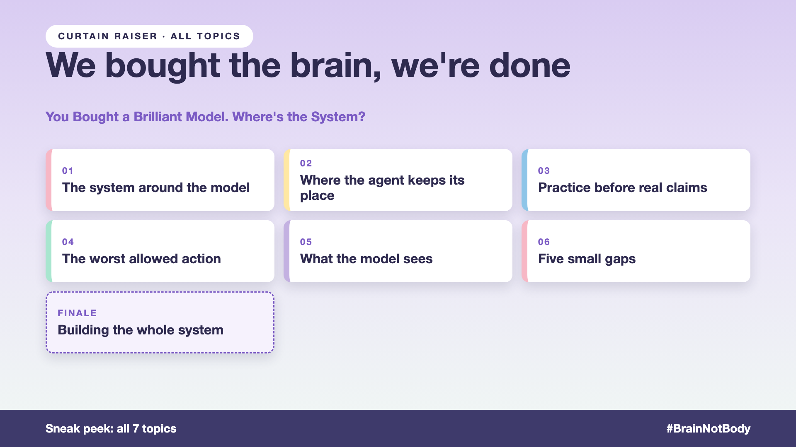

# Curtain raiser post: We bought the brain, we're done

*Post with cover only. No article. The cover lists every topic in the series.*



**Post text (copy and paste):**

```
"The vendor ships the model, so we're done."

The model reads an insurance claim perfectly. Then: what stops a 20-lakh approval? What if the server restarts mid-claim? Does the model even see the exclusion clause?

Treat the model as the whole system, and you pay for it:
• Risk: decisions with no brakes and no human check
• Reliability: claims restarted from scratch, or paid twice
• Accuracy: decisions made without the clause that mattered
• Safety: tests that touch real payouts

Write-up 1 in my new series, We bought the brain, we're done (#BrainNotBody): why the model isn't the system, what the harness around it does, and three things to take to your next kickoff meeting.

Coming up: all 7 write-ups are on the cover.

What share of your last AI project was the model, and what share was everything around it?

#AIEngineering #GenAI #AIAgents #InsurTech #BrainNotBody
```

**Series index (post as the first comment, then pin it):**

```
📌 We bought the brain, we're done: series index

1. You bought a brilliant model. Where's the system? (you're here)
2. Where does the agent keep its place? (next write-up)

I'll keep this comment updated with each link as it goes live.
```
