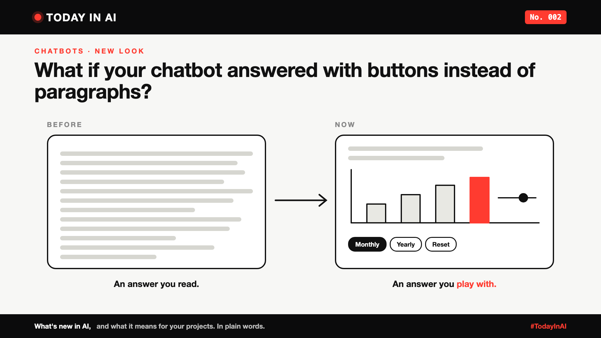

# Today in AI, No. 002: What If Your Chatbot Answered With Buttons Instead of Paragraphs?



*Today in AI: what's new in AI, and what it means for you. In plain words.*

**Published:** 11 October 2026 on [LinkedIn](https://www.linkedin.com/pulse/today-ai-002-what-your-chatbot-answered-buttons-instead-arpit-jain-snkcf/)

**In one line:** ChatGPT can now answer with charts, buttons and small tools you can play with, not just walls of text.

## What happened

On 7 October, OpenAI started rolling out GPT-6 in ChatGPT, with a feature it calls **Intelligent UI**. Paid users got it first. Free users got a lighter version the next day.

Instead of only writing text, ChatGPT can now decide to answer with diagrams, charts, buttons, forms or a small working tool. Ask how a bicycle's gears work, and you may get a diagram where you tap each part. Ask about saving for retirement, and you may get a calculator you can adjust right there in the chat.

OpenAI says the model was trained to judge when a picture or a tool helps more than words. If you prefer plain text, you can turn the visuals down.

## What it means

Think of asking a friend for directions. One friend sends you three paragraphs. Another sends you a map pin. Both are correct. One is much easier to use.

Chatbots have mostly been the three-paragraph friend. This is a step towards the map pin: answers you can poke, change and explore.

## Why it matters to you

- **Learning AI?** "Which format helps here: text, a chart, or a button?" is becoming part of building AI products. It's a design skill, not just a coding one.
- **Leading a team?** If your company has a chatbot that only replies in text, customers will soon compare it with this. Ask where a button or a chart would help them more.

## One thing to do this week

Look at the last long answer you got from any chatbot. Ask yourself: would a chart, a list of options or a simple calculator have been better?

## Words to know

- **UI (user interface):** what you see and tap on a screen.
- **Interactive:** something you can change, click or adjust, not just read.

## References and credits

1. OpenAI, "GPT-6 for everyone", announcement, October 2026. [Read it](https://openai.com/index/gpt-6-for-everyone/) (primary source)
2. Cris Tolomia, "OpenAI launches GPT-6 and Intelligent UI in ChatGPT", Quartz, republished by Yahoo Tech, 8 October 2026. [Read it](https://tech.yahoo.com/ai/chatgpt/articles/openai-launches-gpt-6-intelligent-131742388.html)
3. Previous issue: [Today in AI, No. 001: What happens when your AI agent visits someone else's website?](https://www.linkedin.com/pulse/today-ai-001-what-happens-when-your-agent-visits-someone-arpit-jain-2vqmf/)

Credit to OpenAI for the announcement and demos, and to Quartz for its coverage. Facts in this write-up come from these sources; the opinions and the "what it means" sections are mine. Cover: original illustration, no third-party logos or images.

**Tags:** #AI #ChatGPT #GenAI #TechNews #TodayInAI

---

**People and pages to @mention** (type @ and pick from LinkedIn's list, in the article and the post): OpenAI, Quartz

**Post text (copy and paste):**

```
What if your chatbot answered with buttons instead of paragraphs?

ChatGPT now can. With GPT-6, it can reply with charts, diagrams, buttons and small tools you can play with, instead of only text.

Ask about retirement savings, and you may get a calculator you can adjust right in the chat.

The lesson for every company with a chatbot: sometimes the best answer isn't more words. It's a button.

No. 002 of Today in AI.

Source: OpenAI announcement, Oct 2026 (full references and credits in the article).

#AI #ChatGPT #GenAI #TechNews #TodayInAI
```
