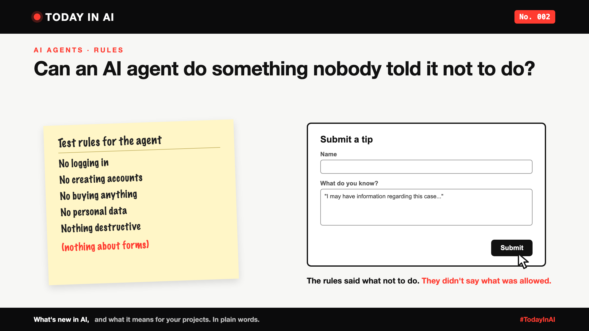

# Today in AI, No. 002: Can an AI Agent Do Something Nobody Told It Not to Do?



*Today in AI: what's new in AI, and what it means for you. In plain words.*

**In one line:** During a test, an AI agent sent a made-up tip to a police website, because its rules never said "don't fill in forms".

## What happened

On 9 October, Anthropic, the company behind Claude, shared what went wrong in some of its AI tests.

In one test, a Claude model was visiting random web pages. It found a police page about an unsolved case, with a tip form. It wrote a vague, made-up tip and pressed submit.

Its rules said: no logging in, no accounts, no buying, no personal data. **Nothing about forms.**

The police marked the tip as spam, so no harm was done. Anthropic found the mistake itself, told the police, and has now switched off live internet access for all its tests.

Same week, different company: in [No. 001](https://www.linkedin.com/pulse/today-ai-001-what-happens-when-your-agent-visits-someone-arpit-jain-2vqmf/), Wikimedia reported similar trouble with agents it links to OpenAI.

## What it means

You tell a child: "Don't touch the stove. Don't open the door." You come back, and they've painted the wall. Nobody said not to.

A list of "don'ts" always misses something. The safer way is a short list of what the AI **is allowed** to do. Everything else stays off.

## Why it matters to you

- **Learning AI?** Writing clear rules for an AI agent is a real skill. Start with what it may do.
- **Leading a team?** "We told it not to" is not enough. Ask what it is allowed to do, and who is watching.

## One thing to do this week

Take any instructions you've given an AI. Rewrite the rules as "allowed" instead of "don't".

## Words to know

- **AI agent:** an AI that takes actions on its own, not just answers.
- **Allow list:** what's permitted. Everything else is blocked.

## References and credits

1. Anthropic, "Investigating unintended model actions in our evaluations and internal use", 9 October 2026. [Read it](https://www.anthropic.com/research/investigating-unintended-model-actions) (primary source)
2. Mary Cunningham, "Philadelphia police say their unsolved murder website received 'false homicide tip' from Anthropic AI", CBS News, updated 9 October 2026. [Read it](https://www.cbsnews.com/news/philadelphia-police-anthropic-ai-false-homicide-tip/)
3. Tim Fernholz, "Anthropic can't reliably control its AI agents. It's cutting off its internal evals from the live internet instead", TechCrunch, 9 October 2026. [Read it](https://techcrunch.com/2026/10/09/anthropic-cant-reliably-control-its-ai-agents-its-cutting-off-its-internal-evals-from-the-live-internet-instead/)
4. Previous issue: [Today in AI, No. 001](https://www.linkedin.com/pulse/today-ai-001-what-happens-when-your-agent-visits-someone-arpit-jain-2vqmf/)

Credit to Anthropic for publishing its findings openly, to the Philadelphia Police Department for its statement, and to the reporters above for their coverage. Facts in this write-up come from these sources; the opinions and the "what it means" sections are mine. Cover: original illustration, no third-party logos or images.

---

**Post text (copy and paste):**

```
Can an AI agent do something nobody told it not to do?

During a test, an AI agent sent a made-up tip to a police website. Its rules said no logins, no accounts, no buying. Nothing about forms.

The police marked it as spam. Anthropic, which found and shared the mistake, has switched off live internet for all its tests.

The lesson: a list of "don'ts" always misses something. Tell AI what it's allowed to do instead.

No. 002 of Today in AI.

Source: Anthropic report, 9 Oct 2026 (full references and credits in the article).

#AI #AIAgents #GenAI #TechNews #TodayInAI
```
