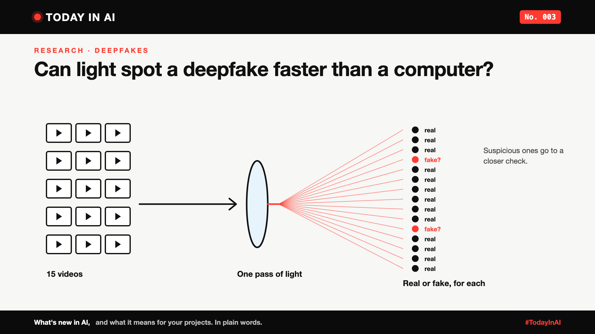

# Today in AI, No. 003: Can Light Spot a Deepfake Faster Than a Computer?



*Today in AI: what's new in AI, and what it means for you. In plain words.*

**In one line:** UCLA researchers built a system that uses light, not just computer chips, to check 15 videos at once for deepfakes, and got it right about 98% of the time in tests.

## What happened

A team at UCLA, led by Professor Aydogan Ozcan, published a study in the journal *eLight* about a new way to catch fake videos.

A small computer program first squeezes each video into a short summary. Then that summary is turned into a pattern of light, and the light does the final check, many videos at the same time. At the end, each video gets a simple score: real or fake.

In tests on a standard set of face-swap videos, it checked 15 videos in one go with about 98% accuracy. It also did well on videos made by newer AI video tools. The researchers say it uses much less energy than a similar computer-only checker.

## What it means

Think of airport security. A scanner checks bags quickly, many at a time. Anything suspicious is pulled aside for a person to look at closely.

That's the role the researchers see for this: a fast first filter for websites flooded with videos, with doubtful ones sent for a closer check. It isn't a magic "fake detector" that replaces people.

## Why it matters to you

- **Learning AI?** AI doesn't only run on normal computer chips. Light-based computing is a growing research area, and it's good to know it exists.
- **Leading a team?** Fake videos are a real risk for brands, payments and hiring interviews. Watch for detection tools, but treat them as a first filter, not a final answer.

## One thing to do this week

Next time a surprising video is shared at work, ask one question before forwarding it: "Where did this come from?"

## Words to know

- **Deepfake:** a fake video or audio made with AI, usually of a real person.
- **Accuracy:** how often a test gets the answer right. 98% still means about 2 mistakes in every 100.

## References and credits

1. Parnian Ghapandar Kashani, Shiqi Chen, Aydogan Ozcan and colleagues, "Scalable, Energy-Efficient Optical-Neural Architecture for Multiplexed Deepfake Video Detection", *eLight*, 2026. [Read it](http://dx.doi.org/10.1186/s43593-026-00143-y) (primary source)
2. ScienceDaily, news release on the UCLA study (source: Light Publishing Center), 1 October 2026. [Read it](https://sciencedaily.com/releases/2026/09/260929053534.htm)
3. Susan Curtis, "Optical Processor Focuses on Deepfake Videos", Optics & Photonics News, 5 October 2026. [Read it](https://www.optica-opn.org/Home/NewsRoom/2026/October/Optical_Processor_Focuses_on_Deepfake_Videos)
4. Previous issue: [Today in AI, No. 002: What if your chatbot answered with buttons instead of paragraphs?](https://www.linkedin.com/pulse/today-ai-002-what-your-chatbot-answered-buttons-instead-arpit-jain-snkcf/)

Credit to Professor Aydogan Ozcan's team at UCLA for the research, and to ScienceDaily and Optics & Photonics News for their coverage. Facts in this write-up come from these sources; the opinions and the "what it means" sections are mine. Cover: original illustration, no third-party logos or images.

---

**Post text (copy and paste):**

```
Can light spot a deepfake faster than a computer?

UCLA researchers built a system that uses light to check 15 videos at once for deepfakes. In tests, it was right about 98% of the time, using far less energy than a computer-only checker.

Think airport security scanner: fast first check, suspicious ones pulled aside for a closer look.

No. 003 of Today in AI.

Source: UCLA research in eLight, 2026 (full references and credits in the article).

#AI #Deepfakes #GenAI #TechNews #TodayInAI
```
