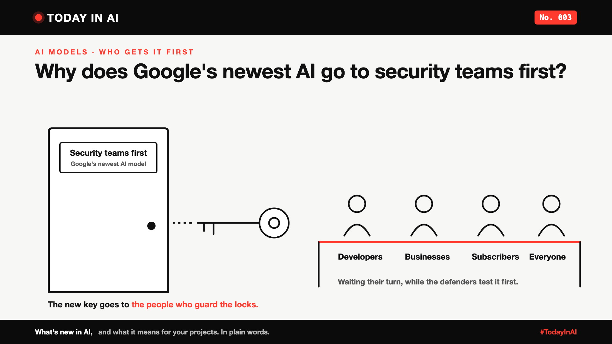

# Today in AI, No. 003: Why Does Google's Newest AI Go to Security Teams First?



*Today in AI: what's new in AI, and what it means for you. In plain words.*

**In one line:** Google has announced Gemini 4 Argon, its most powerful AI model yet, and it's going to cybersecurity experts first, everyone else later.

## What happened

On 30 September, Google announced Gemini 4 Argon, which it calls its most powerful AI model yet. It's built for writing code, research, and especially cybersecurity. Google says it can find, check and fix serious weaknesses in software on its own.

But you can't use it yet. Google is giving it first to a small group of trusted security experts at partner organisations. They'll use it to find and fix weak spots in software before attackers get anything this powerful, and their feedback will help Google tighten its safety rules. Developers, businesses and paying subscribers come next. Google hasn't said when everyone else gets it.

Google's reason, in its own words: releasing an AI this powerful "safely" needs "a phased approach".

## Quick facts, in Google's own numbers

- **Very long answers.** It can write up to about 1 million tokens (pieces of words) in one go, up from about 64,000 before. Enough to work through a whole codebase without stopping.
- **Coding.** Google says it scored 77.9% on a well-known coding test (DeepSWE), a new best. Google is using it to help move large amounts of old code to a safer language, Rust.
- **Security.** It tied for first place on a test of finding software weaknesses (CWE-bench).
- **Office work.** Google says it leads tests for finance, legal and tax tasks (Vals Index) and for automating work steps (AutomationBench, #1).
- **Long videos.** 91.7% on a test of understanding long videos (LVBench).
- **Price, when it opens up.** $2 per million tokens in, $10 per million tokens out, as an introductory price. Later, $4 in and $20 out.

These are Google's own results. Independent tests may differ.

## What it means

Imagine a locksmith invents a key that can open almost any lock. Who should get it first?

Not everyone at once. First, the people who guard the locks, so they can fix the weak ones before anyone else gets the key.

That's Google's idea: an AI that's very good at finding software weaknesses could help attackers too. So the defenders get a head start.

## Why it matters to you

- **Learning AI?** The newest AI isn't always released to everyone on day one anymore. Who gets it first is now part of the story.
- **Leading a team?** Expect the most powerful AI tools to arrive in stages, with checks. Plan your AI roadmap around what you can actually use today, not the headlines.

## One thing to do this week

Ask your security team one question: "If an AI could find weaknesses in our software in minutes, what would it find first?"

## Words to know

- **Cybersecurity:** protecting computers, software and data from attacks.
- **Phased release:** giving something new to a small group first, then to more people over time.

## References and credits

1. Koray Kavukcuoglu, Google DeepMind, "Gemini 4 Argon: our next era of frontier intelligence", Google blog, 30 September 2026. [Read it](https://blog.google/innovation-and-ai/models-and-research/gemini-models/gemini-4-argon/) (primary source)
2. Lucas Ropek, "Google releases Gemini 4 Argon, called its most powerful model yet", TechCrunch, 30 September 2026. [Read it](https://techcrunch.com/2026/09/30/google-releases-gemini-4-argon-called-its-most-powerful-model-yet/)

Credit to Google for the announcement and to TechCrunch for its coverage. Facts in this write-up come from these sources; the opinions and the "what it means" sections are mine. Cover: original illustration, no third-party logos or images.

**Not sponsored.** This write-up is not sponsored by Google or anyone else. Nobody paid for it or reviewed it before publishing.

**Earlier issues of Today in AI:**

- [No. 001: What happens when your AI agent visits someone else's website?](https://www.linkedin.com/pulse/today-ai-001-what-happens-when-your-agent-visits-someone-arpit-jain-2vqmf/)
- [No. 002: What if your chatbot answered with buttons instead of paragraphs?](https://www.linkedin.com/pulse/today-ai-002-what-your-chatbot-answered-buttons-instead-arpit-jain-snkcf/)

---

**Post text (copy and paste):**

```
Google has announced Gemini 4 Argon, its most powerful AI model yet. But it's going to security teams first.

Why? Argon is very good at finding weaknesses in software. So Google is giving it to trusted cyber defenders first. Everyone else gets it later.

Like a key that opens almost any lock: you give it first to the people who guard the locks.

Google's own numbers: up to 1 million tokens in a single answer, 77.9% on a top coding test, and joint first at finding software weaknesses.

No. 003 of Today in AI.

Source: Google announcement, 30 Sep 2026 (full references and credits in the article). Not sponsored by Google or anyone else.

#AI #Cybersecurity #GenAI #TechNews #TodayInAI
```
