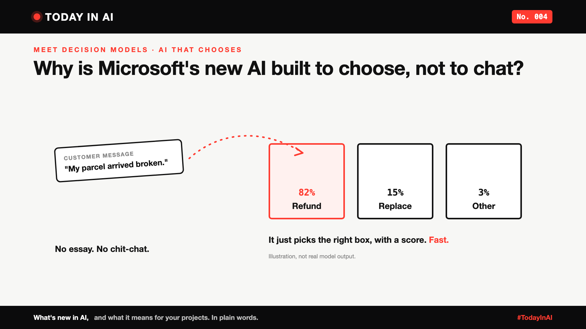

# Today in AI, No. 004: Why Is Microsoft's New AI Built to Choose, Not to Chat? | Meet Decision Models



*Today in AI: what's new in AI, and what it means for you. In plain words.*

**In one line:** Microsoft has launched Microsoft-Decision-1, a small AI model that doesn't write answers. It just picks the best option from a list, fast.

## First, what is a decision model?

Most AI tools you know, like ChatGPT, are **chat models**. You ask, they write: sentences, paragraphs, sometimes pages.

A **decision model** is different. You give it a question and a short list of options. It doesn't write anything. It scores each option and picks one.

Ask a chat model "Which team should handle this complaint?" and you may get a polite paragraph. Ask a decision model, and you get "Delivery team: 90%". That's it.

Because it skips the writing, it's much faster and much cheaper. And a new wave of these models has just arrived.

## What happened

On 9 October, Microsoft introduced Microsoft-Decision-1. Satya Nadella, Microsoft's CEO, called it "our new model for fast decision-making."

You give it a question and a fixed list of options. It gives back a score for each option, like "Refund: 82%, Replace: 15%, Other: 3%". No essay, no chat.

Microsoft is already using it inside the company, for things like sorting incidents, checking quality and helping with scientific work. It's available now in Microsoft Foundry, Microsoft's platform for building AI apps, and through OpenRouter.

## Quick facts, in Microsoft's own numbers

- **Small and fast.** It's built on an open model from Alibaba (Qwen3.5-9B), trained further by Microsoft for decisions only.
- **Accurate.** Microsoft says it was the most accurate model across 36 tests with about 150,000 questions.
- **Speed.** About 35 times faster than GPT-6 Sol, OpenAI's model, on Microsoft's tests.
- **Real example.** Xbox used it to sort more than 10,000 pieces of player feedback, with similar quality, over 14 times faster and about 200 times cheaper.
- **Price.** $0.042 per million tokens in. Nothing for the answer, because the answer is just a score.

These are Microsoft's own results. Independent tests may differ.

## What it means

Think of a post office. One worker writes letters. Another just reads the address and drops each letter into the right slot, hundreds an hour.

Most AI so far has been the letter writer. This is the sorter. Many business jobs are sorting jobs: which team should handle this ticket, is this review positive or negative, should this payment be checked.

Microsoft isn't alone. OpenAI, Cloudflare and a startup called Jev have released similar "decision" tools in the last few weeks.

## Why it matters to you

- **Learning AI?** Not every AI job needs a big chatbot. Picking the right-sized tool is a real skill.
- **Leading a team?** Look for the sorting jobs in your company. A small, fast model can do them for a fraction of the cost.

## One thing to do this week

List three decisions your team makes again and again by picking from a short list. Those are the first places a decision model could help.

## Words to know

- **Decision model:** an AI that picks from fixed options and scores them, instead of writing text.
- **Token:** a small piece of text. AI tools are often priced per million tokens.

## References and credits

1. Achint Srivastava, Office of the CTO, Microsoft, "Introducing Microsoft-Decision-1, our model for fast decision-making", Microsoft Command Line, 9 October 2026. [Read it](https://commandline.microsoft.com/microsoft-decision-1-model-foundry/) (primary source, shared by Satya Nadella)
2. Satya Nadella, LinkedIn post announcing Microsoft-Decision-1, October 2026.
3. Microsoft, "Introducing Microsoft-Decision-1 in Microsoft Foundry for decision and classification workloads", Microsoft Community Hub, Azure AI Foundry blog, October 2026. [Read it](https://techcommunity.microsoft.com/blog/azure-ai-foundry-blog/introducing-microsoft-decision-1-in-microsoft-foundry-for-decision-and-classific/4562742)
4. Matthias Bastian, "Microsoft's Decision-1 model enters the fast-growing AI decision model race", The Decoder, 10 October 2026. [Read it](https://the-decoder.com/microsofts-decision-1-model-enters-the-fast-growing-ai-decision-model-race/)

Credit to Achint Srivastava and the Microsoft team for the announcement, to Satya Nadella for sharing it, and to The Decoder for its coverage. Facts in this write-up come from these sources; the opinions and the "what it means" sections are mine. Cover: original illustration, no third-party logos or images.

**Not sponsored.** This write-up is not sponsored by Microsoft or anyone else. Nobody paid for it or reviewed it before publishing.

**Earlier issues of Today in AI:**

- [No. 001: What happens when your AI agent visits someone else's website?](https://www.linkedin.com/pulse/today-ai-001-what-happens-when-your-agent-visits-someone-arpit-jain-2vqmf/)
- [No. 002: What if your chatbot answered with buttons instead of paragraphs?](https://www.linkedin.com/pulse/today-ai-002-what-your-chatbot-answered-buttons-instead-arpit-jain-snkcf/)
- [No. 003: Why does Google's newest AI go to security teams first?](https://www.linkedin.com/pulse/today-ai-003-why-does-googles-newest-go-security-teams-arpit-jain-kpo3f)

**Tags:** #AI #Microsoft #GenAI #TechNews #TodayInAI

---

**People and pages to @mention** (type @ and pick from LinkedIn's list, in the article and the post): Microsoft, Satya Nadella, Achint Srivastava, The Decoder

**Post text (copy and paste):**

```
Meet decision models: AI that chooses instead of chatting.

A chat model writes you a paragraph. A decision model looks at a short list of options, scores each one, and picks. No essay. Just a fast decision.

The latest: Microsoft has launched Microsoft-Decision-1.

Like a post office sorter: it doesn't write letters, it drops each one into the right slot.

Microsoft's own numbers: about 35 times faster than GPT-6 Sol on its tests, and Xbox sorted 10,000+ pieces of player feedback about 200 times cheaper.

No. 004 of Today in AI.

Source: Microsoft announcement, Oct 2026 (full references and credits in the article). Not sponsored by Microsoft or anyone else.

#AI #Microsoft #GenAI #TechNews #TodayInAI
```
