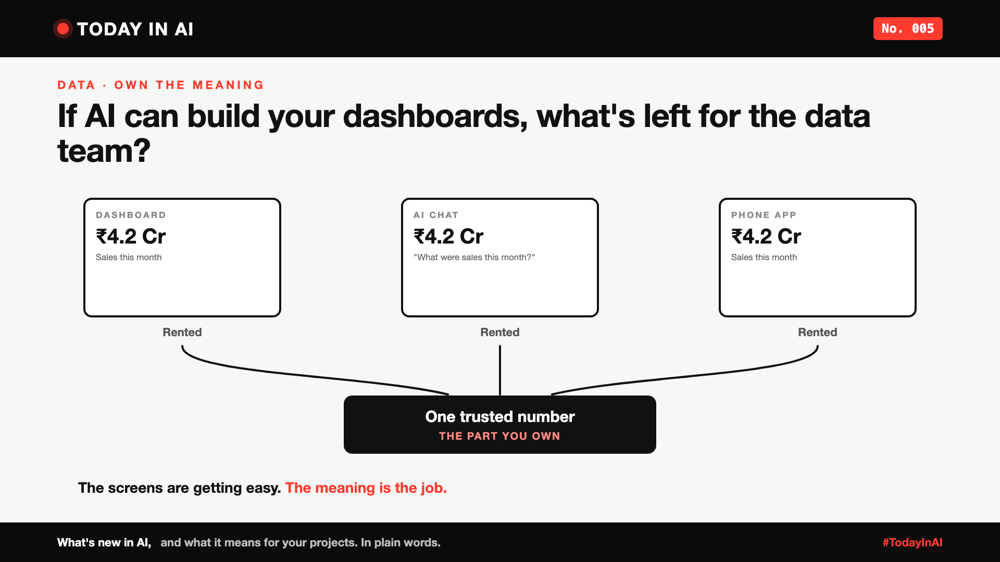

# Today in AI, No. 005: If AI Can Build Your Dashboards, What's Left for the Data Team? | Own the Meaning



*Today in AI: what's new in AI, and what it means for you. In plain words.*

**In one line:** Anthropic's Claude can now build live dashboards from company data. As screens get easy to make, the real job is making sure every screen shows the same, trusted number.

## What happened

On 8 October, Anthropic launched Claude Dashboards in beta for paid plans. You ask a question in plain words, and Claude builds a live dashboard from your company's data, connecting to tools like Snowflake, BigQuery or Databricks. It keeps the charts up to date as the data changes. Each chart shows when it was last refreshed, and you can see the query behind any number.

This follows a pattern. In [No. 002](https://www.linkedin.com/pulse/today-ai-002-what-your-chatbot-answered-buttons-instead-arpit-jain-snkcf/), ChatGPT started answering with charts and buttons instead of paragraphs. Now Claude builds full dashboards. The screen, the part people see, is getting easy and cheap to make.

## A data leader's take

A data leader at EDB, [NAME], wrote about setting this up for their company. Their summary is the best one-liner I've seen on it:

> "Rent the model, rent the surface, own the meaning."

Their point: the dashboard is the last small step. Their team's real job is making sure that whatever screen people use, Claude, another AI tool or an app, it returns the same trusted answer from the same trusted data.

## What it means

Think of a cricket match. The score shows on the TV, on your phone app and on the big screen in the stadium. You don't care which screen you look at. You care that all three show the same score.

The screens can come from anyone. The scorer, who decides what the true score is, is the one you can't replace.

For companies, the "scorer" is clean data and clear definitions: what exactly counts as "a sale", "an active customer" or "this month". If those aren't agreed and owned, three AI tools will happily give you three different numbers.

## Why it matters to you

- **Learning AI?** Making charts is becoming automatic. Understanding data, and defining it clearly, is the skill that stays valuable.
- **Leading a team?** Before rolling out AI dashboards, ask: "Do we agree on what our key numbers mean, and where they come from?" If not, start there.

## One thing to do this week

Pick one number your company talks about every week, like sales or active users. Ask two teams how they calculate it. If the answers differ, you've found your first job.

## Words to know

- **Dashboard:** a screen of charts and numbers that shows how something is doing.
- **Governed data:** data that's checked, agreed and owned, so everyone uses the same version.

## References and credits

1. Anthropic, "Build live dashboards and animate explainers with Claude", claude.com, 8 October 2026. [Read it](https://claude.com/resources/articles/dashboards-and-motion) (primary source)
2. TestingCatalog, "Claude launches Dashboards and Motion in beta", 8 October 2026. [Read it](https://www.testingcatalog.com/claude-launches-dashboards-and-motion-in-beta/)
3. [NAME], [ROLE] at EDB, LinkedIn post on setting up Claude Dashboards at EDB, October 2026. [LINK]

Credit to Anthropic for the announcement, to TestingCatalog for its coverage, and to [NAME] at EDB for sharing a real setup and the line "Rent the model, rent the surface, own the meaning." Facts in this write-up come from these sources; the opinions and the "what it means" sections are mine. Cover: original illustration, no third-party logos or images.

**Not sponsored.** This write-up is not sponsored by Anthropic, EDB or anyone else. Nobody paid for it or reviewed it before publishing.

**Earlier issues of Today in AI:**

- [No. 001: What happens when your AI agent visits someone else's website?](https://www.linkedin.com/pulse/today-ai-001-what-happens-when-your-agent-visits-someone-arpit-jain-2vqmf/)
- [No. 002: What if your chatbot answered with buttons instead of paragraphs?](https://www.linkedin.com/pulse/today-ai-002-what-your-chatbot-answered-buttons-instead-arpit-jain-snkcf/)
- [No. 003: Why does Google's newest AI go to security teams first?](https://www.linkedin.com/pulse/today-ai-003-why-does-googles-newest-go-security-teams-arpit-jain-kpo3f)
- No. 004: Why is Microsoft's new AI built to choose, not to chat? (add the link once published)

**Tags:** #AI #Data #GenAI #TechNews #TodayInAI

---

**People and pages to @mention** (type @ and pick from LinkedIn's list, in the article and the post): Anthropic, EDB, [NAME]

**Post text (copy and paste):**

```
If AI can build your dashboards, what's left for the data team?

Anthropic's Claude can now build live dashboards from company data. In No. 002, ChatGPT started answering with charts. The screen is getting easy.

A data leader at EDB put it best: "Rent the model, rent the surface, own the meaning."

Like a cricket score on TV, phone and stadium screen: nobody cares which screen. Everyone cares that the score is the same.

No. 005 of Today in AI.

Source: Anthropic announcement, 8 Oct 2026 (full references and credits in the article). Not sponsored by Anthropic, EDB or anyone else.

#AI #Data #GenAI #TechNews #TodayInAI
```
