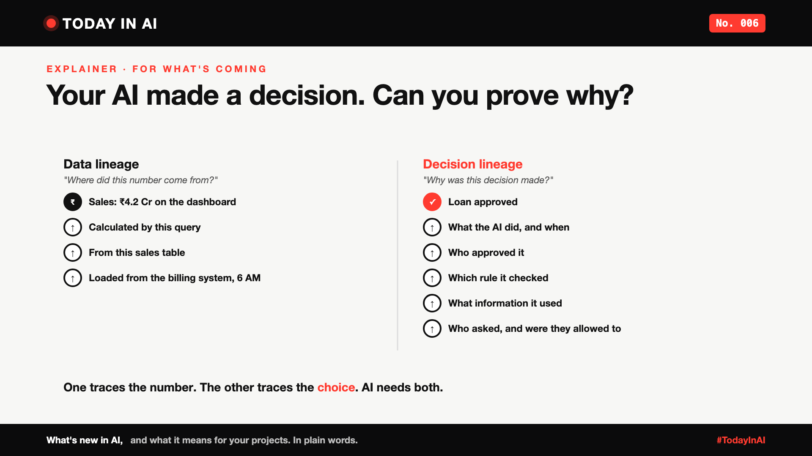

# Today in AI, No. 006: Your AI Made a Decision. Can You Prove Why? | Data Lineage vs Decision Lineage



*Today in AI: what's new in AI, and what it means for you. In plain words.*

**In one line:** Companies have learned to trace where a number came from. As AI starts making decisions, they'll also need to trace why a decision was made.

*This one isn't breaking news. It's an explainer on an idea that's about to matter a lot, building on the last two issues.*

## Why now

In the last two issues, we saw two sides of the same shift:

- **Claude Dashboards** shows the query behind every number on a chart. You can trace where the number came from.
- **Microsoft-Decision-1**, and other new decision models, pick an option and give a score. They don't explain how they chose.

AI is moving from showing numbers to making choices. And a choice needs a different kind of trail.

## Two kinds of trail

**Data lineage** answers: "Where did this number come from?"

Sales on the dashboard: ₹4.2 Cr. It was calculated by this query, from this sales table, which was loaded from the billing system at 6 AM. Follow the trail back, and you can check every step.

**Decision lineage** answers: "Why was this decision made?"

A loan was approved. To explain it, you need the whole journey, step by step:

1. **The request.** Who asked, and were they allowed to?
2. **The information.** What did the AI look at to decide?
3. **The rule.** Which policy did it check, and did it pass?
4. **The approval.** Did a person sign off, and who?
5. **The action.** What exactly did the AI do, and when?
6. **The result.** What happened in the end?

Keep all six together for every decision, and you have a **decision record**: one place that explains the decision to a customer, an auditor or a judge, months later.

Data lineage tracks how data flows. Decision lineage tracks why an action was allowed.

## What it means

Think of a cricket umpire's decision review. The replay doesn't just show the final "OUT". It shows the ball's path, where it hit, and the rule that applied. That's why people accept the decision, even when they don't like it.

AI decisions will need the same replay. "The model said so" won't be enough.

## Why it matters to you

- **Learning AI?** Building a model that decides is the easy part. Recording why it decided is the skill companies will need, and few people have it yet.
- **Leading a team?** Rules are already moving this way. The EU's AI Act, for example, requires high-risk AI systems to keep automatic logs of what they do. If your AI makes decisions about people, plan the trail now, not after the first complaint.

## One thing to do this week

Pick one decision an AI makes, or helps make, in your company. Ask: "If a customer asked us why, could we show them?"

## Words to know

- **Data lineage:** the trail showing where a number came from and how it was calculated.
- **Decision lineage:** the trail showing how a decision was made: the inputs, the model, the rules and the people involved.
- **Decision record:** everything about one decision kept together: who asked, what the AI used, which rule, who approved, what happened.
- **Audit trail:** a record that lets someone check, later, what happened and why.

## References and credits

1. Regulation (EU) 2024/1689 (the EU AI Act), Article 12, record-keeping for high-risk AI systems. [Read it](https://eur-lex.europa.eu/eli/reg/2024/1689/oj) (primary source)
2. OpenLineage, an open standard for collecting data lineage, LF AI & Data Foundation. [Read it](https://openlineage.io)
3. Anthropic, "Build live dashboards and animate explainers with Claude", claude.com, 8 October 2026. [Read it](https://claude.com/resources/articles/dashboards-and-motion)
4. Achint Srivastava, Microsoft, "Introducing Microsoft-Decision-1, our model for fast decision-making", Microsoft Command Line, 9 October 2026. [Read it](https://commandline.microsoft.com/microsoft-decision-1-model-foundry/)

Credit to the teams behind these sources. Facts in this write-up come from these sources; the opinions, examples and the "what it means" sections are mine. The loan and sales examples are illustrations. Cover: original illustration, no third-party logos or images.

**Not sponsored.** This write-up is not sponsored by anyone. Nobody paid for it or reviewed it before publishing.

**Earlier issues of Today in AI:**

- [No. 001: What happens when your AI agent visits someone else's website?](https://www.linkedin.com/pulse/today-ai-001-what-happens-when-your-agent-visits-someone-arpit-jain-2vqmf/)
- [No. 002: What if your chatbot answered with buttons instead of paragraphs?](https://www.linkedin.com/pulse/today-ai-002-what-your-chatbot-answered-buttons-instead-arpit-jain-snkcf/)
- [No. 003: Why does Google's newest AI go to security teams first?](https://www.linkedin.com/pulse/today-ai-003-why-does-googles-newest-go-security-teams-arpit-jain-kpo3f)
- No. 004: Why is Microsoft's new AI built to choose, not to chat? (add the link once published)
- No. 005: If AI can build your dashboards, what's left for the data team? (add the link once published)

**Tags:** #AI #DataGovernance #ResponsibleAI #TechNews #TodayInAI

---

**People and pages to @mention** (type @ and pick from LinkedIn's list, in the article and the post): OpenLineage

**Post text (copy and paste):**

```
Your AI made a decision. Can you prove why?

Companies have learned to trace where a number came from. That's data lineage.

As AI starts making decisions, they'll also need to trace why a decision was made: who asked, what the AI used, which rule it checked, who approved, and what it did. That's decision lineage.

Like a cricket decision review: the replay shows the ball's path and the rule, not just "OUT". AI decisions will need the same replay.

No. 006 of Today in AI, an explainer for what's coming.

Sources: EU AI Act, OpenLineage, and the announcements in No. 004 and No. 005 (full references and credits in the article). Not sponsored by anyone.

#AI #DataGovernance #ResponsibleAI #TechNews #TodayInAI
```
