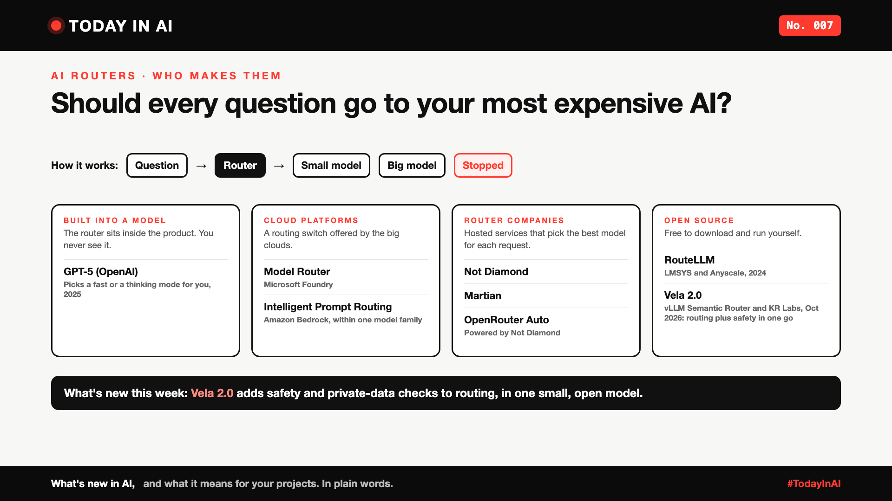

# Today in AI, No. 007: Should Every Question Go to Your Most Expensive AI? | Meet AI Routers



*Today in AI: what's new in AI, and what it means for you. In plain words.*

**In one line:** A new open model called Vela 2.0 sits in front of your other AI models, sends each question to the right one, and stops unsafe ones at the door.

## What happened

In early October, the open-source vLLM Semantic Router project and KR Labs released Vela 2.0, a family of four small, free-to-use models built for one job: **routing**.

A router doesn't answer questions. It reads each one first and decides:

- Is this simple? Send it to a small, cheap model.
- Is this hard? Send it to a big, smart (and expensive) model.
- Is this unsafe, or does it contain private data? Stop it, or handle it carefully.

The news: Vela 2.0 does all these checks in one go. Before, teams often ran nine separate checkers one after another. Now one model can do them in a single request. The smallest version is light enough to run on a normal computer, without special chips.


## What it means

Think of the reception desk at a hospital. The receptionist doesn't treat anyone. They just send you to the right place: a nurse for a small cut, a specialist for something serious, and security if something's wrong.

Without that desk, every patient would queue for the most expensive specialist. That's what many AI apps do today: every question, even "summarise this email", goes to the biggest model.

A router is that reception desk for AI.

## Who else makes AI routers?

Vela 2.0 isn't the first. Routers already come in four flavours:

- **Built into a model.** OpenAI's GPT-5 (2025) has a router inside it that picks a quick mode or a deeper "thinking" mode for each question. You never see it.
- **Cloud platforms.** Microsoft Foundry has a Model Router, and Amazon Bedrock has Intelligent Prompt Routing (which picks between models from the same family).
- **Router companies.** Not Diamond and Martian sell routing as a service. OpenRouter's "Auto" option is powered by Not Diamond.
- **Open source.** RouteLLM, from the LMSYS team with Anyscale (2024), and now Vela 2.0.

What makes Vela 2.0 different: it adds safety and private-data checks to the routing decision, in one small, open model.

## Why it matters to you

- **Learning AI?** Real AI products are rarely one model. They're a team of models, with a router deciding who does what.
- **Leading a team?** If every request goes to your most expensive model, you're overpaying. A router can cut the bill and catch unsafe requests before they cost anything.

The catch: a router that does everything at once is slightly less accurate than a specialist doing one check. Test it on your own questions first.

## One thing to do this week

Look at 20 real questions your AI handles. How many really needed the most expensive model?

## Words to know

- **AI router:** a small model that decides which AI should handle each request.
- **Open model:** an AI model anyone can download and use, under a free licence.

## References and credits

1. KR Labs and vLLM Semantic Router, "Vela 2.0: Towards Open Foundation Routing Models", 2026. [Read it](https://vllm-sr.ai/blog/vela-2-0-open-foundation-routing-models) (primary source)
2. Vela 2.0 model card (9B), Hugging Face. [Read it](https://huggingface.co/vllm-sr/Vela-2.0-9B)
3. "vLLM's Vela 2.0 Collapses Nine AI Safety Checks Into One Open Model", AlphaSignal, 7 October 2026. [Read it](https://alphasignal.ai/news/vllm-s-vela-2-0-collapses-nine-ai-safety-checks-into-one-open-model)
4. OpenAI, "Introducing GPT-5", 7 August 2025. [Read it](https://openai.com/index/introducing-gpt-5/)
5. Microsoft, "Model router for Microsoft Foundry", Microsoft Learn. [Read it](https://learn.microsoft.com/en-us/azure/foundry/openai/concepts/model-router)
6. AWS, "Amazon Bedrock Intelligent Prompt Routing is now generally available", April 2025. [Read it](https://aws.amazon.com/about-aws/whats-new/2025/04/amazon-bedrock-intelligent-prompt-routing-generally-available)
7. Isaac Ong and colleagues (LMSYS, UC Berkeley, Anyscale), "RouteLLM: Learning to Route LLMs with Preference Data", 2024. [Read it](https://arxiv.org/abs/2406.18665)
8. Not Diamond. [Read it](https://www.notdiamond.ai), Martian. [Read it](https://withmartian.com), and OpenRouter's Auto Router. [Read it](https://openrouter.ai/docs)
9. Previous issue: Today in AI, No. 004: Why is Microsoft's new AI built to choose, not to chat? [LINK-004]

Credit to the vLLM Semantic Router team and KR Labs for releasing Vela 2.0 openly, to the teams behind the other routers named here, and to AlphaSignal for its coverage. Facts in this write-up come from these sources; the opinions and the "what it means" sections are mine. Cover and diagram: original illustrations, no third-party logos or images.

**Not sponsored.** This write-up is not sponsored by anyone. Nobody paid for it or reviewed it before publishing.

**Earlier issues of Today in AI:**

- [No. 001: What happens when your AI agent visits someone else's website?](https://www.linkedin.com/pulse/today-ai-001-what-happens-when-your-agent-visits-someone-arpit-jain-2vqmf/)
- [No. 002: What if your chatbot answered with buttons instead of paragraphs?](https://www.linkedin.com/pulse/today-ai-002-what-your-chatbot-answered-buttons-instead-arpit-jain-snkcf/)
- [No. 003: Why does Google's newest AI go to security teams first?](https://www.linkedin.com/pulse/today-ai-003-why-does-googles-newest-go-security-teams-arpit-jain-kpo3f)
- No. 004: Why is Microsoft's new AI built to choose, not to chat? (add the link once published)
- No. 005: If AI can build your dashboards, what's left for the data team? (add the link once published)
- No. 006: Your AI made a decision. Can you prove why? (add the link once published)

**Tags:** #AI #OpenSource #GenAI #TechNews #TodayInAI

---

**People and pages to @mention** (type @ and pick from LinkedIn's list, in the article and the post): vLLM, KR Labs, Not Diamond, Martian, OpenRouter

**Post text (copy and paste):**

```
Should every question go to your most expensive AI?

Most AI apps send everything, even "summarise this email", to their biggest model. That's like every hospital patient queuing for the top specialist.

AI routers work like the reception desk: they read each question, send simple ones to a small cheap model and hard ones to a big model.

They're everywhere now: inside GPT-5, in Microsoft Foundry and Amazon Bedrock, from companies like Not Diamond and Martian, and in open source like RouteLLM.

The newest, Vela 2.0, also stops unsafe questions and private data at the door. In one small, open model.

Not every question needs the most expensive AI. A router decides.

No. 007 of Today in AI.

Source: Vela 2.0 by vLLM Semantic Router and KR Labs (full references and credits in the article). Not sponsored by anyone.

#AI #OpenSource #GenAI #TechNews #TodayInAI
```
