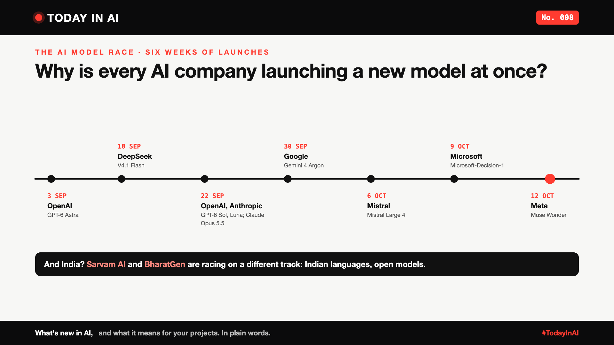
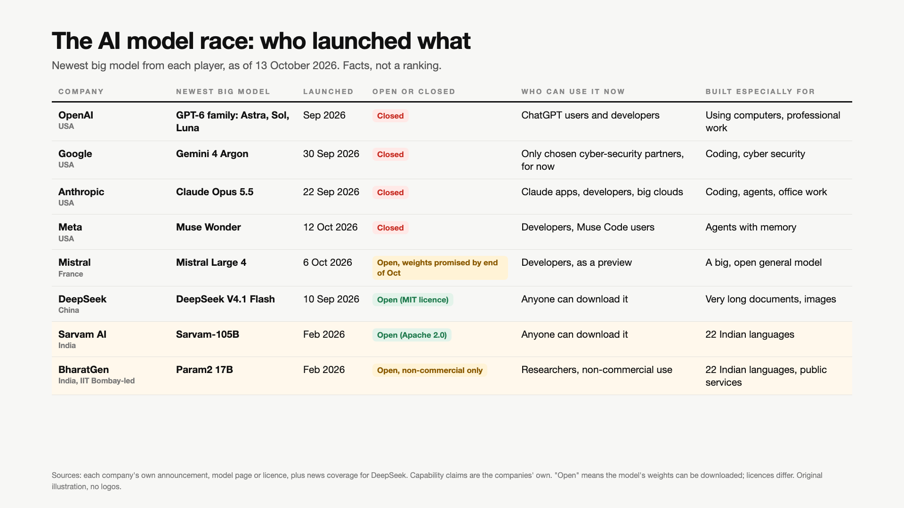

# Today in AI, No. 008: Why Is Every AI Company Launching a New Model at Once? | The AI Model Race



*Today in AI: what's new in AI, and what it means for you. In plain words.*

**In one line:** In just six weeks, seven companies launched big new AI models. Here's who launched what, in simple facts, and where India fits in.

## What happened

Between 3 September and 12 October 2026, almost every big AI company shipped something new:

- **3 September:** OpenAI started the GPT-6 family with Astra, then added Sol and Luna on 22 September.
- **10 September:** DeepSeek, from China, released V4.1 Flash, free to download.
- **22 September:** Anthropic launched Claude Opus 5.5.
- **30 September:** Google introduced Gemini 4 Argon, first only for chosen cyber-security partners.
- **6 October:** Mistral, from France, opened a preview of Mistral Large 4.
- **9 October:** Microsoft launched Microsoft-Decision-1 (we covered it in No. 004).
- **12 October:** Meta launched Muse Wonder.

## Who launched what



| Company | Newest big model | Launched | Open or closed | Who can use it now | Built especially for |
|---|---|---|---|---|---|
| OpenAI (USA) | GPT-6 family: Astra, Sol, Luna | Sep 2026 | Closed | ChatGPT users and developers | Using computers, professional work |
| Google (USA) | Gemini 4 Argon | 30 Sep 2026 | Closed | Only chosen cyber-security partners, for now | Coding, cyber security |
| Anthropic (USA) | Claude Opus 5.5 | 22 Sep 2026 | Closed | Claude apps, developers, big clouds | Coding, agents, office work |
| Meta (USA) | Muse Wonder | 12 Oct 2026 | Closed | Developers, Muse Code users | Agents with memory |
| Mistral (France) | Mistral Large 4 | 6 Oct 2026 | Open, weights promised by end of October | Developers, as a preview | A big, open general model |
| DeepSeek (China) | DeepSeek V4.1 Flash | 10 Sep 2026 | Open (MIT licence) | Anyone can download it | Very long documents, images |
| Sarvam AI (India) | Sarvam-105B | Feb 2026 | Open (Apache 2.0) | Anyone can download it | 22 Indian languages |
| BharatGen (India) | Param2 17B | Feb 2026 | Open, non-commercial only | Researchers, non-commercial use | 22 Indian languages, public services |

Every company says its model is the best at something. This table doesn't rank them. It only shows the facts you need to choose.

## And India?

India is racing on a different track. Not the biggest model, but the right one for India.

- **Sarvam AI** launched Sarvam-105B and a smaller 30B model in February, at the India AI Impact Summit. Both were trained from scratch, on government-backed computing under the IndiaAI Mission, and anyone can download them.
- **BharatGen**, a consortium led by IIT Bombay, launched Param2, a 17-billion-parameter model for 22 Indian languages, aimed at areas like governance, education, health and farming.
- The IndiaAI Mission is funding 12 organisations to build Indian models, according to a reply in Parliament.

One more twist: Meta, which used to give its Llama models away for free, has made its newest models closed. Meanwhile, Mistral, DeepSeek and India's labs are betting on open.

## What it means

Think of the Auto Expo. Every carmaker unveils a shiny new model in the same few days. But the "best car" depends on you: city or highway, family of five or solo, petrol or electric.

AI models are the same. A model that's brilliant at coding may be the wrong choice for a Hindi or Tamil customer helpline.

## Why it matters to you

- **Learning AI?** Don't chase every launch. Learn how to compare models on the things that matter: open or closed, languages, price, and where your data goes.
- **Leading a team?** The race means prices keep falling and choices keep growing. Don't lock your product to one model. Build so you can switch.

## One thing to do this week

Write down the three things your AI project needs most, for example, Indian languages, low cost, data staying in India. Then look at the table again. The "winner" may surprise you.

## Words to know

- **AI model:** the "brain" behind an AI tool like ChatGPT or Gemini.
- **Open model:** you can download the model and run it yourself. Licences decide what you're allowed to do with it.
- **Closed model:** you can only use it through the company's app or service.
- **Parameters:** the numbers a model learns during training. More parameters usually means a bigger, costlier model, not always a better one.

## References and credits

1. OpenAI, "GPT-6 Astra: A new generation of intelligence", September 2026, with updates on GPT-6 Sol and Luna (22 September). [Read it](https://openai.com/index/gpt-6-astra/) (primary source)
2. Google, "Gemini 4 Argon", The Keyword, 30 September 2026. [Read it](https://blog.google/innovation-and-ai/models-and-research/gemini-models/gemini-4-argon/) (primary source)
3. Anthropic, "Claude Opus 5.5", 22 September 2026. [Read it](https://www.anthropic.com/news/claude-opus-5-5) (primary source)
4. Meta, "Introducing Muse Wonder", 12 October 2026. [Read it](https://about.fb.com/news/2026/10/introducing-muse-wonder-models/) (primary source)
5. Mistral AI, "Introducing Mistral Large 4", 6 October 2026. [Read it](https://mistral.ai/news) (primary source)
6. "DeepSeek V4.1 Flash launches with lower prices and native vision", ProPakistani, 11 September 2026. [Read it](https://propakistani.pk/2026/09/11/deepseek-v4-1-flash-launches-with-lower-prices-and-native-vision/)
7. Sarvam AI, Sarvam-105B model card, Hugging Face (Apache 2.0). [Read it](https://huggingface.co/sarvamai/sarvam-105b) (primary source)
8. "Indian AI lab Sarvam's new models are a major bet on the viability of open source AI", TechCrunch, 18 February 2026. [Read it](https://techcrunch.com/2026/02/18/indian-ai-lab-sarvams-new-models-are-a-major-bet-on-the-viability-of-open-source-ai/)
9. BharatGen, Param2 17B on AIKosh, IndiaAI. [Read it](https://aikosh.indiaai.gov.in/home/models/details/param2_17b_a2_4b_thinking.html) (primary source)
10. "Govt is funding 12 AI orgs to develop indigenous models", MediaNama, April 2026. [Read it](https://www.medianama.com/2026/04/223-centre-funds-12-ai-projects-sovereign-models-bharatgen-4x-next-highest-allocation-rs-1000-crore/)
11. Previous issue: [Today in AI, No. 004: Why is Microsoft's new AI built to choose, not to chat?](https://www.linkedin.com/pulse/today-ai-004-why-microsofts-new-built-choose-chat-meet-arpit-jain-ypmkf/)

Credit to the teams at all the companies and labs named here, and to TechCrunch, MediaNama and ProPakistani for their coverage. Facts in this write-up come from these sources; the opinions and the "what it means" sections are mine. Capability claims are each company's own; this write-up doesn't rank models. Cover and table: original illustrations, no third-party logos or images.

**Not sponsored.** This write-up is not sponsored by any of the companies named, or anyone else. Nobody paid for it or reviewed it before publishing.

**Earlier issues of Today in AI:**

- [No. 001: What happens when your AI agent visits someone else's website?](https://www.linkedin.com/pulse/today-ai-001-what-happens-when-your-agent-visits-someone-arpit-jain-2vqmf/)
- [No. 002: What if your chatbot answered with buttons instead of paragraphs?](https://www.linkedin.com/pulse/today-ai-002-what-your-chatbot-answered-buttons-instead-arpit-jain-snkcf/)
- [No. 003: Why does Google's newest AI go to security teams first?](https://www.linkedin.com/pulse/today-ai-003-why-does-googles-newest-go-security-teams-arpit-jain-kpo3f)
- [No. 004: Why is Microsoft's new AI built to choose, not to chat?](https://www.linkedin.com/pulse/today-ai-004-why-microsofts-new-built-choose-chat-meet-arpit-jain-ypmkf/)
- [No. 005: If AI can build your dashboards, what's left for the data team?](https://www.linkedin.com/pulse/today-ai-005-can-build-your-dashboards-whats-left-data-arpit-jain-oukuf)
- No. 006: Your AI made a decision. Can you prove why? (add the link once published)
- No. 007: Should every question go to your most expensive AI? (add the link once published)

**Tags:** #AI #GenAI #IndiaAI #TechNews #TodayInAI

---

**People and pages to @mention** (type @ and pick from LinkedIn's list, in the article and the post): OpenAI, Google DeepMind, Anthropic, Meta, Mistral AI, DeepSeek, Sarvam AI, BharatGen, IndiaAI

**Post text (copy and paste):**

```
Why is every AI company launching a new model at once?

In just six weeks: OpenAI, DeepSeek, Anthropic, Google, Mistral, Microsoft and Meta all launched big new AI models.

And India? Sarvam AI and BharatGen are racing on a different track: models built for 22 Indian languages, open for anyone to download.

Like the Auto Expo: every carmaker shows a shiny new model the same week. But the best car depends on your road.

The same goes for AI. The best model is the one that fits your users, your languages and your budget.

No. 008 of Today in AI, with a simple table of who launched what. Facts, not a ranking.

Sources: each company's own announcements (full references and credits in the article). Not sponsored by anyone.

#AI #GenAI #IndiaAI #TechNews #TodayInAI
```
