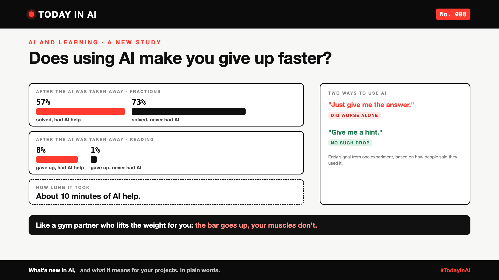

# Today in AI, No. 008: Does Using AI Make You Give Up Faster? | AI and Learning



*Today in AI: what's new in AI, and what it means for you. In plain words.*

**In one line:** A new study found that people who used AI for just 10 minutes did worse, and gave up more often, once the AI was taken away.

## What happened

Researchers from UC Berkeley, Carnegie Mellon, MIT, Oxford and UCLA ran three experiments with 1,222 people in the US. Everyone solved problems: fractions in two experiments, reading comprehension in the third.

Some people had an AI helper in a side panel, ready to give the answer whenever asked. Others had no AI. After about 10 minutes, the AI was taken away without warning, and everyone carried on alone.

With the AI, people did better. Without it, they did worse than people who never had it.

## Quick facts, from the study

- **Fractions:** after the AI was removed, people who'd had it solved 57% of problems. People who never had it solved 73%.
- **Reading:** 8% of people who'd had AI help gave up on problems, against 1% of those who never had it.
- **The twist:** people who said they used the AI for **hints** didn't show the same drop. People who asked for **answers** did. (An early signal, based on what people reported, not proof.)

## What it means

Think of a gym partner who lifts the weight for you. The bar goes up. Your muscles don't.

The researchers' explanation: AI trains us to expect instant answers. So when a problem gets hard and the AI isn't there, we're out of practice at sticking with it. And sticking with hard problems, they note, is one of the strongest signs of long-term learning.

The good news is in the twist. AI that gives hints, like a good teacher, may help without the cost.

## Why it matters to you

- **Learning AI, or learning anything?** Ask AI for a hint before you ask for the answer. Struggle for a few minutes first. That struggle is the learning.
- **Leading a team?** If your team uses AI all day, plan for the day it's down, or wrong. Do people still know how to think it through? And when you buy AI tools for learning or training, pick ones that coach, not just answer.

## The fine print

This was a short online experiment. It doesn't show what happens after months of daily use, or whether the effect lasts. The researchers say so themselves.

## One thing to do this week

Next time you're stuck, set a three-minute timer before opening an AI tool. Then ask it for a hint, not the answer.

## Words to know

- **Persistence:** sticking with a hard problem instead of giving up.
- **Scaffolding:** help that supports you while you learn, then steps back, like training wheels on a bicycle.

## References and credits

1. Grace Liu (Carnegie Mellon University), Brian Christian (UC Berkeley), Tsvetomira Dumbalska (University of Oxford), Michiel A. Bakker (MIT) and Rachit Dubey (UCLA), "AI Assistance Reduces Persistence and Hurts Independent Performance", arXiv, April 2026, revised 3 October 2026. [Read it](https://arxiv.org/abs/2604.04721) (primary source)

Credit to the researchers for a careful study, and for being clear about its limits. Facts and figures in this write-up come from the paper; the opinions and the "what it means" sections are mine. Cover: original illustration, no third-party logos or images.

**Not sponsored.** This write-up is not sponsored by anyone. Nobody paid for it or reviewed it before publishing.

**Earlier issues of Today in AI:**

- [No. 001: What happens when your AI agent visits someone else's website?](https://www.linkedin.com/pulse/today-ai-001-what-happens-when-your-agent-visits-someone-arpit-jain-2vqmf/)
- [No. 002: What if your chatbot answered with buttons instead of paragraphs?](https://www.linkedin.com/pulse/today-ai-002-what-your-chatbot-answered-buttons-instead-arpit-jain-snkcf/)
- [No. 003: Why does Google's newest AI go to security teams first?](https://www.linkedin.com/pulse/today-ai-003-why-does-googles-newest-go-security-teams-arpit-jain-kpo3f)
- [No. 004: Why is Microsoft's new AI built to choose, not to chat?](https://www.linkedin.com/pulse/today-ai-004-why-microsofts-new-built-choose-chat-meet-arpit-jain-ypmkf/)
- [No. 005: If AI can build your dashboards, what's left for the data team?](https://www.linkedin.com/pulse/today-ai-005-can-build-your-dashboards-whats-left-data-arpit-jain-oukuf)
- [No. 006: Your AI made a decision. Can you prove why?](https://www.linkedin.com/pulse/today-ai-006-your-made-decision-can-you-prove-why-data-arpit-jain-vjenf)
- [No. 007: Should every question go to your most expensive AI?](https://www.linkedin.com/pulse/today-ai-007-should-every-question-go-your-most-expensive-arpit-jain-xjexf)

**Tags:** #AI #Learning #FutureOfWork #EdTech #TodayInAI

---

**People and pages to @mention** (type @ and pick from LinkedIn's list, in the article and the post): UC Berkeley, Carnegie Mellon University, MIT, University of Oxford, UCLA, Brian Christian

**Post text (copy and paste):**

```
Does using AI make you give up faster?

A new study from UC Berkeley, Carnegie Mellon, MIT, Oxford and UCLA: 1,222 people solved problems, some with an AI helper. After about 10 minutes, the AI was taken away.

Those who'd had AI did worse alone. On fractions: 57% solved, against 73% for people who never had it. On reading, they gave up more often.

The twist: people who asked the AI for hints didn't show the same drop. People who asked for answers did.

Like a gym partner who lifts the weight for you: the bar goes up, your muscles don't.

Ask for the hint first. The struggle is the learning.

No. 008 of Today in AI.

Source: "AI Assistance Reduces Persistence and Hurts Independent Performance", arXiv, 2026 (full references and credits in the article). Not sponsored by anyone.

#AI #Learning #FutureOfWork #EdTech #TodayInAI
```
