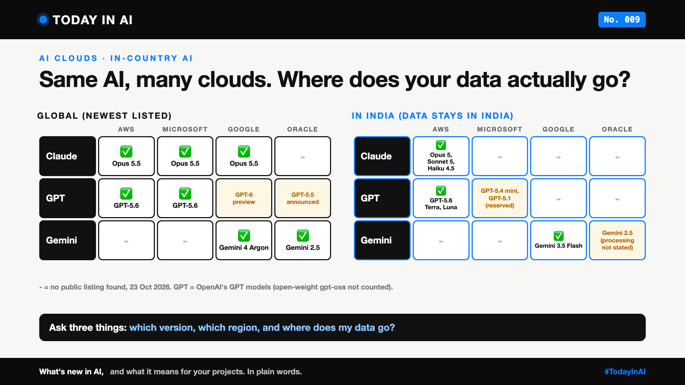

# Today in AI, No. 009: Same AI, Many Clouds. Where Does Your Data Actually Go? | In-Country AI



*Today in AI: what's new in AI, and what it means for you. In plain words.*

**In one line:** Top AI models now run on many clouds, and in India some run without your data leaving the country. But not always the newest version.

## What happened

- **5 October:** Anthropic's Claude (Opus 5, Sonnet 5, Haiku 4.5) went live on Amazon Bedrock with **in-country inference** in India, in Mumbai and Hyderabad. [1]
- **18 August:** OpenAI's GPT-5.6 Terra and Luna got the same in-India option. [2]
- **21 October:** OpenAI said its models are coming to Google Cloud, in private preview. [3]

## Who hosts what (23 October 2026)

- **AWS:** Claude ✅, GPT ✅, both in-country in India [1, 2, 6]. Gemini ➖.
- **Microsoft:** GPT ✅ [7], Claude ✅ [4]. Gemini ➖.
- **Google Cloud:** Gemini ✅, Claude ✅ [5], GPT 🟡 preview [3].
- **Oracle:** Gemini ✅ [9], GPT 🟡 announced [8], Claude ➖.

*➖ = no public listing found. Catalogs change often.*

## What it means

Think of a restaurant chain. In-country means the kitchen is in your city: your order never leaves town.

Picking a model no longer means picking a cloud. For banks, hospitals and government work under India's DPDP Act, that removes a big "no" from the risk review.

## The catch

New dishes reach some branches later. Claude Opus 5.5 and Sonnet 5.5 are on Microsoft and Google, but not yet in-country in India [4, 5]. OpenAI's in-India choice is Terra and Luna, not the flagship Sol [2].

## One thing to do this week

- **Learners:** call one model through two clouds. See what changes.
- **Leaders:** ask for one table: each AI feature, its model version, its region, and whether data leaves the country.

## Words to know

- **Inference:** the AI answering a request.
- **Data residency:** rules about where data is stored and processed.

## References and credits

1. Analytics India Magazine, "Anthropic Brings Claude In-Country Inference to India Through Amazon Bedrock", 5 October 2026. [Read it](https://analyticsindiamag.com/ai-news/anthropic-brings-claude-in-country-inference-to-india-through-amazon-bedrock). Also covered by [Business Standard](https://www.business-standard.com/technology/artificial-intelligence/anthropic-claude-india-inference-amazon-bedrock-data-residency-126100500356_1.html).
2. AWS, "Amazon Bedrock now supports OpenAI models in India", 18 August 2026. [Read it](https://aws.amazon.com/about-aws/whats-new/2026/08/amazon-bedrock-openai-india-v1/) (primary source)
3. OpenAI, "OpenAI models are coming to Google Cloud", 21 October 2026. [Read it](https://openai.com/index/openai-models-google-cloud/) (primary source). Also covered by [CNBC](https://www.cnbc.com/2026/10/21/openai-bring-its-ai-models-to-googles-cloud-expands-beyond-microsoft.html) and [TechWire Asia](https://techwireasia.com/2026/10/openai-google-cloud-ai-models/).
4. Microsoft Learn, "Claude models in Microsoft Foundry", updated 22 September 2026. [Read it](https://learn.microsoft.com/en-us/azure/foundry/foundry-models/concepts/claude-models) (primary source). And Anthropic, "Claude in Microsoft Foundry is now generally available", 29 June 2026. [Read it](https://claude.com/blog/claude-in-microsoft-foundry)
5. Anthropic, "Claude Models on Google Cloud", Claude Platform docs (model ID table). [Read it](https://platform.claude.com/docs/en/build-with-claude/claude-on-vertex-ai) (primary source)
6. AWS, "OpenAI GPT-5.6 Sol, Terra, and Luna now generally available on Amazon Bedrock", 13 July 2026. [Read it](https://aws.amazon.com/about-aws/whats-new/2026/07/openai-gpt-sol-terra/) (primary source)
7. Microsoft, "GPT-5.6 now available in Microsoft Foundry", 9 July 2026. [Read it](https://azure.microsoft.com/en-us/blog/gpt-5-6-now-available-in-microsoft-foundry/) (primary source)
8. IT Brief, "OpenAI and Oracle to offer models on OCI Marketplace", June 2026. [Read it](https://itbrief.news/story/openai-oracle-to-offer-models-on-oci-marketplace)
9. Oracle, "Use Google Gemini 2.5 in OCI Generative AI", release note, 1 October 2025. [Read it](https://docs.oracle.com/iaas/releasenotes/generative-ai/gemini-2-5-GA.htm) (primary source)

Credit to Anthropic, OpenAI, AWS, Microsoft, Google Cloud and Oracle for their public announcements and documentation, and to the reporters at Analytics India Magazine, Business Standard, CNBC, TechWire Asia and IT Brief. Facts come from these sources, checked on 23 October 2026; the cloud list is my summary of them, and the opinions are mine. Cover: original illustration, no third-party logos or images.

**Not sponsored.** This write-up is not sponsored by anyone. Nobody paid for it or reviewed it before publishing.

**Earlier issues of Today in AI:**

- [No. 001: What happens when your AI agent visits someone else's website?](https://www.linkedin.com/pulse/today-ai-001-what-happens-when-your-agent-visits-someone-arpit-jain-2vqmf/)
- [No. 002: What if your chatbot answered with buttons instead of paragraphs?](https://www.linkedin.com/pulse/today-ai-002-what-your-chatbot-answered-buttons-instead-arpit-jain-snkcf/)
- [No. 003: Why does Google's newest AI go to security teams first?](https://www.linkedin.com/pulse/today-ai-003-why-does-googles-newest-go-security-teams-arpit-jain-kpo3f)
- [No. 004: Why is Microsoft's new AI built to choose, not to chat?](https://www.linkedin.com/pulse/today-ai-004-why-microsofts-new-built-choose-chat-meet-arpit-jain-ypmkf/)
- [No. 005: If AI can build your dashboards, what's left for the data team?](https://www.linkedin.com/pulse/today-ai-005-can-build-your-dashboards-whats-left-data-arpit-jain-oukuf)
- [No. 006: Your AI made a decision. Can you prove why?](https://www.linkedin.com/pulse/today-ai-006-your-made-decision-can-you-prove-why-data-arpit-jain-vjenf)
- [No. 007: Should every question go to your most expensive AI?](https://www.linkedin.com/pulse/today-ai-007-should-every-question-go-your-most-expensive-arpit-jain-xjexf)
- [No. 008: Does using AI make you give up faster?](https://www.linkedin.com/pulse/today-ai-008-does-using-make-you-give-up-faster-learning-arpit-jain-ppghf/)

**Tags:** #AI #Cloud #DataResidency #AWS #TodayInAI

---

**People and pages to @mention** (type @ and pick from LinkedIn's list, in the article and the post): Anthropic, OpenAI, Amazon Web Services (AWS), Microsoft Azure, Google Cloud, Oracle

**Post text (copy and paste):**

```
Same AI, many clouds. Where does your data actually go?

Claude now runs in-country in India on Amazon Bedrock. OpenAI's GPT models do too, and are coming to Google Cloud.

Like a restaurant chain opening a kitchen in your city: your order never leaves town.

The catch: the newest dishes reach some branches later.

Ask: which version, which region, data going where?

No. 009 of Today in AI. Sources in the article. Not sponsored.

#AI #Cloud #DataResidency #AWS #TodayInAI
```
