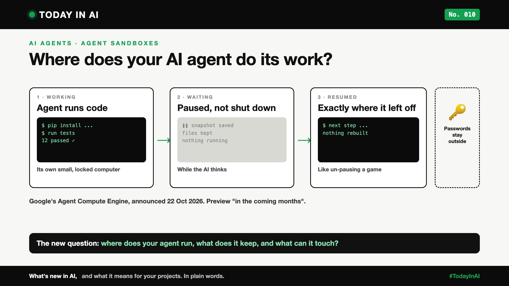

# Today in AI, No. 010: Where Does Your AI Agent Do Its Work? | Agent Sandboxes



*Today in AI: what's new in AI, and what it means for you. In plain words.*

**In one line:** Google announced a way to give every AI agent its own small, locked computer that pauses while the agent waits and wakes up exactly where it left off.

## What happened

On 22 October 2026, Google Cloud announced **Agent Compute Engine**. [1]

A coding agent writes code, installs tools, runs tests, then waits for the AI to decide the next step. Today, teams either shut its computer down after every step (and rebuild it each time) or leave it running all session (and pay for idle time).

Google's answer: each agent gets its own tiny virtual computer, a **microVM**. When the agent goes quiet, Google saves its exact state and pauses it. When work arrives, it resumes from that snapshot. [1]

## Three ideas worth knowing

- **Pause, don't restart.** Like pausing a video game instead of replaying the level.
- **Share what's the same.** Many agents use the same system and libraries. One shared copy in memory; each agent gets a private copy only of what it changes. [1]
- **Keep the keys outside.** Each agent runs walled off, with its own identity. Long-lived passwords stay outside its computer, and a gateway checks what it sends out. [1]

## Why it matters to you

- **Learning AI?** An agent is more than a model. It needs somewhere to run, a memory of its work, and limits on what it can reach.
- **Leading a team?** The question used to be "what will the AI decide?" Now add: "where does it run, what does it keep, and what can it touch?"

## The catch

It isn't available yet: Google says preview "in the coming months", and today it powers Google's own Gemini agent. [1] The post gives no numbers for this product. And not every agent needs it: one that only calls a few APIs is fine without its own computer.

## One thing to do this week

- **Learners:** run an agent that writes code, and note what happens to its files after each step.
- **Leaders:** ask your team where your agents run code today, and where the passwords live.

## Words to know

- **Sandbox:** a walled-off space where an agent can run things without touching anything else.
- **MicroVM:** a very small virtual computer that starts fast.
- **Snapshot:** a saved copy of a computer's exact state, so it can resume later.

## References and credits

1. Nirav Mehta, Michael Bachman and Kevin Hutchins, Google Cloud, "Introducing Agent Compute Engine and expanded agent governance", Google Cloud Blog, 22 October 2026. [Read it](https://cloud.google.com/blog/topics/ai-infrastructure/introducing-agent-compute-engine-and-expanded-agent-governance) (primary source)

Credit to the Google Cloud team for a clear write-up of the design. This is a vendor announcement: the claims come from Google and haven't been independently tested. Facts come from the source; the opinions and "what it means" sections are mine. Cover: original illustration, no third-party logos or images.

**Not sponsored.** This write-up is not sponsored by anyone. Nobody paid for it or reviewed it before publishing.

**Earlier issues of Today in AI:**

- [No. 001: What happens when your AI agent visits someone else's website?](https://www.linkedin.com/pulse/today-ai-001-what-happens-when-your-agent-visits-someone-arpit-jain-2vqmf/)
- [No. 002: What if your chatbot answered with buttons instead of paragraphs?](https://www.linkedin.com/pulse/today-ai-002-what-your-chatbot-answered-buttons-instead-arpit-jain-snkcf/)
- [No. 003: Why does Google's newest AI go to security teams first?](https://www.linkedin.com/pulse/today-ai-003-why-does-googles-newest-go-security-teams-arpit-jain-kpo3f)
- [No. 004: Why is Microsoft's new AI built to choose, not to chat?](https://www.linkedin.com/pulse/today-ai-004-why-microsofts-new-built-choose-chat-meet-arpit-jain-ypmkf/)
- [No. 005: If AI can build your dashboards, what's left for the data team?](https://www.linkedin.com/pulse/today-ai-005-can-build-your-dashboards-whats-left-data-arpit-jain-oukuf)
- [No. 006: Your AI made a decision. Can you prove why?](https://www.linkedin.com/pulse/today-ai-006-your-made-decision-can-you-prove-why-data-arpit-jain-vjenf)
- [No. 007: Should every question go to your most expensive AI?](https://www.linkedin.com/pulse/today-ai-007-should-every-question-go-your-most-expensive-arpit-jain-xjexf)
- [No. 008: Does using AI make you give up faster?](https://www.linkedin.com/pulse/today-ai-008-does-using-make-you-give-up-faster-learning-arpit-jain-ppghf/)
- [No. 009: Same AI, many clouds. Where does your data actually go?](https://www.linkedin.com/pulse/today-ai-009-same-many-clouds-where-does-your-data-actually-jain-zgc1f)

**Tags:** #AI #AIAgents #CloudComputing #AISecurity #TodayInAI

---

**People and pages to @mention** (type @ and pick from LinkedIn's list, in the article and the post): Google Cloud

**Post text (copy and paste):**

```
Where does your AI agent do its work?

A coding agent writes code, runs tests, then waits. Its computer sits idle, or gets rebuilt every step.

Google's new Agent Compute Engine gives each agent its own small, locked computer. It pauses while the agent waits, and wakes up exactly where it left off.

Like pausing a game instead of replaying the level.

Not available yet: preview "in the coming months".

No. 010 of Today in AI. Source in the article. Not sponsored.

#AI #AIAgents #CloudComputing #AISecurity #TodayInAI
```
