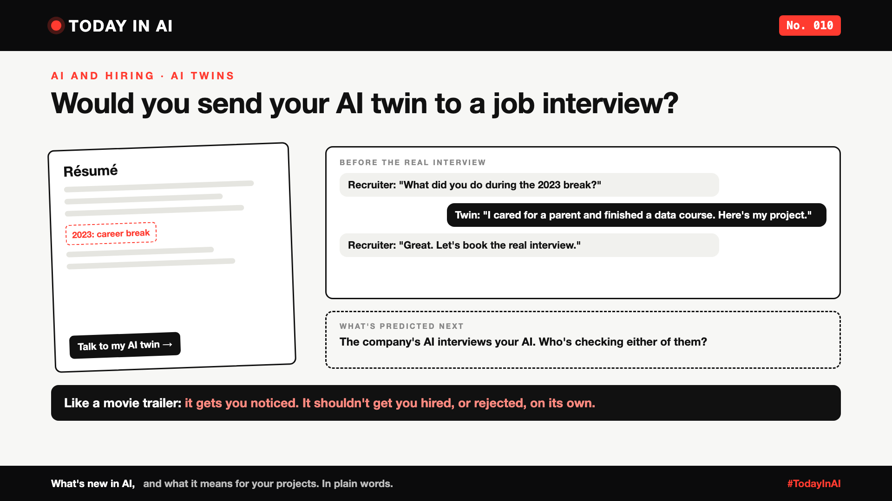

# Today in AI, No. 010: Would You Send Your AI Twin to a Job Interview? | AI Twins in Hiring



*Today in AI: what's new in AI, and what it means for you. In plain words.*

**In one line:** A new platform lets job seekers build an AI version of themselves, so recruiters can ask it questions before booking a real interview.

## What happened

On 12 October, Fortune reported on TwinCafe, a platform launched by Ashutosh Garg, the CEO of the AI hiring company Eightfold AI.

Here's how it works:

- A job seeker uploads their résumé, LinkedIn profile, work samples and other documents.
- The platform builds an **AI twin**: a chatbot that answers questions as that person, using what they uploaded.
- They get a shareable link to put on their résumé or LinkedIn profile.
- A recruiter can question the twin first, about past roles, skills or a career break, and save the real interview for questions that need a human.

Garg's reason, in his words: "a résumé is so limiting." He also expects that, one day, companies will send their own AI to interview candidates' twins.

## What it means

Think of a movie trailer. It shows the best scenes in two minutes, so you know whether to watch the film. Nobody gives an award to a trailer.

An AI twin could be a trailer for a person. It can explain what a résumé can't, like a career break or a side project. That's genuinely useful, especially for people with unusual career paths who get filtered out by keyword scanners.

But a trailer can also mislead. So the big questions are about trust:

- **Does the twin say only what you would say?** Or can it make things up about you?
- **Who owns your twin, and your data?** Can you see what it told each recruiter, and delete it?
- **Is it fair?** What about candidates who don't have a twin?
- **And if AI interviews AI,** who checks either of them?

## Why it matters to you

- **Looking for a job, or soon will be?** Real work samples and clear stories matter more than buzzwords, for your twin and for you. If you ever use one, test it with tough questions first, and read its answers.
- **Leading a team or hiring?** A twin can be a useful first filter. It shouldn't be the decision. Tell candidates when AI is part of your process, and keep a person responsible for every hiring call.

## The fine print

This is early. Fortune's report gives no pricing, launch date or user numbers, and the "AI interviews AI" part is a prediction, not a product.

## One thing to do this week

Ask any AI chatbot to answer "Tell me about yourself" using only your résumé. Would you be happy if a recruiter heard that answer? If not, fix your résumé first.

## Words to know

- **AI twin (digital twin):** an AI that answers questions as a specific person, based on their documents and data.
- **AI screening:** using AI to filter job candidates before a person looks at them.

## References and credits

1. Fortune, coverage of TwinCafe and Ashutosh Garg's plans for AI twins in hiring, 12 October 2026. [Read it](https://fortune.com/2026/10/12/recruiter-interview-screen-ai-twin-ashutosh-garg-eightfold-ai-twincafe/) (primary source for this write-up)

Credit to Fortune for the reporting. Facts in this write-up come from this report; the opinions, the example on the cover and the "what it means" sections are mine. Cover: original illustration, no third-party logos or images.

**Not sponsored.** This write-up is not sponsored by Eightfold AI, TwinCafe or anyone else. Nobody paid for it or reviewed it before publishing.

**Earlier issues of Today in AI:**

- [No. 001: What happens when your AI agent visits someone else's website?](https://www.linkedin.com/pulse/today-ai-001-what-happens-when-your-agent-visits-someone-arpit-jain-2vqmf/)
- [No. 002: What if your chatbot answered with buttons instead of paragraphs?](https://www.linkedin.com/pulse/today-ai-002-what-your-chatbot-answered-buttons-instead-arpit-jain-snkcf/)
- [No. 003: Why does Google's newest AI go to security teams first?](https://www.linkedin.com/pulse/today-ai-003-why-does-googles-newest-go-security-teams-arpit-jain-kpo3f)
- [No. 004: Why is Microsoft's new AI built to choose, not to chat?](https://www.linkedin.com/pulse/today-ai-004-why-microsofts-new-built-choose-chat-meet-arpit-jain-ypmkf/)
- [No. 005: If AI can build your dashboards, what's left for the data team?](https://www.linkedin.com/pulse/today-ai-005-can-build-your-dashboards-whats-left-data-arpit-jain-oukuf)
- [No. 006: Your AI made a decision. Can you prove why?](https://www.linkedin.com/pulse/today-ai-006-your-made-decision-can-you-prove-why-data-arpit-jain-vjenf)
- [No. 007: Should every question go to your most expensive AI?](https://www.linkedin.com/pulse/today-ai-007-should-every-question-go-your-most-expensive-arpit-jain-xjexf)
- [No. 008: Does using AI make you give up faster?](https://www.linkedin.com/pulse/today-ai-008-does-using-make-you-give-up-faster-learning-arpit-jain-ppghf/)
- No. 009: Same AI, many clouds. Where does your data actually go? *(link added when published)*

**Tags:** #AI #Hiring #FutureOfWork #HRTech #TodayInAI

---

**People and pages to @mention** (type @ and pick from LinkedIn's list, in the article and the post): Eightfold AI, Ashutosh Garg, Fortune

**Post text (copy and paste):**

```
Would you send your AI twin to a job interview?

A new platform, TwinCafe, lets job seekers upload their résumé, LinkedIn profile and work samples to build an AI version of themselves. Recruiters can question the twin first, then book the real interview.

Like a movie trailer: it can show what a résumé can't, like a career break or a side project. But a trailer should get you noticed, not hired or rejected on its own.

The questions that matter: Does your twin say only what you'd say? Who owns it? And if, one day, a company's AI interviews your AI, who checks either of them?

No. 010 of Today in AI.

Source: Fortune, 12 Oct 2026 (full references and credits in the article). Not sponsored by anyone.

#AI #Hiring #FutureOfWork #HRTech #TodayInAI
```
