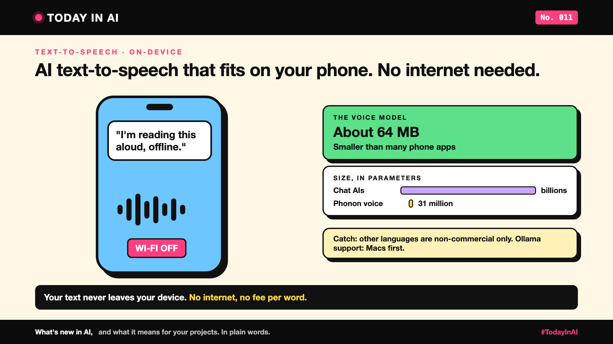

# Today in AI, No. 011: AI Text-to-Speech That Fits on Your Phone. No Internet Needed. | Text-to-Speech



*Today in AI: what's new in AI, and what it means for you. In plain words.*

**In one line:** A free AI voice, small enough for a phone, now reads text aloud right on your device. Nothing you type leaves it.

## What happened

- **20 October 2026:** voice AI company Gradium released **Phonon**, small text-to-speech models (they turn written text into a spoken voice) that anyone can download. Gradium says they run on phones, laptops and even in a web browser. [1]
- **26 October 2026:** Ollama, a popular free app for running AI on your own computer, added Phonon. Your local AI can now read its answers aloud. [2, 3]

## What it means

Most AI voices live in the cloud: your text travels to a company's servers, and a voice comes back.

Phonon is more like a radio you own. It plays right there on your phone or laptop. No internet, no fee per word, and your text never leaves the room.

And it's tiny. Chat AIs have billions of parameters. Phonon's English model has 31 million, smaller than many phone apps. [1]

## Why it matters to you

- **Learning AI?** Try a full AI assistant that thinks and talks, all offline.
- **Leading a team?** Private documents, patient notes or bank letters can be read aloud without sending them anywhere.

## The catch

- **Only the English model is free for business use.** The French, German, Spanish, Portuguese and multilingual models are non-commercial only. [1]
- **Macs first.** In Ollama, it works on Apple Silicon Macs today; Windows and Linux are "coming soon". [3]
- **The speed and quality numbers are the companies' own.** Nobody has tested them independently yet.

## One thing to do this week

Ask: which text in your work is too private to send to a cloud AI voice? That's where a local voice fits.

## Words to know

- **Text-to-speech (TTS):** AI that turns written text into a spoken voice.
- **On-device:** running on your own computer or phone, not in the cloud.

## References and credits

1. Gradium, "Open-Sourcing Phonon: A Suite of Frontier On-Device TTS Models", 20 October 2026. [Read it](https://gradium.ai/blog/release-phonon-open-weight) (primary source)
2. Ollama, Phonon model page and speech documentation. [Read it](https://ollama.com/library/phonon) and [the docs](https://docs.ollama.com/capabilities/speech) (primary source)
3. Marcus Mendes, "Ollama for Mac gains support for local text-to-speech models", 9to5Mac, 26 October 2026. [Read it](https://9to5mac.com/2026/10/26/ollama-for-mac-gains-support-for-local-text-to-speech-models/)

Credit to the Gradium and Ollama teams for their public announcements and documentation, and to 9to5Mac for the report. Facts come from these sources; the opinions are mine. Cover: original illustration, no third-party logos or images.

**Not sponsored.** This write-up is not sponsored by anyone. Nobody paid for it or reviewed it before publishing.

**Earlier issues of Today in AI:**

- [No. 001: What happens when your AI agent visits someone else's website?](https://www.linkedin.com/pulse/today-ai-001-what-happens-when-your-agent-visits-someone-arpit-jain-2vqmf/)
- [No. 002: What if your chatbot answered with buttons instead of paragraphs?](https://www.linkedin.com/pulse/today-ai-002-what-your-chatbot-answered-buttons-instead-arpit-jain-snkcf/)
- [No. 003: Why does Google's newest AI go to security teams first?](https://www.linkedin.com/pulse/today-ai-003-why-does-googles-newest-go-security-teams-arpit-jain-kpo3f)
- [No. 004: Why is Microsoft's new AI built to choose, not to chat?](https://www.linkedin.com/pulse/today-ai-004-why-microsofts-new-built-choose-chat-meet-arpit-jain-ypmkf/)
- [No. 005: If AI can build your dashboards, what's left for the data team?](https://www.linkedin.com/pulse/today-ai-005-can-build-your-dashboards-whats-left-data-arpit-jain-oukuf)
- [No. 006: Your AI made a decision. Can you prove why?](https://www.linkedin.com/pulse/today-ai-006-your-made-decision-can-you-prove-why-data-arpit-jain-vjenf)
- [No. 007: Should every question go to your most expensive AI?](https://www.linkedin.com/pulse/today-ai-007-should-every-question-go-your-most-expensive-arpit-jain-xjexf)
- [No. 008: Does using AI make you give up faster?](https://www.linkedin.com/pulse/today-ai-008-does-using-make-you-give-up-faster-learning-arpit-jain-ppghf/)
- [No. 009: Same AI, many clouds. Where does your data actually go?](https://www.linkedin.com/pulse/today-ai-009-same-many-clouds-where-does-your-data-actually-jain-zgc1f)
- [No. 010: Your AI agent is waiting. Are you still paying?](https://www.linkedin.com/pulse/today-ai-010-your-agent-waiting-you-still-paying-sandboxes-arpit-jain-07qvf)

**Tags:** #AI #VoiceAI #OnDeviceAI #Privacy #TodayInAI

---

**People and pages to @mention** (type @ and pick from LinkedIn's list, in the article and the post): Gradium, Ollama

**Post text (copy and paste):**

```
AI text-to-speech that fits on your phone. No internet needed.

Gradium's new Phonon reads text aloud right on your device. Ollama just added it for Macs.

Your text never leaves your device.

The English model is just 64 MB. The catch: other languages are non-commercial only.

No. 011 of Today in AI. Sources in the article. Not sponsored.

#AI #VoiceAI #OnDeviceAI #Privacy #TodayInAI
```
