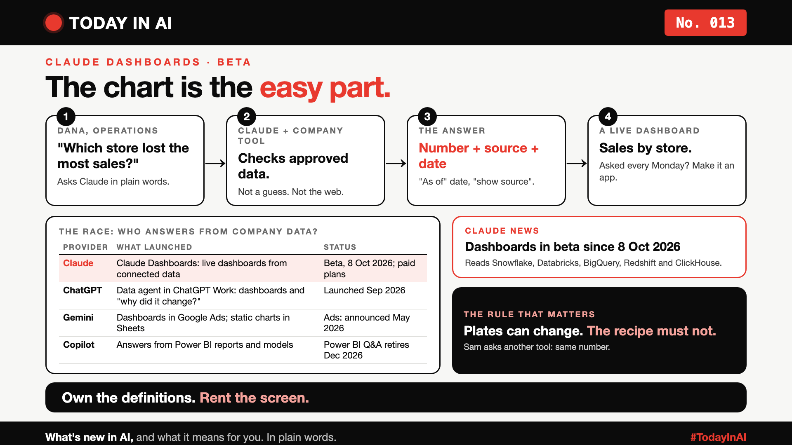

# Today in AI, No. 013: What If the Chart Is the Easy Part? | Claude Dashboards



*Today in AI: what's new in AI, and what it means for you. In plain words.*

**Published:** 2 November 2026 on [LinkedIn](https://www.linkedin.com/pulse/today-ai-013-what-chart-easy-part-claude-dashboards-arpit-jain-18dhf)

**In one line:** Claude can now draw a live dashboard from company data. The hard part is making sure every AI tool gives the same answer.

## A story: Monday at Hollow Creek Home

Hollow Creek Home is a fictional chain of twelve shops. Every Monday, Dana asks, "Which store lost the most sales last month?"

This Monday, Dana asked Claude and got a dashboard. Dana clicked "show source" and saw the number, the query, and the date the data was current to.

Sam, in marketing, asked a different AI tool the same question. The screen looked different, but the number matched. Both tools read the same approved data.

## What happened

On 8 October 2026, Anthropic launched Claude Dashboards in beta. You ask in plain words, and Claude builds a live dashboard from connected data such as Snowflake, Databricks and BigQuery. It is available on paid plans.

## What it means

Think of a restaurant. The plates can change, but the kitchen must follow the same recipes. A dashboard is a plate. The recipe is the data behind it: what counts as a "sale", and which date a month ends on.

## The race

| Provider | What launched | Status |
|---|---|---|
| Anthropic (Claude) | Claude Dashboards | Beta since 8 Oct 2026 |
| OpenAI (ChatGPT) | Data agent in ChatGPT Work | Launched Sep 2026 |
| Google (Gemini) | Dashboards in Google Ads | Announced May 2026 |
| Microsoft (Copilot) | Answers from Power BI | Power BI Q&A retires Dec 2026 |

Everyone wants to be the place you ask. The question is which data each one reads, and who controls the definitions.

## Why it matters to you

- **Working with data?** Own the definitions. Write them down once, and make every tool use them.
- **Leading a team?** Ask every AI answer: "Where did this number come from, and as of when?"

## The fine print

Most of this comes from press coverage, and dates and tiers vary between sources. Check each provider's official page before you decide.

## One thing to do this week

Pick one number your team argues about. Write its single definition, then check that every AI tool you use returns the same number.

## Words to know

- **Governed data:** data an owner has approved, so everyone reads the same version.

## References and credits

1. Anthropic's Claude Dashboards launch, reported by [AI Catchup](https://aicatchup.com/news/claude-dashboards-motion-beta) and [The Star](https://www.thestar.com.my/tech/tech-news/2026/10/09/anthropic-launches-dashboard-animation-tools-for-claude). Launch date: 8 October 2026.
2. OpenAI, [Put data to work](https://openai.com/index/put-data-to-work/) (Data agent in ChatGPT Work). Launch date reported as 9 or 10 September 2026, depending on the outlet.
3. Google Ads Dashboards with Gemini, reported by [TechWyse](https://www.techwyse.com/news/platform-updates/google-ads-ai-dashboards-rollout-text-prompts).
4. Microsoft Power BI and Copilot: [Microsoft Learn, Explore data with Copilot for Power BI](https://learn.microsoft.com/en-ca/training/modules/create-dashboards-power-bi/3-explore-data).

Hollow Creek Home, Dana, Sam and the company tool in the story are fictional. The story was inspired by a public practitioner post about an internal setup. It is not a description of any real company. Facts about the providers come from the references above; the opinions, analogies and story are mine. Cover: original illustration, no third-party logos or images.

**Not sponsored.** This write-up is not sponsored by Anthropic, OpenAI, Google, Microsoft or anyone else. Nobody paid for it or reviewed it before publishing.

**Earlier issues of Today in AI:**

- [No. 001: What happens when your AI agent visits someone else's website?](https://www.linkedin.com/pulse/today-ai-001-what-happens-when-your-agent-visits-someone-arpit-jain-2vqmf/)
- [No. 002: What if your chatbot answered with buttons instead of paragraphs?](https://www.linkedin.com/pulse/today-ai-002-what-your-chatbot-answered-buttons-instead-arpit-jain-snkcf/)
- [No. 003: Why does Google's newest AI go to security teams first?](https://www.linkedin.com/pulse/today-ai-003-why-does-googles-newest-go-security-teams-arpit-jain-kpo3f)
- [No. 004: Why is Microsoft's new AI built to choose, not to chat?](https://www.linkedin.com/pulse/today-ai-004-why-microsofts-new-built-choose-chat-meet-arpit-jain-ypmkf/)
- [No. 005: If AI can build your dashboards, what's left for the data team?](https://www.linkedin.com/pulse/today-ai-005-can-build-your-dashboards-whats-left-data-arpit-jain-oukuf)
- [No. 006: Your AI made a decision. Can you prove why?](https://www.linkedin.com/pulse/today-ai-006-your-made-decision-can-you-prove-why-data-arpit-jain-vjenf)
- [No. 007: Should every question go to your most expensive AI?](https://www.linkedin.com/pulse/today-ai-007-should-every-question-go-your-most-expensive-arpit-jain-xjexf)
- [No. 008: Does using AI make you give up faster?](https://www.linkedin.com/pulse/today-ai-008-does-using-make-you-give-up-faster-learning-arpit-jain-ppghf/)
- [No. 009: Same AI, many clouds. Where does your data actually go?](https://www.linkedin.com/pulse/today-ai-009-same-many-clouds-where-does-your-data-actually-jain-zgc1f)
- [No. 010: Your AI agent is waiting. Are you still paying?](https://www.linkedin.com/pulse/today-ai-010-your-agent-waiting-you-still-paying-sandboxes-arpit-jain-07qvf)
- [No. 011: AI text-to-speech that fits on your phone. No internet needed.](https://www.linkedin.com/pulse/today-ai-011-text-to-speech-fits-your-phone-internet-needed-jain-1ipuf)
- No. 012: Would you send your AI twin to a job interview? (link added when published)

**Tags:** #AI #Claude #DataStrategy #Dashboards #TodayInAI

---

**People and pages to @mention** (type @ and pick from LinkedIn's list, in the article and the post): Anthropic, OpenAI, Google, Microsoft

**Post text (copy and paste):**

```
What if the chart is the easy part?

Anthropic launched Claude Dashboards in beta on 8 October. Ask a question, get a live dashboard from your company data.

The chart is easy. The hard part is making every tool, Claude, ChatGPT, Gemini or Copilot, return the same number for the same question.

Like a restaurant: the plates can change, but the kitchen must follow the same recipes.

No. 013 of Today in AI, with a fictional story and a provider comparison.

Sources and full credits in the article. Not sponsored by anyone.

#AI #Claude #DataStrategy #Dashboards #TodayInAI
```
