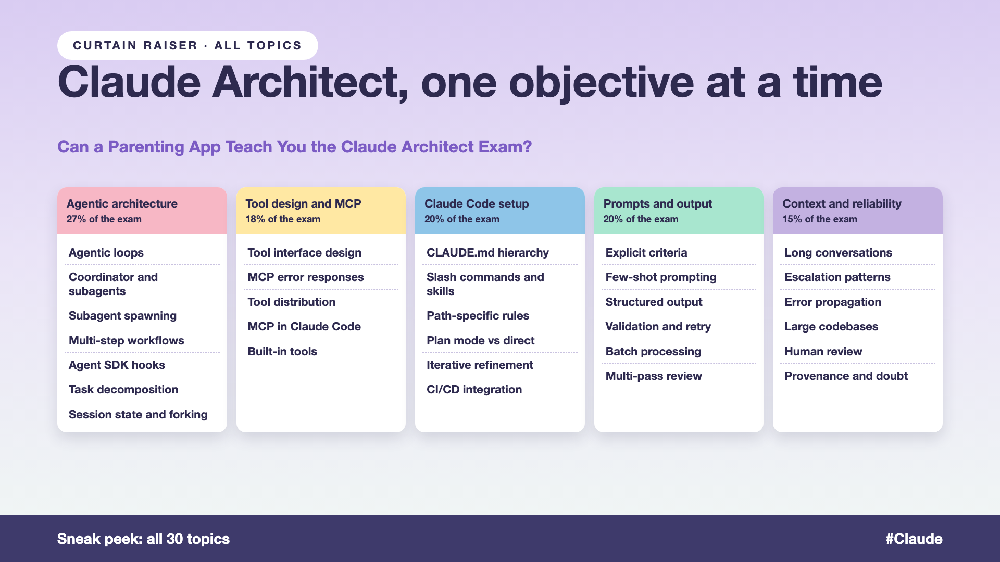

# Curtain raiser post: Claude Architect, one objective at a time

*Post with cover only. No article. The cover lists every topic in the series.*



**Post text (copy and paste):**

```
I'm preparing for the Claude Certified Architect exam. You can learn with me.

60 questions. 5 domains. 30 objectives. One write-up for each.

Every write-up: a real-world moment at ParentPace, a made-up parenting-coach company. What went wrong, what an architect would do, one exam trap, one practice question.

Are you preparing for this exam too?

Not an official Anthropic resource. ParentPace is fictional.

#ClaudeCertifiedArchitect #ClaudeArchitectPrep #AIEngineering #Anthropic #Claude
```

**Series index (post as the first comment, then pin it):**

```
📌 Claude Architect, One Objective at a Time

0. Can a parenting app teach you the Claude Architect exam? (you're here)
1. How does an agent know when to stop? (next, objective 1.1)
```
