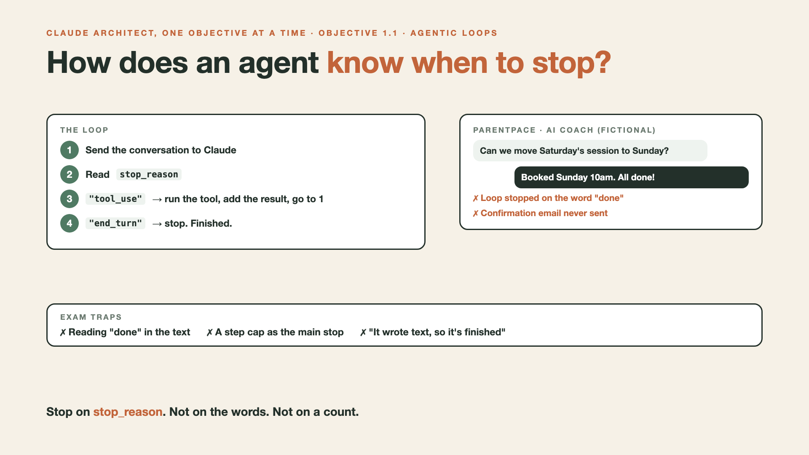

# 1. How Does an Agent Know When to Stop? | Agentic Loops



*Claude Architect, One Objective at a Time: objective 1.1*

**Exam objective 1.1:** Design and implement agentic loops for autonomous task execution.

## The store moment

A customer writes: "Order 9931 arrived broken. Can I have a refund?"

The refund agent checks the policy, replies "All done!", and stops. The refund never ran. The code stopped on the word "done".

## Hello world: the loop

The repo's loop is short. It stops on the signal, not on the words:

```python
for turn in range(1, MAX_TURNS + 1):
    llm_response = client.messages.create(**request)
    if llm_response.stop_reason != "tool_use":    # end_turn: the model is finished
        return "".join(b.text for b in llm_response.content if b.type == "text")
    tool_results = []
    for block in llm_response.content:
        if block.type == "tool_use":
            result = tools[block.name](**block.input)
            tool_results.append({"type": "tool_result", "tool_use_id": block.id, "content": json.dumps(result)})
    messages.append({"role": "assistant", "content": llm_response.content})
    messages.append({"role": "user", "content": tool_results})
```

This is simplified from [agents/agent_loop.py](https://github.com/arpit-jain-mygit/agentic-ai-hello-world/blob/main/agents/agent_loop.py). The real loop also handles `max_tokens`, `pause_turn` and `refusal`. `MAX_TURNS` is only a safety net.

## Exam traps

- **Reading the words.** Stopping because the text says "done".
- **A step cap as the main stop.** "Stop after 5 rounds" ends real work early.
- **"There's text, so it's finished."** Claude can write text and ask for a tool in the same reply.

## Practice question

The refund agent sometimes ends without issuing the refund. The loop exits when the reply contains "done", or after 5 rounds. What's the best fix?

- **A.** Raise the cap to 15 rounds.
- **B.** Tell the prompt never to say "done" before the refund runs.
- **C.** Continue while `stop_reason` is `"tool_use"`, stop on `"end_turn"`, and keep a high cap only as a safety net.
- **D.** Stop as soon as the reply contains any text.

*Answer: C. A still makes a cap the main stop. B relies on the model's wording. D stops on text, not on the stop signal.*

**You can now:** design a loop that stops for the right reason.

Next write-up (2): **One coordinator, three helpers: who builds the course?** (Objective 1.2)

Follow me for the next one. Which of the three traps have you seen in real code?

*The store is fictional. These are my own study notes, not an official Anthropic resource.*

---

**Post text (copy and paste):**

```
"Refund order 9931? It arrived broken."

The agent checked the policy, replied "All done!", and stopped. The refund never ran.

Exam objective 1.1: an agent stops on stop_reason "end_turn". Not on its own words. Not on a step count.

Which trap have you seen in real code?

Not an official Anthropic resource. The store is fictional.

#ClaudeCertifiedArchitect #ClaudeArchitectPrep #AIEngineering #AIAgents #Claude
```

**Series index (post as the first comment; also update the pinned comment on write-up 0):**

```
📌 Claude Architect, One Objective at a Time

0. Can a refund bot teach you the Claude Architect exam? [link]
1. How does an agent know when to stop? (you're here, objective 1.1)
2. One coordinator, three helpers: who builds the course? (next, objective 1.2)
```
