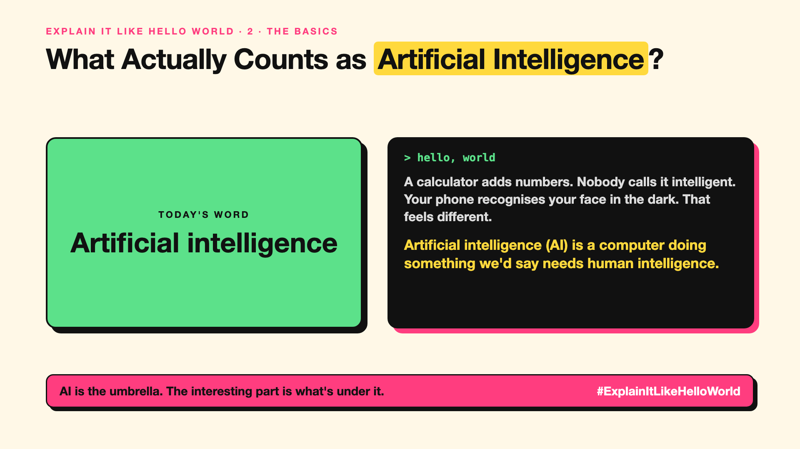

# 2. What Actually Counts as Artificial Intelligence? | Artificial intelligence



*Explain It Like Hello World series: Artificial intelligence*

**Published:** 27 October 2026 on [LinkedIn](https://www.linkedin.com/pulse/2-what-actually-counts-artificial-intelligence-arpit-jain-su9lf)

Everything is "AI" now: phones, washing machines, toothbrushes. The word is so stretched it barely means anything.

## The hello world

A calculator adds numbers, but nobody calls it intelligent. It follows fixed steps someone wrote.

Now a phone that recognises your face in the dark, from an angle, with new glasses. Nobody wrote a rule for every case. That's the hello world: **AI** is a computer doing something we'd normally say needs human intelligence, like seeing, understanding language or deciding.

## One step further

AI is the big umbrella. Under it: rule-based systems (old chess programs), machine learning (write-up 3) where computers learn from examples, and deep learning (write-up 4) behind today's chatbots and image tools.

The bar keeps moving. Once something works reliably, people stop calling it AI. Spell-check and route planning were "AI" once.

## Where you've already met it

Face unlock, spam filters, maps that reroute around traffic, voice assistants, chatbots.

## The real name

**Artificial intelligence (AI)**.

- **AI:** computers doing tasks that seem to need human intelligence.
- **Narrow AI:** AI that's good at one kind of task.
- **AI effect:** once something works, people stop calling it AI.

## What it's not

AI isn't one technology, and it isn't a mind. "AI-powered" on a label can mean anything from a simple rule to a large language model. Ask what it actually does.

## Take this to your next meeting

1. When a product says "AI-powered", ask: what exactly does the AI do?
2. Separate the umbrella (AI) from the method (rules, machine learning, LLMs).
3. Judge AI by results on your tasks, not by the label.

AI is the umbrella. The interesting part is what's under it.

Next write-up (3): **How Does Machine Learning Learn Without Being Told the Rules?**

Follow me for the next one. What's the silliest "AI-powered" product you've seen?

**Earlier in this series:**

1. [AI words everyone uses. Nobody explains.](https://lnkd.in/p/d8abaPhq) (the curtain raiser post)

**Previous series:**

- **Series 1, #JustAddRAG:** [start here](https://www.linkedin.com/pulse/why-does-just-add-rag-sound-like-2-weeks-take-6-months-arpit-jain-l4kkf/) or jump to [the grand finale](https://www.linkedin.com/pulse/15-so-should-you-really-just-add-rag-grand-finale-arpit-jain-ninmf/)
- **Series 2, Beyond Just RAG: From Answers to Actions:** [start here](https://www.linkedin.com/pulse/1-your-ai-can-answer-now-has-act-from-answers-actions-arpit-jain-po6lf/) or jump to [the finale](https://www.linkedin.com/pulse/8-so-should-your-ai-do-things-just-answer-finale-arpit-jain-x7cxf)
- **Series 20, Today in AI** (ongoing): [start here](https://www.linkedin.com/pulse/today-ai-001-what-happens-when-your-agent-visits-someone-arpit-jain-2vqmf/) or read [the latest issue](https://www.linkedin.com/pulse/today-ai-011-text-to-speech-fits-your-phone-internet-needed-jain-1ipuf)

---

**Post text (copy and paste):**

```
A calculator adds numbers. Nobody calls it intelligent.
Your phone recognises your face in the dark. That feels different.

Artificial intelligence (AI) is a computer doing something we'd say needs human intelligence.

It's an umbrella word. What's under it matters more.

What's the silliest "AI-powered" product you've seen?

#AI #GenAI #LearnAI #ExplainItLikeHelloWorld
```

**Series index (post as the first comment):**

```
Explain It Like Hello World

Start here: AI words everyone uses. Nobody explains. https://lnkd.in/p/d8abaPhq
You're here: 2. What Actually Counts as Artificial Intelligence?
Next: 3. How Does Machine Learning Learn Without Being Told the Rules?

Full list: in the curtain raiser post.
```
