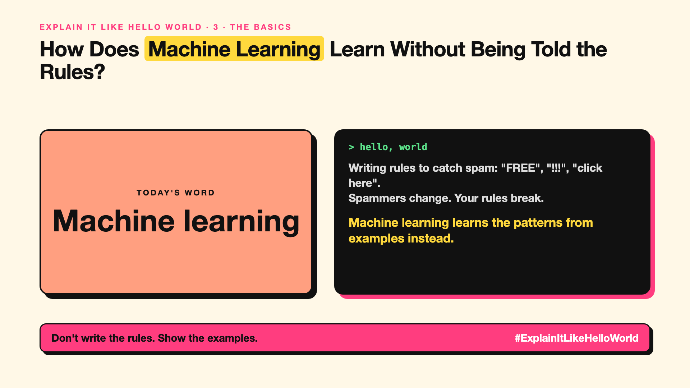

# 3. How Does Machine Learning Learn Without Being Told the Rules? | Machine learning



*Explain It Like Hello World series: Machine learning*

**Published:** 28 October 2026 on [LinkedIn](https://www.linkedin.com/pulse/3-how-does-machine-learning-learn-without-being-told-rules-arpit-jain-ppdyf)

"Machine learning" was the buzzword before "AI" took over. It's still the engine underneath most of it.

## The hello world

Try writing rules for spotting spam: "contains FREE", "has many exclamation marks"... Spammers change, and your rules break.

Instead, show a computer 10,000 emails already marked "spam" or "not spam". It finds the patterns itself. That's the hello world: **machine learning** means learning patterns from examples instead of following hand-written rules.

## One step further

You give the computer examples and the right answers. It adjusts itself until its guesses match the answers. Then it can label new emails it has never seen.

The same idea predicts house prices, recommends films, flags fraud and reads X-rays. The quality depends heavily on the examples: bad or biased examples teach bad or biased patterns.

## Where you've already met it

Gmail's spam folder, Netflix recommendations, fraud alerts from your bank.

## The real name

**Machine learning (ML)**.

- **Training data:** the examples the computer learns from.
- **Label:** the right answer attached to an example.
- **Model:** what the computer ends up with after learning.

## What it's not

Machine learning doesn't understand the way people do. It finds patterns, including accidental ones. If every "spam" example came on Mondays, it might learn "Monday means spam".

## Take this to your next meeting

1. Ask what examples a model learned from; that's where its strengths and blind spots come from.
2. Check performance on new, real cases, not just the training data.
3. Remember: better examples usually beat cleverer methods.

Don't write the rules. Show the examples.

Next write-up (4): **What's "Deep" About Deep Learning?**

Follow me for the next one. Where did machine learning surprise you, for better or worse?

**Earlier in this series:**

1. [AI words everyone uses. Nobody explains.](https://lnkd.in/p/d8abaPhq) (the curtain raiser post)
2. [What Actually Counts as Artificial Intelligence?](https://www.linkedin.com/pulse/2-what-actually-counts-artificial-intelligence-arpit-jain-su9lf)

**Previous series:**

- **Series 1, #JustAddRAG:** [start here](https://www.linkedin.com/pulse/why-does-just-add-rag-sound-like-2-weeks-take-6-months-arpit-jain-l4kkf/) or jump to [the grand finale](https://www.linkedin.com/pulse/15-so-should-you-really-just-add-rag-grand-finale-arpit-jain-ninmf/)
- **Series 2, Beyond Just RAG: From Answers to Actions:** [start here](https://www.linkedin.com/pulse/1-your-ai-can-answer-now-has-act-from-answers-actions-arpit-jain-po6lf/) or jump to [the finale](https://www.linkedin.com/pulse/8-so-should-your-ai-do-things-just-answer-finale-arpit-jain-x7cxf)
- **Series 20, Today in AI** (ongoing): [start here](https://www.linkedin.com/pulse/today-ai-001-what-happens-when-your-agent-visits-someone-arpit-jain-2vqmf/) or read [the latest issue](https://www.linkedin.com/pulse/today-ai-011-text-to-speech-fits-your-phone-internet-needed-jain-1ipuf)

---

**Post text (copy and paste):**

```
Writing rules to catch spam: "FREE", "!!!", "click here".
Spammers change. Your rules break.

Machine learning learns the patterns from examples instead.

Show 10,000 marked emails. It finds the rules itself.

Where did machine learning surprise you, for better or worse?

#AI #GenAI #LearnAI #ExplainItLikeHelloWorld
```

**Series index (post as the first comment):**

```
Explain It Like Hello World

Start here: AI words everyone uses. Nobody explains. https://lnkd.in/p/d8abaPhq
Previous: 2. What Actually Counts as Artificial Intelligence? https://www.linkedin.com/pulse/2-what-actually-counts-artificial-intelligence-arpit-jain-su9lf
You're here: 3. How Does Machine Learning Learn Without Being Told the Rules?
Next: 4. What's "Deep" About Deep Learning?

Full list: in the curtain raiser post.
```
