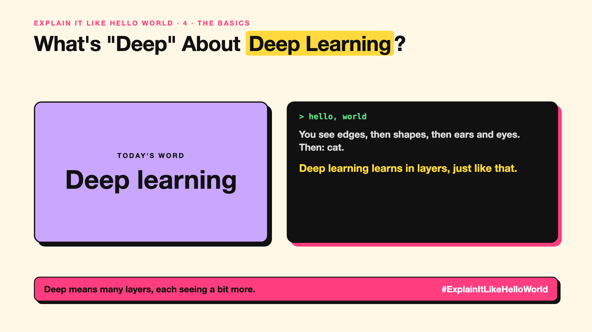

# 4. What's "Deep" About Deep Learning? | Deep learning



*Explain It Like Hello World series: Deep learning*

"Deep learning" sounds philosophical. It's the reason AI suddenly got good at seeing, hearing and writing in the last decade.

## The hello world

How do you recognise a cat? You don't think "pointed ears AND whiskers AND fur". You see edges, then shapes, then ears and eyes, then "cat", in layers, without trying.

That's the hello world: **deep learning** stacks many layers, each spotting slightly bigger patterns than the last. "Deep" just means many layers.

## One step further

Each layer is part of a neural network (write-up 5). Early layers learn simple things like edges or sounds. Later layers combine them into faces, words or meanings.

It needs lots of data and computing power, which is why it took off around 2012, when GPUs (write-up 46) and huge image collections met. Today's LLMs are deep learning at enormous scale.

## Where you've already met it

Photo apps that find "beach" pictures, speech-to-text, real-time translation, every chatbot.

## The real name

**Deep learning**.

- **Layer:** one stage of pattern-spotting in the network.
- **Deep:** many layers stacked together.
- **Feature:** a pattern a layer has learned to detect.

## What it's not

"Deep" doesn't mean deep understanding. It means many layers. And it's not always the right tool; for small tables of numbers, simpler machine learning often wins.

## Take this to your next meeting

1. Use deep learning for images, speech and language; consider simpler methods for small, tidy data.
2. Expect it to need lots of examples.
3. Remember "deep" is about layers, not wisdom.

Deep means many layers, each seeing a bit more.

Next write-up (5): **Is a Neural Network Really Like a Brain?**

Follow me for the next one. Did you think "deep" meant something more mysterious?

**Earlier in this series:**

1. [AI words everyone uses. Nobody explains.](https://lnkd.in/p/d8abaPhq) (the curtain raiser post)
2. [What Actually Counts as Artificial Intelligence?](https://www.linkedin.com/pulse/2-what-actually-counts-artificial-intelligence-arpit-jain-su9lf)
3. How Does Machine Learning Learn Without Being Told the Rules? *(link added when published)*

**Previous series:**

- **Series 1, #JustAddRAG:** [start here](https://www.linkedin.com/pulse/why-does-just-add-rag-sound-like-2-weeks-take-6-months-arpit-jain-l4kkf/) or jump to [the grand finale](https://www.linkedin.com/pulse/15-so-should-you-really-just-add-rag-grand-finale-arpit-jain-ninmf/)
- **Series 2, Beyond Just RAG: From Answers to Actions:** [start here](https://www.linkedin.com/pulse/1-your-ai-can-answer-now-has-act-from-answers-actions-arpit-jain-po6lf/) or jump to [the finale](https://www.linkedin.com/pulse/8-so-should-your-ai-do-things-just-answer-finale-arpit-jain-x7cxf)

---

**Post text (copy and paste):**

```
You see edges, then shapes, then ears and eyes.
Then: cat.

Deep learning learns in layers, just like that.

"Deep" means many layers, not deep thoughts.

Did you think "deep" meant something more mysterious?

#AI #GenAI #LearnAI #ExplainItLikeHelloWorld
```

**Series index (post as the first comment):**

```
Explain It Like Hello World

Start here: AI words everyone uses. Nobody explains. https://lnkd.in/p/d8abaPhq
Previous: 3. How Does Machine Learning Learn Without Being Told the Rules? [link]
You're here: 4. What's "Deep" About Deep Learning?
Next: 5. Is a Neural Network Really Like a Brain?

Full list: in the curtain raiser post.
```
