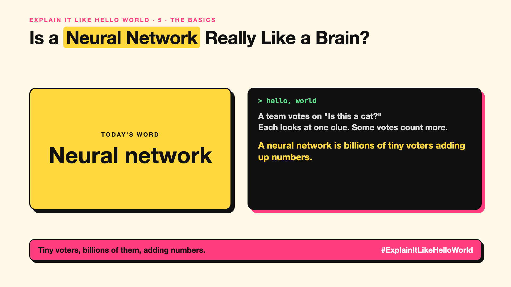

# 5. Is a Neural Network Really Like a Brain? | Neural network



*Explain It Like Hello World series: Neural network*

"Neural network." It sounds like a digital brain. The truth is simpler, and still impressive.

## The hello world

Picture a team voting on "Is this a cat?". Each member looks at one small clue and shouts a number. Some voices count more than others. The total decides.

That's the hello world: a **neural network** is lots of tiny voters, called neurons, passing numbers forward and adding them up, layer after layer.

## One step further

Each tiny neuron takes numbers in, multiplies them by its weights (how much to trust each input), adds them up and passes the result on. Training adjusts those weights (write-up 26) until the final answer comes out right.

One neuron is trivial. Billions of them, in many layers (write-up 4), can recognise faces or write essays.

## Where you've already met it

Behind face unlock, voice typing, photo search and every modern chatbot.

## The real name

A **neural network**, made of **neurons** and **weights**.

- **Neuron:** a tiny unit that adds up weighted inputs.
- **Weight:** how much a neuron trusts each input.
- **Activation:** the number a neuron passes on.

## What it's not

It's loosely inspired by the brain, not a copy of one. Real brain cells are far more complex, and a neural network has no feelings or awareness.

## Take this to your next meeting

1. Picture a huge team of tiny voters, not a brain.
2. Remember the knowledge lives in the weights.
3. Treat "brain-like" marketing with a pinch of salt.

Tiny voters, billions of them, adding numbers.

Next write-up (6): **What Makes AI "Generative"?**

Follow me for the next one. Did you picture a brain when you heard "neural network"?

**Earlier in this series:**

1. AI words everyone uses. Nobody explains. (the curtain raiser post) *(link added when published)*
2. What Actually Counts as AI? *(link added when published)*
3. How Does a Computer Learn Without Being Told the Rules? *(link added when published)*
4. What's "Deep" About Deep Learning? *(link added when published)*

**Previous series:**

- **Series 1, #JustAddRAG:** [start here](https://www.linkedin.com/pulse/why-does-just-add-rag-sound-like-2-weeks-take-6-months-arpit-jain-l4kkf/) or jump to [the grand finale](https://www.linkedin.com/pulse/15-so-should-you-really-just-add-rag-grand-finale-arpit-jain-ninmf/)
- **Series 2, Beyond Just RAG: From Answers to Actions:** [start here](https://www.linkedin.com/pulse/1-your-ai-can-answer-now-has-act-from-answers-actions-arpit-jain-po6lf/) or jump to [the finale](https://www.linkedin.com/pulse/8-so-should-your-ai-do-things-just-answer-finale-arpit-jain-x7cxf)

---

**Post text (copy and paste):**

```
A team votes on "Is this a cat?"
Each looks at one clue. Some votes count more.

A neural network is billions of tiny voters adding up numbers.

Inspired by the brain, not a copy of it.

Did you picture a brain when you heard "neural network"?

#AI #GenAI #LearnAI #ExplainItLikeHelloWorld
```

**Series index (post as the first comment):**

```
Explain It Like Hello World

Start here: 1. AI words everyone uses. Nobody explains. [link]
Previous: 4. What's "Deep" About Deep Learning? [link]
You're here: 5. Is a Neural Network Really Like a Brain?
Next: 6. What Makes AI "Generative"?

Full list: in the curtain raiser post.
```
