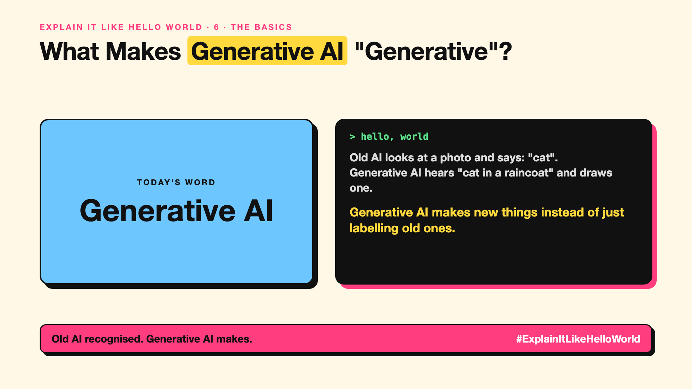

# 6. What Makes Generative AI "Generative"? | Generative AI



*Explain It Like Hello World series: Generative AI*

"GenAI." It's in every job title and strategy deck since 2023. What made it different from the AI before it?

## The hello world

Old AI looks at a photo and says "cat". It **recognises**.

Generative AI takes the words "a cat wearing a raincoat" and **makes** a new picture. That's the hello world: **generative AI** creates new content (text, images, music, code) instead of only sorting or predicting labels.

## One step further

It learns the patterns of huge amounts of existing content, then produces new content that fits those patterns. LLMs (write-up 12) generate text a token at a time; diffusion models (write-up 89) generate images from noise.

The output is new, not copied, but shaped entirely by what it learned from, which is why questions about quality, bias and copyright come with it.

## Where you've already met it

ChatGPT, Claude and Gemini writing text; image generators; AI music tools; coding assistants.

## The real name

**Generative AI (GenAI)**.

- **Generative:** creating new content.
- **Discriminative:** classifying or predicting a label.
- **Prompt:** the instruction that tells it what to create.

## What it's not

Generative isn't "creative" the way people are, and it isn't a search engine. It produces likely-looking content, which can be wrong (write-up 99).

## Take this to your next meeting

1. Use GenAI for first drafts, ideas and variations.
2. Check facts, numbers and names in anything it creates.
3. Know your company's rules on using generated content.

Old AI recognised. Generative AI makes.

Next write-up (7): **Why Are They Called Foundation Models?**

Follow me for the next one. What's the first thing you ever generated with AI?

**Earlier in this series:**

1. [AI words everyone uses. Nobody explains.](https://lnkd.in/p/d8abaPhq) (the curtain raiser post)
2. [What Actually Counts as Artificial Intelligence?](https://www.linkedin.com/pulse/2-what-actually-counts-artificial-intelligence-arpit-jain-su9lf)
3. [How Does Machine Learning Learn Without Being Told the Rules?](https://www.linkedin.com/pulse/3-how-does-machine-learning-learn-without-being-told-rules-arpit-jain-ppdyf)
4. [What's "Deep" About Deep Learning?](https://www.linkedin.com/pulse/4-whats-deep-learning-arpit-jain-rvlff)
5. [Is a Neural Network Really Like a Brain?](https://www.linkedin.com/pulse/5-neural-network-really-like-brain-arpit-jain-jpigf)

**Previous series:**

- **Series 1, #JustAddRAG:** [start here](https://www.linkedin.com/pulse/why-does-just-add-rag-sound-like-2-weeks-take-6-months-arpit-jain-l4kkf/) or jump to [the grand finale](https://www.linkedin.com/pulse/15-so-should-you-really-just-add-rag-grand-finale-arpit-jain-ninmf/)
- **Series 2, Beyond Just RAG: From Answers to Actions:** [start here](https://www.linkedin.com/pulse/1-your-ai-can-answer-now-has-act-from-answers-actions-arpit-jain-po6lf/) or jump to [the finale](https://www.linkedin.com/pulse/8-so-should-your-ai-do-things-just-answer-finale-arpit-jain-x7cxf)
- **Series 20, Today in AI** (ongoing): [start here](https://www.linkedin.com/pulse/today-ai-001-what-happens-when-your-agent-visits-someone-arpit-jain-2vqmf/) or read [the latest issue](https://www.linkedin.com/pulse/today-ai-011-text-to-speech-fits-your-phone-internet-needed-jain-1ipuf)

---

**Post text (copy and paste):**

```
Old AI looks at a photo and says: "cat".
Generative AI hears "cat in a raincoat" and draws one.

Generative AI makes new things instead of just labelling old ones.

Text, images, music, code.

What's the first thing you ever generated with AI?

#AI #GenAI #LearnAI #ExplainItLikeHelloWorld
```

**Series index (post as the first comment):**

```
Explain It Like Hello World

Start here: AI words everyone uses. Nobody explains. https://lnkd.in/p/d8abaPhq
Previous: 5. Is a Neural Network Really Like a Brain? https://www.linkedin.com/pulse/5-neural-network-really-like-brain-arpit-jain-jpigf
You're here: 6. What Makes Generative AI "Generative"?
Next: 7. Why Are They Called Foundation Models?

Full list: in the curtain raiser post.
```
